# E5 experiment dashboard

Last updated 2026-10-17 16:43:25 (server time). Regenerated after every queue event.

| # | run | status | attempts | started | finished |
|---|---|---|---|---|---|
| 1 | [v3_pilot](#v3_pilot): Items 1+2 pilot renders (far-glued C3, floating shadowless C4) for visual approval | done | 1 | 2026-10-15 19:49:59 | 2026-10-15 20:00:30 |
| 2 | [t4_causal_v2](#t4_causal_v2): Item 4: five heads together, amplification, path patching into scene-flow decoder (v2) | done | 1 | 2026-10-15 20:00:44 | 2026-10-15 20:18:45 |
| 3 | [t5_subspace_v2](#t5_subspace_v2): Item 5: LEACE erasure and steering along the motion subspace, layers 17-21 (v2) | done | 1 | 2026-10-15 20:19:23 | 2026-10-15 20:36:24 |
| 4 | [t3_viewsweep_v2](#t3_viewsweep_v2): Item 3: 2, 3, 4, 7 input views, outputs + probes + attention (v2) | done | 1 | 2026-10-15 20:36:30 | 2026-10-15 21:01:31 |
| 5 | [v3_scale](#v3_scale): (split into v3_scale_float and v3_scale_far) | waiting for approval (gate `retired`) | 0 |  |  |
| 6 | [v3_pipeline](#v3_pipeline): (split into v3_pipeline_float and v3_pipeline_far) | queued | 0 |  |  |
| 7 | [v3_viewsweep](#v3_viewsweep): Items 2+3: view-count sweep on the floating set | done | 1 | 2026-10-16 01:22:26 | 2026-10-16 01:40:04 |
| 8 | [v3_pilot_far2](#v3_pilot_far2): Item 1 pilot re-render: far-glued pairs kept far apart in the image | done | 1 | 2026-10-15 21:35:58 | 2026-10-15 21:40:05 |
| 9 | [t8_realdata_kitti](#t8_realdata_kitti): Item 8a: KITTI scene flow 2015 (200 scenes), Any4D slope / EPE / sep_ratio, 2, 4, 7 views, square and wide input | done | 1 | 2026-10-15 21:40:18 | 2026-10-15 22:01:41 |
| 10 | [t8_realdata_sintel](#t8_realdata_sintel): Item 8b: MPI Sintel training (final, clean; every 4th frame), Any4D slope / EPE / sep_ratio, 2 and 4 views, square and wide input | done | 1 | 2026-10-15 22:01:54 | 2026-10-15 22:32:35 |
| 11 | [v3_scale_float](#v3_scale_float): Item 2: render 70 floating shadowless scenes + 20 extra grounded epi (v2) | done | 1 | 2026-10-15 22:32:43 | 2026-10-16 00:03:34 |
| 12 | [v3_pipeline_float](#v3_pipeline_float): Item 2: Steps 3-6 + adjacency control on the floating set and v2 with 30 epi | done | 1 | 2026-10-16 01:05:40 | 2026-10-16 01:22:18 |
| 13 | [v3_scale_far](#v3_scale_far): Item 1: render 20 far-glued scenes (image-gap constraint) | done | 1 | 2026-10-16 00:48:25 | 2026-10-16 01:05:33 |
| 14 | [v3_pipeline_far](#v3_pipeline_far): Item 1: Steps 3-6 + adjacency control on the far-glued set | done | 1 | 2026-10-16 01:40:13 | 2026-10-16 01:43:20 |
| 15 | [t7_any4d_v2](#t7_any4d_v2): Item 7 cross-model: Any4D reference (3D/2D slope, sep_ratio, probes P + attention A at layers 0,4..24) | done | 1 | 2026-10-16 00:11:50 | 2026-10-16 00:17:28 |
| 16 | [t7_mapanything_v2](#t7_mapanything_v2): Item 7 cross-model: MapAnything V1 (static, Any4D's base) outputs, probes, attention | done | 1 | 2026-10-16 01:43:28 | 2026-10-16 01:46:05 |
| 17 | [t7_vggt_v2](#t7_vggt_v2): Item 7 cross-model: VGGT-1B (static) outputs + tracks (fixed tracker head), probes, attention | done | 1 | 2026-10-16 01:46:13 | 2026-10-16 01:49:51 |
| 18 | [t7_page4d_v2](#t7_page4d_v2): Item 7 cross-model: PAGE-4D (dynamic VGGT fine-tune) outputs, probes, attention | done | 1 | 2026-10-16 01:49:59 | 2026-10-16 01:53:36 |
| 19 | [t7_xm_summary](#t7_xm_summary): Item 7: cross-model comparison table (Any4D, MapAnything, VGGT, PAGE-4D) | done | 1 | 2026-10-16 01:55:59 | 2026-10-16 01:56:07 |
| 20 | [t7_any4d_v2_100](#t7_any4d_v2_100): Item 7: Any4D reference rerun on the fixed 100 v2 scenes (writes into t7_any4d_v2 results) | done | 1 | 2026-10-16 01:53:44 | 2026-10-16 01:55:51 |
| 21 | [w2_kubric_baselines](#w2_kubric_baselines): Round 2 item 1 (W2): CoTracker3 + RAFT on Kubric v2 (100) and floating (70), same query sets as Any4D/VGGT; Any4D + VGGT on floating | done | 1 | 2026-10-16 15:11:22 | 2026-10-16 15:46:33 |
| 22 | [w2_real_baselines](#w2_real_baselines): Round 2 item 1 (W2): RAFT on KITTI 2015 and Sintel (2 views), metrics + alpha/beta vs Any4D cached | done | 1 | 2026-10-16 15:46:42 | 2026-10-16 15:54:49 |
| 23 | [w2_decomp](#w2_decomp): Round 2 item 1 (W2): alpha/beta decomposition and slope vs boundary distance, all models | done | 1 | 2026-10-16 15:54:57 | 2026-10-16 15:55:05 |
| 24 | [w2_dose](#w2_dose): Round 2 item 1 (W2): dose-response of the slope (speed, area, texture, occlusion, camera rotation, motions, confidence) | done | 1 | 2026-10-16 15:55:12 | 2026-10-16 15:55:49 |
| 25 | [w2_summary](#w2_summary): Round 2 item 1 (W2): summary table, figure and verdict (pull: 4D-model property or generic shrinkage?) | done | 1 | 2026-10-16 15:55:58 | 2026-10-16 15:56:05 |
| 26 | [ft_render_v2](#ft_render_v2): Item 10: render 200 v2-grounded training scenes (seeds 2001-2200, approved settings) | done | 1 | 2026-10-16 15:56:13 | 2026-10-16 19:20:03 |
| 27 | [ft_render_float](#ft_render_float): Item 10: render 200 floating training scenes (seeds 2201-2400, approved v3float settings) | done | 1 | 2026-10-16 19:20:12 | 2026-10-16 22:48:04 |
| 28 | [ft_eval_base](#ft_eval_base): Item 10: evaluate base Any4D with the fine-tune evaluation (Kubric v2/v3float/v3far, internals, KITTI, Sintel) | done | 1 | 2026-10-17 11:30:48 | 2026-10-17 11:41:57 |
| 29 | [ft_pilot](#ft_pilot): Item 10: pilot fine-tune (heads_sf, 1000 steps) to choose the number of steps | done | 3 | 2026-10-17 01:01:23 | 2026-10-17 02:31:45 |
| 30 | [ft_train_heads](#ft_train_heads): Item 10: fine-tune (a) LoRA r8 on the five supply heads' slices | done | 1 | 2026-10-17 11:42:06 | 2026-10-17 12:09:15 |
| 31 | [ft_eval_heads](#ft_eval_heads): Item 10: evaluate fine-tune (a) LoRA r8 on the five supply heads' slices | done | 1 | 2026-10-17 12:09:24 | 2026-10-17 12:24:03 |
| 32 | [ft_train_ctrl](#ft_train_ctrl): Item 10: fine-tune (d) control: LoRA r8 on 5 matched random heads | done | 1 | 2026-10-17 12:24:13 | 2026-10-17 12:51:22 |
| 33 | [ft_eval_ctrl](#ft_eval_ctrl): Item 10: evaluate fine-tune (d) control: LoRA r8 on 5 matched random heads | done | 1 | 2026-10-17 12:51:31 | 2026-10-17 13:06:10 |
| 34 | [ft_train_sf](#ft_train_sf): Item 10: fine-tune (b) scene-flow DPT head + adaptor | done | 1 | 2026-10-17 13:06:18 | 2026-10-17 13:46:58 |
| 35 | [ft_eval_sf](#ft_eval_sf): Item 10: evaluate fine-tune (b) scene-flow DPT head + adaptor | done | 1 | 2026-10-17 13:47:07 | 2026-10-17 14:01:16 |
| 36 | [ft_train_heads_sf](#ft_train_heads_sf): Item 10: fine-tune (c) five-head LoRA + scene-flow head | done | 1 | 2026-10-17 14:01:26 | 2026-10-17 15:24:46 |
| 37 | [ft_eval_heads_sf](#ft_eval_heads_sf): Item 10: evaluate fine-tune (c) five-head LoRA + scene-flow head | done | 1 | 2026-10-17 15:24:57 | 2026-10-17 15:39:05 |
| 38 | [ft_train_gain](#ft_train_gain): Item 10: fine-tune (e) 5 learned per-head gains | done | 1 | 2026-10-17 15:39:16 | 2026-10-17 16:06:25 |
| 39 | [ft_eval_gain](#ft_eval_gain): Item 10: evaluate fine-tune (e) 5 learned per-head gains | done | 1 | 2026-10-17 16:06:35 | 2026-10-17 16:21:13 |
| 40 | [ft_summary](#ft_summary): Item 10: comparison table and figure (base vs variants; a vs d head specificity; transfer; decodability gap) | done | 1 | 2026-10-17 16:21:23 | 2026-10-17 16:21:33 |
| 41 | [v4_pilot](#v4_pilot): Review item W3 pilot: 2 scenes each of epi_accel, epi_const (paired), epi_sizerand, epi_sizematch, with GT checks | done | 1 | 2026-10-16 22:48:29 | 2026-10-16 22:53:06 |
| 42 | [v4_scale_epi](#v4_scale_epi): Review item W3: render 30 scenes per new epipolar split (120 scenes) + GT checks | done | 1 | 2026-10-16 22:53:45 | 2026-10-17 01:01:15 |
| 43 | [v4_viewsweep_epi](#v4_viewsweep_epi): Review item W3: 2/3/4/7-view sweep on v4 epipolar set + v3float: outputs, probes (pooled and transfer), attention, stats | done | 1 | 2026-10-17 16:21:43 | 2026-10-17 16:37:22 |
| 44 | [r2_probe_extract](#r2_probe_extract): Round 2 W4: control-model internals (random-init Any4D, DINOv2 + random transformer, raw encoder tokens) on v2 out100 and v3float | done | 1 | 2026-10-17 16:37:33 | 2026-10-17 16:43:12 |
| 45 | [r2_heads_null](#r2_heads_null): Round 2 W5: five supply heads vs 40 matched random head sets (mean ablation), resample ablation, amplification x1.5 (v2 out100) | RUNNING | 1 | 2026-10-17 16:43:22 |  |
| 46 | [r2_probe_linear](#r2_probe_linear): Round 2 W4: seeded linear probes (5 seeds) with random-init, DINOv2-only and label-shuffle controls (v2 out100, v3float) | queued | 0 |  |  |
| 47 | [r2_probe_mlp](#r2_probe_mlp): Round 2 W4: MLP probes vs linear, 5 seeds, label-shuffle selectivity, combined figure (v2 out100, v3float) | queued | 0 |  |  |
| 48 | [ft_train_heads_sel](#ft_train_heads_sel): Item 10 rerun: train heads with corrected checkpoint selection | queued | 0 |  |  |
| 49 | [ft_eval_heads_sel](#ft_eval_heads_sel): Item 10 rerun: evaluate heads_sel | queued | 0 |  |  |
| 50 | [ft_train_ctrl_sel](#ft_train_ctrl_sel): Item 10 rerun: train ctrl with corrected checkpoint selection | queued | 0 |  |  |
| 51 | [ft_eval_ctrl_sel](#ft_eval_ctrl_sel): Item 10 rerun: evaluate ctrl_sel | queued | 0 |  |  |
| 52 | [ft_train_gain_sel](#ft_train_gain_sel): Item 10 rerun: train gain with corrected checkpoint selection | queued | 0 |  |  |
| 53 | [ft_eval_gain_sel](#ft_eval_gain_sel): Item 10 rerun: evaluate gain_sel | queued | 0 |  |  |
| 54 | [ft_summary_sel](#ft_summary_sel): Item 10: comparison table with corrected head variants | queued | 0 |  |  |

Supervisor heartbeat: 2026-10-17 16:42:42 running r2_probe_extract

## v3_pilot

Items 1+2 pilot renders (far-glued C3, floating shadowless C4) for visual approval

Status: **done**, attempt 1, started 2026-10-15 19:49:59, finished 2026-10-15 20:00:30. [Raw results](../results/queue/v3_pilot/), [log](../results/queue/v3_pilot/task.log).

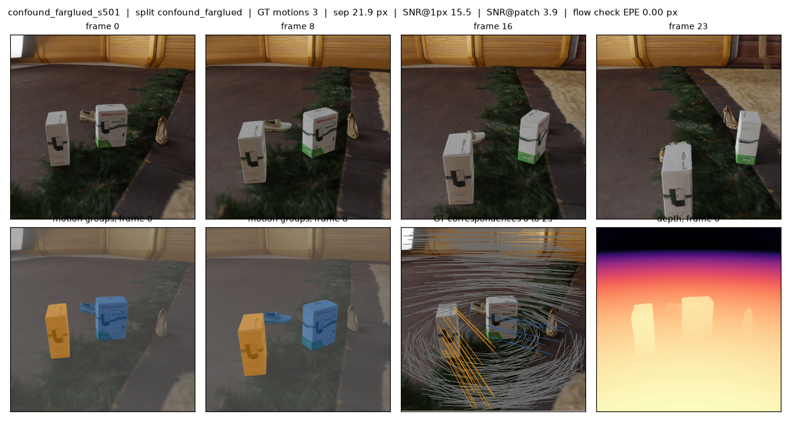
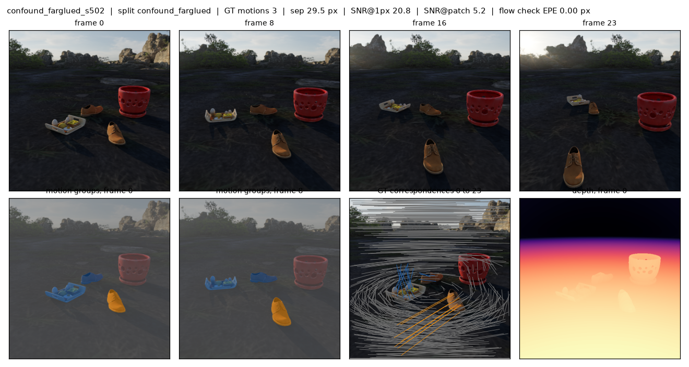
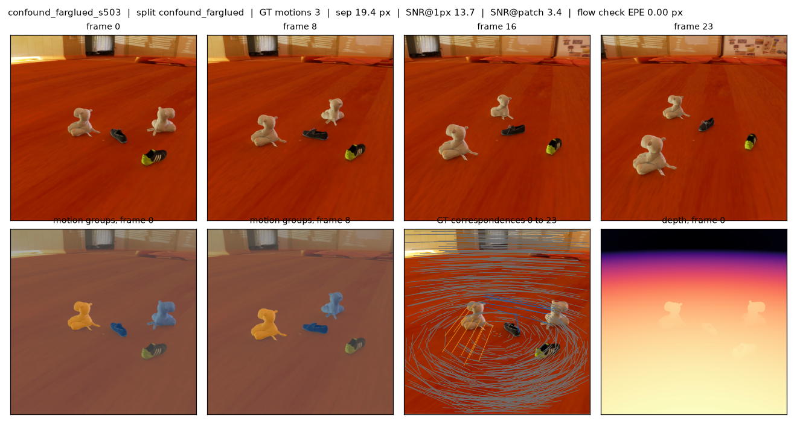
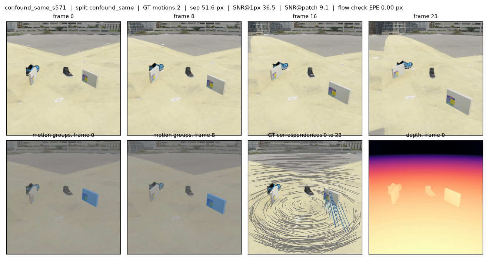
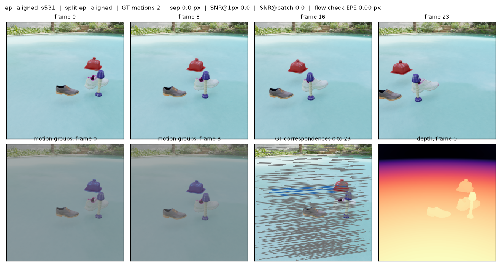
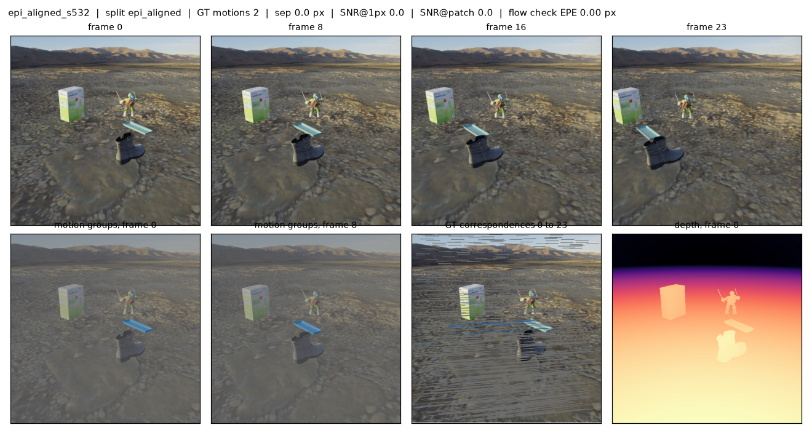
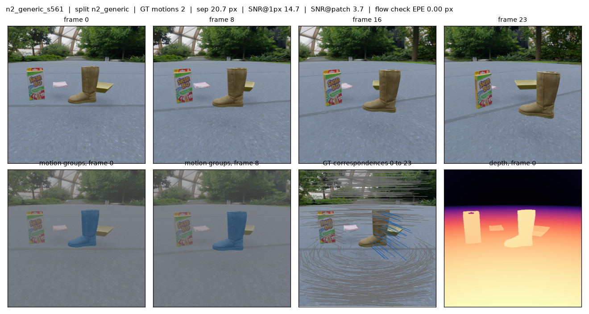
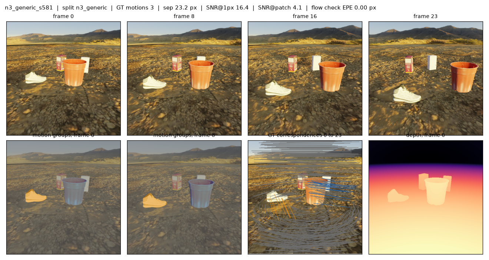

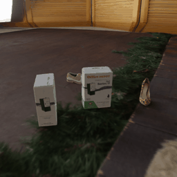 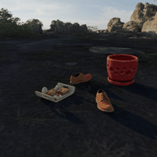 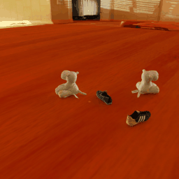 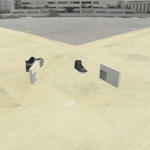 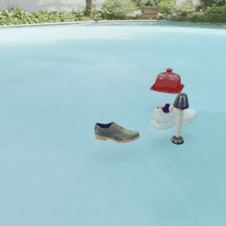 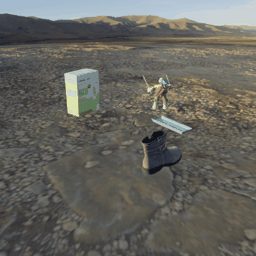 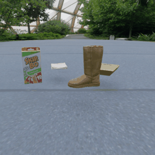 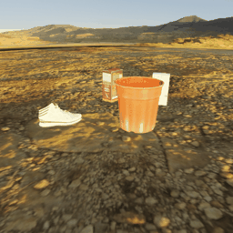

## t4_causal_v2

Item 4: five heads together, amplification, path patching into scene-flow decoder (v2)

Status: **done**, attempt 1, started 2026-10-15 20:00:44, finished 2026-10-15 20:18:45. [Raw results](../results/queue/t4_causal_v2/), [log](../results/queue/t4_causal_v2/task.log).

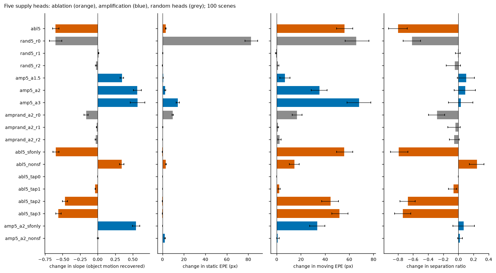
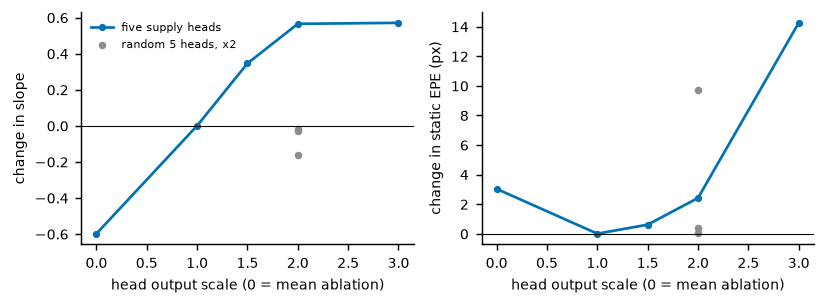

| condition | n | change in slope [95% CI] | change in epe_static [95% CI] | change in epe_moving [95% CI] | change in sep_ratio [95% CI] |
|---|---|---|---|---|---|
| abl5 | 98 | -0.599 [-0.641, -0.552] | +3.028 [+2.652, +3.418] | +56.046 [+49.429, +62.922] | -0.796 [-0.925, -0.677] |
| rand5_r0 | 98 | -0.603 [-0.688, -0.512] | +82.527 [+77.073, +88.878] | +65.643 [+56.554, +76.205] | -0.614 [-0.729, -0.502] |
| rand5_r1 | 98 | +0.013 [+0.008, +0.017] | +0.190 [+0.020, +0.356] | -0.646 [-1.056, -0.281] | -0.007 [-0.039, +0.022] |
| rand5_r2 | 98 | -0.021 [-0.032, -0.012] | +0.026 [-0.027, +0.080] | +1.060 [+0.273, +1.853] | -0.048 [-0.160, +0.026] |
| amp5_a1.5 | 98 | +0.346 [+0.318, +0.372] | +0.609 [+0.397, +0.836] | +6.702 [+2.648, +10.877] | +0.102 [-0.012, +0.212] |
| amp5_a2 | 98 | +0.565 [+0.509, +0.623] | +2.413 [+1.900, +2.987] | +35.210 [+28.445, +41.645] | +0.090 [-0.055, +0.227] |
| amp5_a3 | 98 | +0.570 [+0.463, +0.670] | +14.253 [+12.911, +15.775] | +68.018 [+58.151, +77.788] | +0.034 [-0.130, +0.193] |
| amprand_a2_r0 | 98 | -0.165 [-0.194, -0.134] | +9.694 [+9.131, +10.274] | +16.741 [+12.908, +21.048] | -0.281 [-0.397, -0.184] |
| amprand_a2_r1 | 98 | -0.016 [-0.020, -0.012] | +0.351 [+0.231, +0.482] | +0.981 [+0.571, +1.431] | -0.039 [-0.139, +0.025] |
| amprand_a2_r2 | 98 | -0.029 [-0.037, -0.022] | +0.037 [-0.005, +0.085] | +2.196 [+1.086, +3.594] | -0.055 [-0.120, +0.010] |
| abl5_sfonly | 98 | -0.597 [-0.637, -0.552] | -0.033 [-0.044, -0.022] | +55.862 [+49.374, +62.780] | -0.789 [-0.900, -0.669] |
| abl5_nonsf | 98 | +0.342 [+0.310, +0.374] | +3.142 [+2.732, +3.543] | +14.683 [+10.405, +18.671] | +0.245 [+0.145, +0.337] |
| abl5_tap0 | 98 | +0.000 [+0.000, +0.000] | +0.000 [+0.000, +0.000] | +0.000 [+0.000, +0.000] | +0.000 [+0.000, +0.000] |
| abl5_tap1 | 98 | -0.034 [-0.038, -0.031] | +0.010 [+0.005, +0.016] | +2.047 [+1.357, +2.957] | -0.066 [-0.133, -0.023] |
| abl5_tap2 | 98 | -0.464 [-0.502, -0.428] | -0.029 [-0.040, -0.018] | +44.376 [+37.258, +50.982] | -0.670 [-0.773, -0.571] |
| abl5_tap3 | 98 | -0.558 [-0.596, -0.520] | -0.024 [-0.036, -0.012] | +51.867 [+45.666, +58.910] | -0.736 [-0.844, -0.629] |
| amp5_a2_sfonly | 98 | +0.546 [+0.496, +0.601] | +0.187 [+0.138, +0.241] | +33.533 [+27.208, +39.827] | +0.068 [-0.072, +0.212] |
| amp5_a2_nonsf | 98 | +0.005 [-0.005, +0.015] | +2.341 [+1.829, +2.883] | +0.858 [-0.065, +2.004] | +0.021 [-0.012, +0.052] |

**causal_v2_summary.md**

| condition | n | d slope [95% CI] (p) | d epe_static [95% CI] (p) | d epe_moving [95% CI] (p) | d sep_ratio [95% CI] (p) |
|---|---|---|---|---|---|
| base | 100 | 0.607 | 4.100 | 34.957 | 0.825 |
| abl5 | 100 | -0.599 [-0.641, -0.552] (p=9.9e-25) | +3.028 [+2.644, +3.418] (p=6.4e-24) | +56.046 [+49.487, +63.222] (p=2.4e-23) | -0.796 [-0.917, -0.685] (p=3.2e-27) |
| rand5_r0 | 100 | -0.603 [-0.691, -0.509] (p=4.5e-22) | +82.527 [+76.484, +88.337] (p=1.6e-30) | +65.643 [+56.134, +75.703] (p=9.9e-25) | -0.614 [-0.748, -0.494] (p=2e-18) |
| rand5_r1 | 100 | +0.013 [+0.008, +0.017] (p=0.0032) | +0.190 [+0.018, +0.356] (p=0.035) | -0.646 [-1.033, -0.242] (p=0.02) | -0.007 [-0.039, +0.022] (p=0.83) |
| rand5_r2 | 100 | -0.021 [-0.030, -0.012] (p=0.0016) | +0.026 [-0.025, +0.078] (p=0.13) | +1.060 [+0.307, +1.815] (p=0.02) | -0.048 [-0.143, +0.026] (p=1) |
| amp5_a1.5 | 100 | +0.346 [+0.320, +0.371] (p=9.9e-25) | +0.609 [+0.409, +0.842] (p=0.00041) | +6.702 [+2.721, +10.861] (p=0.00077) | +0.102 [-0.011, +0.215] (p=0.033) |
| amp5_a2 | 100 | +0.565 [+0.510, +0.621] (p=2.4e-23) | +2.413 [+1.884, +3.011] (p=1.3e-11) | +35.210 [+28.731, +41.926] (p=5.9e-15) | +0.090 [-0.058, +0.227] (p=0.53) |
| amp5_a3 | 100 | +0.570 [+0.463, +0.683] (p=1.1e-17) | +14.253 [+12.887, +15.741] (p=1.6e-30) | +68.018 [+57.848, +77.329] (p=7.1e-21) | +0.034 [-0.126, +0.188] (p=0.83) |
| amprand_a2_r0 | 100 | -0.165 [-0.194, -0.136] (p=2.5e-13) | +9.694 [+9.141, +10.280] (p=1.6e-30) | +16.741 [+13.008, +20.851] (p=2.5e-13) | -0.281 [-0.399, -0.183] (p=3.2e-09) |
| amprand_a2_r1 | 100 | -0.016 [-0.020, -0.012] (p=3.6e-11) | +0.351 [+0.227, +0.482] (p=1.3e-05) | +0.981 [+0.574, +1.407] (p=2.6e-05) | -0.039 [-0.140, +0.027] (p=0.14) |
| amprand_a2_r2 | 100 | -0.029 [-0.037, -0.021] (p=3.6e-11) | +0.037 [-0.011, +0.086] (p=0.0066) | +2.196 [+1.129, +3.689] (p=6.6e-05) | -0.055 [-0.119, +0.008] (p=0.019) |
| abl5_sfonly | 100 | -0.597 [-0.639, -0.552] (p=6.3e-30) | -0.033 [-0.045, -0.021] (p=1.3e-11) | +55.862 [+49.332, +63.123] (p=6.2e-28) | -0.789 [-0.908, -0.681] (p=3.2e-27) |
| abl5_nonsf | 100 | +0.342 [+0.307, +0.375] (p=6.3e-30) | +3.142 [+2.751, +3.549] (p=6.4e-24) | +14.683 [+10.535, +18.844] (p=3.7e-06) | +0.245 [+0.149, +0.336] (p=1.3e-08) |
| amp5_a2_sfonly | 100 | +0.546 [+0.492, +0.597] (p=3.1e-26) | +0.187 [+0.136, +0.241] (p=2e-21) | +33.533 [+27.535, +40.204] (p=4e-14) | +0.068 [-0.071, +0.212] (p=0.83) |
| amp5_a2_nonsf | 100 | +0.005 [-0.005, +0.015] (p=0.085) | +2.341 [+1.807, +2.946] (p=1.1e-09) | +0.858 [-0.108, +2.018] (p=0.054) | +0.021 [-0.011, +0.054] (p=0.056) |
| abl5_tap0 | 100 | +0.000 [+0.000, +0.000] (p=nan) | +0.000 [+0.000, +0.000] (p=nan) | +0.000 [+0.000, +0.000] (p=nan) | +0.000 [+0.000, +0.000] (p=nan) |
| abl5_tap1 | 100 | -0.034 [-0.039, -0.031] (p=9.9e-25) | +0.010 [+0.005, +0.016] (p=1.6e-08) | +2.047 [+1.326, +2.879] (p=4.2e-07) | -0.066 [-0.133, -0.021] (p=6e-07) |
| abl5_tap2 | 100 | -0.464 [-0.502, -0.427] (p=6.2e-28) | -0.029 [-0.041, -0.018] (p=1.1e-09) | +44.376 [+38.115, +51.386] (p=6.2e-28) | -0.670 [-0.778, -0.565] (p=3.8e-22) |
| abl5_tap3 | 100 | -0.558 [-0.597, -0.519] (p=6.3e-30) | -0.024 [-0.037, -0.012] (p=1.6e-08) | +51.867 [+45.332, +58.405] (p=6.2e-28) | -0.736 [-0.847, -0.628] (p=2.9e-25) |

## t5_subspace_v2

Item 5: LEACE erasure and steering along the motion subspace, layers 17-21 (v2)

Status: **done**, attempt 1, started 2026-10-15 20:19:23, finished 2026-10-15 20:36:24. [Raw results](../results/queue/t5_subspace_v2/), [log](../results/queue/t5_subspace_v2/task.log).

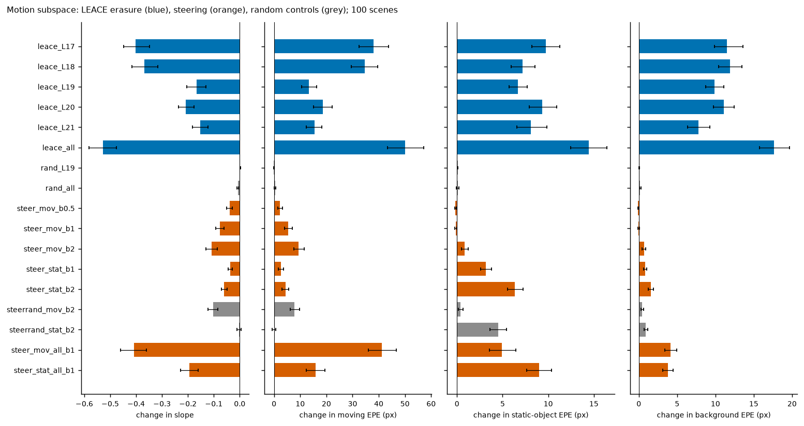

| condition | n | change in slope [95% CI] | change in epe_moving [95% CI] | change in epe_static_obj [95% CI] | change in epe_bg [95% CI] |
|---|---|---|---|---|---|
| leace_L17 | 98 | -0.402 [-0.447, -0.348] | +38.038 [+32.434, +43.697] | +9.730 [+8.226, +11.254] | +11.513 [+9.845, +13.571] |
| leace_L18 | 98 | -0.368 [-0.417, -0.317] | +34.570 [+29.524, +39.565] | +7.174 [+5.963, +8.542] | +11.906 [+10.423, +13.435] |
| leace_L19 | 98 | -0.166 [-0.204, -0.130] | +13.393 [+10.523, +16.318] | +6.676 [+5.698, +7.692] | +9.856 [+8.726, +11.113] |
| leace_L20 | 98 | -0.208 [-0.237, -0.177] | +18.545 [+15.091, +22.181] | +9.312 [+7.896, +10.942] | +11.067 [+9.719, +12.466] |
| leace_L21 | 98 | -0.152 [-0.182, -0.123] | +15.413 [+12.389, +18.300] | +8.094 [+6.548, +9.835] | +7.760 [+6.356, +9.285] |
| leace_all | 98 | -0.528 [-0.582, -0.476] | +49.998 [+43.372, +57.259] | +14.456 [+12.472, +16.420] | +17.634 [+15.746, +19.696] |
| rand_L19 | 98 | +0.002 [+0.002, +0.003] | -0.054 [-0.106, +0.005] | +0.079 [+0.043, +0.117] | +0.069 [+0.030, +0.107] |
| rand_all | 98 | -0.007 [-0.010, -0.005] | +0.373 [+0.160, +0.591] | +0.091 [-0.054, +0.221] | +0.169 [+0.067, +0.271] |
| steer_mov_b0.5 | 98 | -0.039 [-0.050, -0.029] | +2.284 [+1.457, +3.179] | -0.164 [-0.239, -0.090] | -0.102 [-0.149, -0.052] |
| steer_mov_b1 | 98 | -0.077 [-0.093, -0.061] | +5.371 [+3.989, +6.980] | -0.110 [-0.232, +0.006] | -0.041 [-0.133, +0.051] |
| steer_mov_b2 | 98 | -0.108 [-0.131, -0.086] | +9.446 [+7.487, +11.583] | +0.808 [+0.487, +1.253] | +0.677 [+0.450, +0.919] |
| steer_stat_b1 | 98 | -0.036 [-0.044, -0.028] | +2.573 [+1.680, +3.609] | +3.151 [+2.611, +3.756] | +0.801 [+0.606, +1.012] |
| steer_stat_b2 | 98 | -0.060 [-0.071, -0.048] | +4.325 [+3.000, +5.561] | +6.357 [+5.555, +7.219] | +1.557 [+1.233, +1.908] |
| steerrand_mov_b2 | 98 | -0.103 [-0.122, -0.084] | +7.788 [+6.122, +9.671] | +0.387 [+0.153, +0.638] | +0.432 [+0.285, +0.604] |
| steerrand_stat_b2 | 98 | -0.002 [-0.010, +0.005] | -0.031 [-0.809, +0.711] | +4.499 [+3.590, +5.410] | +0.914 [+0.683, +1.176] |
| steer_mov_all_b1 | 98 | -0.409 [-0.460, -0.360] | +41.084 [+36.002, +46.727] | +4.910 [+3.568, +6.472] | +4.125 [+3.376, +4.954] |
| steer_stat_all_b1 | 98 | -0.195 [-0.228, -0.160] | +15.861 [+12.403, +19.399] | +8.973 [+7.629, +10.363] | +3.818 [+3.154, +4.460] |

Eraser fits (training fold; linear R^2 of 'moving' before and after erasure):

| fit | before | after |
|---|---|---|
| fold0_L17 | 0.595 | 0.095 |
| fold0_L18 | 0.592 | 0.159 |
| fold0_L19 | 0.652 | 0.069 |
| fold0_L20 | 0.696 | 0.258 |
| fold0_L21 | 0.750 | 0.100 |
| fold1_L17 | 0.573 | 0.130 |
| fold1_L18 | 0.570 | 0.172 |
| fold1_L19 | 0.627 | 0.124 |
| fold1_L20 | 0.677 | 0.040 |
| fold1_L21 | 0.719 | 0.019 |

**subspace_v2_summary.md**

| condition | n | d slope [95% CI] (p) | d epe_moving [95% CI] (p) | d epe_static_obj [95% CI] (p) | d epe_bg [95% CI] (p) | d spurious_static_obj [95% CI] (p) |
|---|---|---|---|---|---|---|
| base | 100 | 0.607 | 34.957 | 4.138 | 4.125 | 4.138 |
| leace_L17 | 100 | -0.402 [-0.449, -0.351] (p=1.1e-18) | +38.038 [+32.118, +43.972] (p=9.4e-20) | +9.730 [+8.166, +11.271] (p=2.7e-20) | +11.513 [+9.673, +13.375] (p=1.6e-28) | +9.730 [+8.148, +11.251] (p=2.7e-20) |
| leace_L18 | 100 | -0.368 [-0.421, -0.313] (p=4e-14) | +34.570 [+29.498, +39.969] (p=4.5e-22) | +7.174 [+5.960, +8.460] (p=3.3e-18) | +11.906 [+10.402, +13.403] (p=1.6e-30) | +7.174 [+5.997, +8.453] (p=3.3e-18) |
| leace_L19 | 100 | -0.166 [-0.201, -0.130] (p=3.9e-08) | +13.393 [+10.685, +16.170] (p=7.4e-12) | +6.676 [+5.756, +7.681] (p=6.4e-24) | +9.856 [+8.698, +11.076] (p=1.6e-28) | +6.676 [+5.648, +7.671] (p=6.4e-24) |
| leace_L20 | 100 | -0.208 [-0.239, -0.179] (p=9.9e-17) | +18.545 [+15.150, +22.090] (p=9.9e-17) | +9.312 [+7.857, +10.820] (p=2.6e-25) | +11.067 [+9.713, +12.587] (p=1.6e-28) | +9.312 [+7.885, +10.824] (p=2.6e-25) |
| leace_L21 | 100 | -0.152 [-0.183, -0.123] (p=4e-14) | +15.413 [+12.457, +18.483] (p=1.1e-18) | +8.094 [+6.491, +9.684] (p=3.3e-18) | +7.760 [+6.313, +9.208] (p=2.6e-25) | +8.094 [+6.508, +9.836] (p=3.3e-18) |
| leace_all | 100 | -0.528 [-0.580, -0.473] (p=7.1e-21) | +49.998 [+43.168, +56.996] (p=4.5e-22) | +14.456 [+12.475, +16.624] (p=8e-27) | +17.634 [+15.719, +19.562] (p=1.6e-28) | +14.456 [+12.530, +16.387] (p=8e-27) |
| rand_L19 | 100 | +0.002 [+0.001, +0.003] (p=1.3e-06) | -0.054 [-0.111, +0.007] (p=0.61) | +0.079 [+0.043, +0.118] (p=0.0018) | +0.069 [+0.033, +0.106] (p=0.012) | +0.079 [+0.040, +0.116] (p=0.0018) |
| rand_all | 100 | -0.007 [-0.010, -0.005] (p=1e-05) | +0.373 [+0.155, +0.598] (p=0.011) | +0.091 [-0.037, +0.227] (p=0.089) | +0.169 [+0.073, +0.264] (p=0.035) | +0.091 [-0.039, +0.223] (p=0.089) |
| steer_mov_b0.5 | 100 | -0.039 [-0.050, -0.030] (p=2.9e-09) | +2.284 [+1.430, +3.120] (p=0.00016) | -0.164 [-0.244, -0.088] (p=0.0016) | -0.102 [-0.151, -0.049] (p=1e-05) | -0.164 [-0.242, -0.092] (p=0.0016) |
| steer_mov_b1 | 100 | -0.077 [-0.093, -0.062] (p=9.9e-17) | +5.371 [+3.927, +6.817] (p=2.9e-09) | -0.110 [-0.228, +0.015] (p=0.02) | -0.041 [-0.128, +0.050] (p=0.19) | -0.110 [-0.230, +0.010] (p=0.02) |
| steer_mov_b2 | 100 | -0.108 [-0.130, -0.084] (p=2.5e-13) | +9.446 [+7.365, +11.576] (p=4e-14) | +0.808 [+0.448, +1.191] (p=0.00077) | +0.677 [+0.458, +0.917] (p=6.6e-05) | +0.808 [+0.470, +1.229] (p=0.00077) |
| steer_stat_b1 | 100 | -0.036 [-0.045, -0.028] (p=8.1e-16) | +2.573 [+1.699, +3.578] (p=3.7e-06) | +3.151 [+2.584, +3.678] (p=3.1e-17) | +0.801 [+0.593, +1.002] (p=1.6e-08) | +3.151 [+2.582, +3.744] (p=3.1e-17) |
| steer_stat_b2 | 100 | -0.060 [-0.072, -0.048] (p=5.9e-15) | +4.325 [+3.025, +5.785] (p=1e-05) | +6.357 [+5.484, +7.242] (p=2.6e-25) | +1.557 [+1.208, +1.897] (p=1.3e-14) | +6.357 [+5.480, +7.306] (p=2.6e-25) |
| steerrand_mov_b2 | 100 | -0.103 [-0.122, -0.084] (p=1.1e-17) | +7.788 [+5.914, +9.682] (p=7.1e-10) | +0.387 [+0.174, +0.642] (p=0.0061) | +0.432 [+0.284, +0.610] (p=4.2e-07) | +0.387 [+0.174, +0.633] (p=0.0061) |
| steerrand_stat_b2 | 100 | -0.002 [-0.010, +0.005] (p=0.19) | -0.031 [-0.813, +0.732] (p=0.48) | +4.499 [+3.545, +5.490] (p=2e-21) | +0.914 [+0.693, +1.174] (p=2.6e-12) | +4.499 [+3.582, +5.459] (p=2e-21) |
| steer_mov_all_b1 | 100 | -0.409 [-0.457, -0.356] (p=9.9e-25) | +41.084 [+35.862, +46.562] (p=3.1e-26) | +4.910 [+3.573, +6.490] (p=4e-14) | +4.125 [+3.349, +4.965] (p=6.3e-30) | +4.910 [+3.608, +6.423] (p=4e-14) |
| steer_stat_all_b1 | 100 | -0.195 [-0.227, -0.165] (p=1.1e-17) | +15.861 [+12.186, +19.571] (p=1.7e-10) | +8.973 [+7.630, +10.420] (p=6.4e-24) | +3.818 [+3.225, +4.499] (p=2e-21) | +8.973 [+7.706, +10.336] (p=6.4e-24) |

## t3_viewsweep_v2

Item 3: 2, 3, 4, 7 input views, outputs + probes + attention (v2)

Status: **done**, attempt 1, started 2026-10-15 20:36:30, finished 2026-10-15 21:01:31. [Raw results](../results/queue/t3_viewsweep_v2/), [log](../results/queue/t3_viewsweep_v2/task.log).

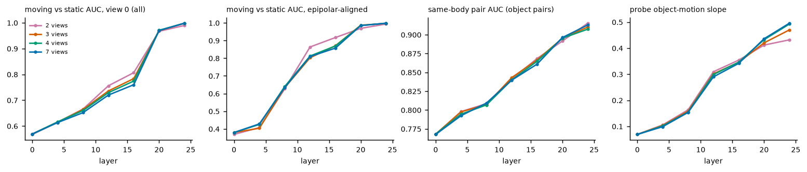

| views | moving vs static AUC, view 0 (all) (first / last layer) | moving vs static AUC, epipolar-aligned (first / last layer) | same-body pair AUC (object pairs) (first / last layer) | probe object-motion slope (first / last layer) |
|---|---|---|---|---|
| 2 | 0.567 / 0.989 | 0.369 / 0.993 | 0.768 / 0.915 | 0.069 / 0.432 |
| 3 | 0.569 / 0.998 | 0.379 / 0.997 | 0.768 / 0.910 | 0.069 / 0.470 |
| 4 | 0.569 / 0.998 | 0.379 / 0.998 | 0.768 / 0.907 | 0.069 / 0.492 |
| 7 | 0.569 / 0.998 | 0.379 / 0.998 | 0.768 / 0.913 | 0.069 / 0.496 |

| views | output separation ratio, frame 0 to 23 (median over scenes) | n scenes |
|---|---|---|
| 2 | 0.741 | 89 |
| 3 | 0.721 | 89 |
| 4 | 0.788 | 89 |
| 7 | 0.726 | 89 |

## v3_viewsweep

Items 2+3: view-count sweep on the floating set

Status: **done**, attempt 1, started 2026-10-16 01:22:26, finished 2026-10-16 01:40:04. [Raw results](../results/queue/v3_viewsweep/), [log](../results/queue/v3_viewsweep/task.log).

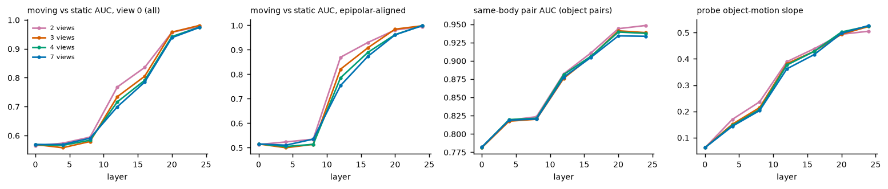

| views | moving vs static AUC, view 0 (all) (first / last layer) | moving vs static AUC, epipolar-aligned (first / last layer) | same-body pair AUC (object pairs) (first / last layer) | probe object-motion slope (first / last layer) |
|---|---|---|---|---|
| 2 | 0.565 / 0.977 | 0.513 / 0.995 | 0.781 / 0.948 | 0.061 / 0.505 |
| 3 | 0.569 / 0.980 | 0.515 / 0.998 | 0.781 / 0.939 | 0.062 / 0.524 |
| 4 | 0.569 / 0.974 | 0.515 / 0.999 | 0.782 / 0.938 | 0.062 / 0.525 |
| 7 | 0.569 / 0.973 | 0.515 / 0.999 | 0.782 / 0.934 | 0.062 / 0.527 |

| views | output separation ratio, frame 0 to 23 (median over scenes) | n scenes |
|---|---|---|
| 2 | 0.735 | 38 |
| 3 | 0.680 | 38 |
| 4 | 0.675 | 38 |
| 7 | 0.681 | 38 |

## v3_pilot_far2

Item 1 pilot re-render: far-glued pairs kept far apart in the image

Status: **done**, attempt 1, started 2026-10-15 21:35:58, finished 2026-10-15 21:40:05. [Raw results](../results/queue/v3_pilot_far2/), [log](../results/queue/v3_pilot_far2/task.log).

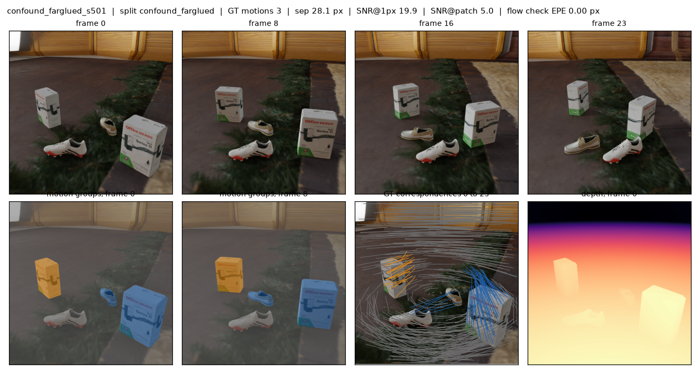
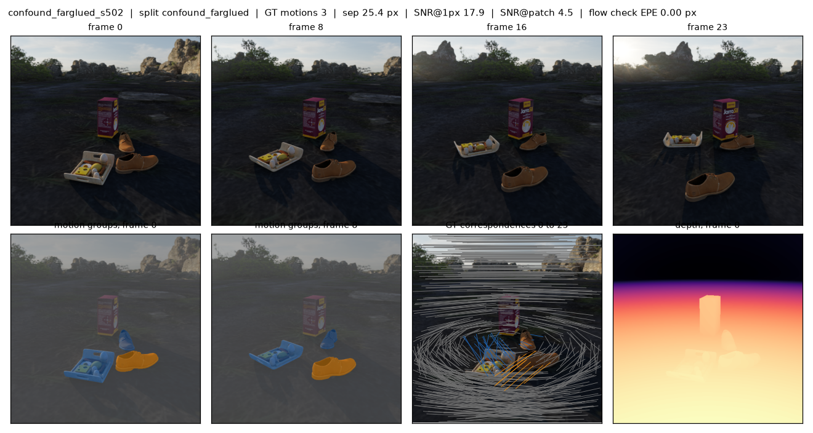
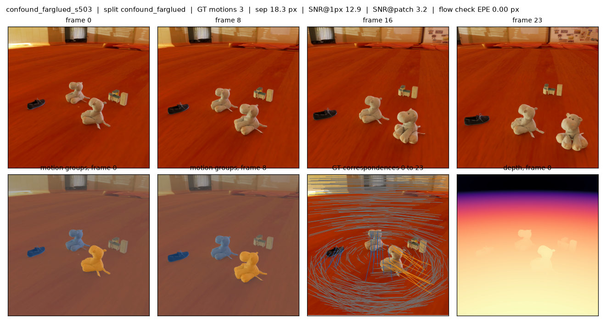

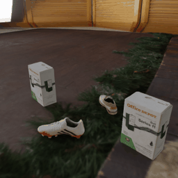 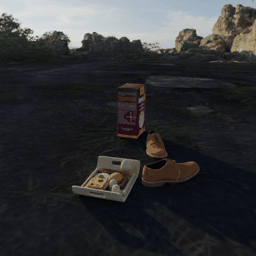 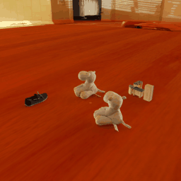

## t8_realdata_kitti

Item 8a: KITTI scene flow 2015 (200 scenes), Any4D slope / EPE / sep_ratio, 2, 4, 7 views, square and wide input

Status: **done**, attempt 1, started 2026-10-15 21:40:18, finished 2026-10-15 22:01:41. [Raw results](../results/queue/t8_realdata_kitti/), [log](../results/queue/t8_realdata_kitti/task.log).

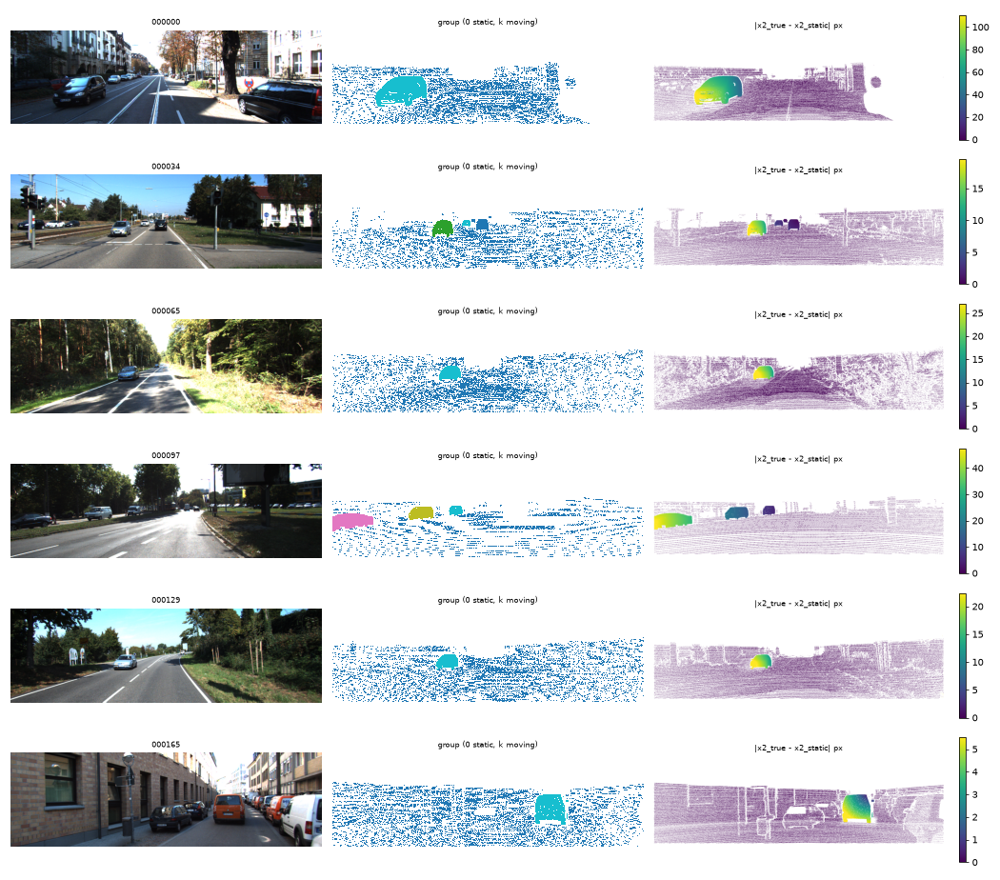

## t8_realdata_sintel

Item 8b: MPI Sintel training (final, clean; every 4th frame), Any4D slope / EPE / sep_ratio, 2 and 4 views, square and wide input

Status: **done**, attempt 1, started 2026-10-15 22:01:54, finished 2026-10-15 22:32:35. [Raw results](../results/queue/t8_realdata_sintel/), [log](../results/queue/t8_realdata_sintel/task.log).

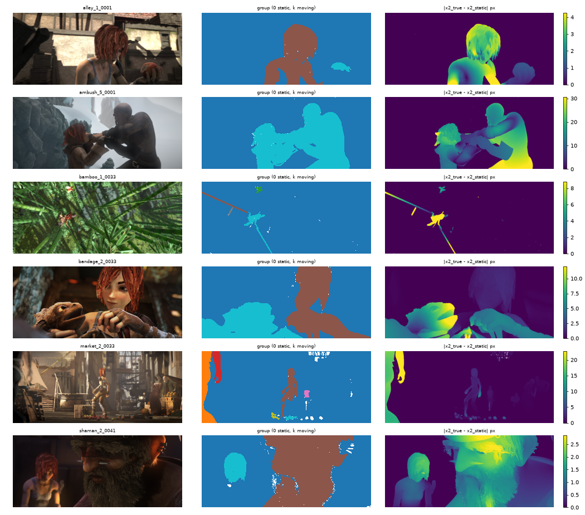

## v3_scale_float

Item 2: render 70 floating shadowless scenes + 20 extra grounded epi (v2)

Status: **done**, attempt 1, started 2026-10-15 22:32:43, finished 2026-10-16 00:03:34. [Raw results](../results/queue/v3_scale_float/), [log](../results/queue/v3_scale_float/task.log).

## v3_pipeline_float

Item 2: Steps 3-6 + adjacency control on the floating set and v2 with 30 epi

Status: **done**, attempt 1, started 2026-10-16 01:05:40, finished 2026-10-16 01:22:18. [Raw results](../results/queue/v3_pipeline_float/), [log](../results/queue/v3_pipeline_float/task.log).

## v3_scale_far

Item 1: render 20 far-glued scenes (image-gap constraint)

Status: **done**, attempt 1, started 2026-10-16 00:48:25, finished 2026-10-16 01:05:33. [Raw results](../results/queue/v3_scale_far/), [log](../results/queue/v3_scale_far/task.log).

## v3_pipeline_far

Item 1: Steps 3-6 + adjacency control on the far-glued set

Status: **done**, attempt 1, started 2026-10-16 01:40:13, finished 2026-10-16 01:43:20. [Raw results](../results/queue/v3_pipeline_far/), [log](../results/queue/v3_pipeline_far/task.log).

## t7_any4d_v2

Item 7 cross-model: Any4D reference (3D/2D slope, sep_ratio, probes P + attention A at layers 0,4..24)

Status: **done**, attempt 1, started 2026-10-16 00:11:50, finished 2026-10-16 00:17:28. [Raw results](../results/queue/t7_any4d_v2/), [log](../results/queue/t7_any4d_v2/task.log).

**xm_output_any4d_summary.md**

# any4d: output metrics, 120 scenes

| metric | mean | median | n |
|---|---|---|---|
| align_scale | 3.0688 | 3.0656 | 120 |
| align_rmse | 0.1411 | 0.1249 | 120 |
| median_true_disp3d | 2.3388 | 2.3434 | 118 |
| slope3d | 0.9836 | 0.9844 | 117 |
| epe3d_static | 0.1332 | 0.1225 | 120 |
| epe3d_moving | 0.2579 | 0.1784 | 118 |
| slope3d_flow | 0.5940 | 0.6580 | 117 |
| epe3d_static_flow | 0.0034 | 0.0034 | 120 |
| epe3d_moving_flow | 0.8628 | 0.6699 | 118 |
| sep_gt | 21.1408 | 25.4433 | 118 |
| slope2d | 0.6050 | 0.6619 | 117 |
| epe_static | 4.0341 | 3.8025 | 120 |
| epe_moving | 36.5558 | 30.0682 | 118 |
| sep_pred | 16.5939 | 14.6443 | 118 |
| sep_ratio | 0.8259 | 0.7512 | 89 |
| slope2d_q | 0.6039 | 0.6614 | 117 |
| epe_static_q | 4.0285 | 3.7729 | 120 |
| epe_moving_q | 36.6064 | 30.1741 | 118 |
| sep_pred_q | 16.5939 | 14.6443 | 118 |
| sep_ratio_q | 0.8259 | 0.7512 | 89 |
| slope3d_track | 0.5789 | 0.6499 | 117 |
| slope3d_q | 0.9840 | 0.9866 | 117 |

## t7_mapanything_v2

Item 7 cross-model: MapAnything V1 (static, Any4D's base) outputs, probes, attention

Status: **done**, attempt 1, started 2026-10-16 01:43:28, finished 2026-10-16 01:46:05. [Raw results](../results/queue/t7_mapanything_v2/), [log](../results/queue/t7_mapanything_v2/task.log).

**xm_output_mapanything_summary.md**

# mapanything: output metrics, 100 scenes

| metric | mean | median | n |
|---|---|---|---|
| align_scale | 4.7920 | 4.7222 | 100 |
| align_rmse | 0.2612 | 0.2507 | 100 |
| median_true_disp3d | 2.3630 | 2.3707 | 98 |
| slope3d | 0.9191 | 0.9322 | 98 |
| epe3d_static | 0.1588 | 0.1568 | 100 |
| epe3d_moving | 0.3917 | 0.3151 | 98 |
| sep_gt | 25.4553 | 27.6463 | 98 |

## t7_vggt_v2

Item 7 cross-model: VGGT-1B (static) outputs + tracks (fixed tracker head), probes, attention

Status: **done**, attempt 1, started 2026-10-16 01:46:13, finished 2026-10-16 01:49:51. [Raw results](../results/queue/t7_vggt_v2/), [log](../results/queue/t7_vggt_v2/task.log).

**xm_output_vggt_summary.md**

# vggt: output metrics, 100 scenes

| metric | mean | median | n |
|---|---|---|---|
| align_scale | 21.5576 | 21.8734 | 100 |
| align_rmse | 0.1265 | 0.1001 | 100 |
| median_true_disp3d | 2.3630 | 2.3707 | 98 |
| slope3d | 1.0153 | 0.9953 | 98 |
| epe3d_static | 0.1527 | 0.0810 | 100 |
| epe3d_moving | 0.1737 | 0.1325 | 98 |
| align_rmse_head | 0.1265 | 0.1034 | 100 |
| slope3d_head | 1.0167 | 0.9883 | 98 |
| epe3d_static_head | 0.1330 | 0.0671 | 100 |
| epe3d_moving_head | 0.1727 | 0.1261 | 98 |
| sep_gt | 25.4553 | 27.6463 | 98 |
| slope2d_q | 0.3439 | 0.2911 | 98 |
| epe_static_q | 9.6846 | 5.8218 | 100 |
| epe_moving_q | 57.5506 | 52.6230 | 98 |
| sep_pred_q | 4.8884 | 2.9189 | 98 |
| sep_ratio_q | 0.2280 | 0.1184 | 89 |
| track_self_offset | 0.0000 | 0.0000 | 100 |
| slope3d_track | 0.3527 | 0.4312 | 98 |
| slope3d_q | 1.0157 | 0.9944 | 98 |

## t7_page4d_v2

Item 7 cross-model: PAGE-4D (dynamic VGGT fine-tune) outputs, probes, attention

Status: **done**, attempt 1, started 2026-10-16 01:49:59, finished 2026-10-16 01:53:36. [Raw results](../results/queue/t7_page4d_v2/), [log](../results/queue/t7_page4d_v2/task.log).

**xm_output_page4d_summary.md**

# page4d: output metrics, 100 scenes

| metric | mean | median | n |
|---|---|---|---|
| align_scale | 20.6718 | 21.1419 | 100 |
| align_rmse | 0.1627 | 0.1366 | 100 |
| median_true_disp3d | 2.3630 | 2.3707 | 98 |
| slope3d | 1.0239 | 0.9673 | 98 |
| epe3d_static | 0.3488 | 0.2526 | 100 |
| epe3d_moving | 0.3208 | 0.2270 | 98 |
| align_rmse_head | 0.1261 | 0.0908 | 100 |
| slope3d_head | 1.0300 | 0.9883 | 98 |
| epe3d_static_head | 0.1921 | 0.0942 | 100 |
| epe3d_moving_head | 0.2540 | 0.1643 | 98 |
| sep_gt | 25.4553 | 27.6463 | 98 |

## t7_xm_summary

Item 7: cross-model comparison table (Any4D, MapAnything, VGGT, PAGE-4D)

Status: **done**, attempt 1, started 2026-10-16 01:55:59, finished 2026-10-16 01:56:07. [Raw results](../results/queue/t7_xm_summary/), [log](../results/queue/t7_xm_summary/task.log).

## t7_any4d_v2_100

Item 7: Any4D reference rerun on the fixed 100 v2 scenes (writes into t7_any4d_v2 results)

Status: **done**, attempt 1, started 2026-10-16 01:53:44, finished 2026-10-16 01:55:51. [Raw results](../results/queue/t7_any4d_v2_100/), [log](../results/queue/t7_any4d_v2_100/task.log).

## w2_kubric_baselines

Round 2 item 1 (W2): CoTracker3 + RAFT on Kubric v2 (100) and floating (70), same query sets as Any4D/VGGT; Any4D + VGGT on floating

Status: **done**, attempt 1, started 2026-10-16 15:11:22, finished 2026-10-16 15:46:33. [Raw results](../results/queue/w2_kubric_baselines/), [log](../results/queue/w2_kubric_baselines/task.log).

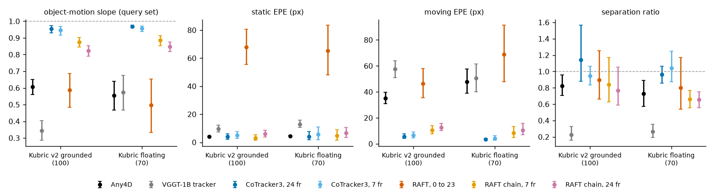

**w2_kubric_baselines_summary.md**

# w2_kubric_baselines: non-reconstruction baselines on Kubric (review item 1, W2)

Same scenes and query sets as e5_xm_eval.py (slope2d_q, epe_*_q, sep_ratio_q). Mean over scenes with bootstrap 95% CI; last column is the paired per-scene difference (model minus Any4D) with a two-sided sign test.

| model | data | n | slope2d_q | epe_static_q | epe_moving_q | sep_ratio_q | paired slope2d_q diff vs Any4D [sign test p] |
|---|---|---|---|---|---|---|---|
| Any4D | v2 | 100 | 0.61 [0.56, 0.65] | 4.10 [3.82, 4.39] | 35.03 [30.93, 39.64] | 0.83 [0.70, 0.96] | reference |
| Any4D | v3float | 69 | 0.56 [0.47, 0.64] | 4.53 [4.11, 5.03] | 47.88 [38.97, 57.61] | 0.73 [0.57, 0.89] | reference |
| VGGT-1B tracker | v2 | 100 | 0.34 [0.29, 0.41] | 9.68 [7.49, 12.32] | 57.55 [51.12, 63.95] | 0.23 [0.16, 0.33] | -0.26 [-0.34, -0.18] [p 3.7e-06, 26+/72-] |
| VGGT-1B tracker | v3float | 69 | 0.57 [0.47, 0.68] | 12.95 [10.55, 15.68] | 50.48 [40.00, 61.35] | 0.27 [0.19, 0.35] | 0.02 [-0.10, 0.14] [p 0.620, 30+/35-] |
| CoTracker3, 24 fr | v2 | 100 | 0.96 [0.93, 0.97] | 3.97 [2.29, 6.05] | 5.56 [3.98, 7.75] | 1.14 [0.88, 1.57] | 0.35 [0.31, 0.39] [p 9.9e-25, 95+/3-] |
| CoTracker3, 24 fr | v3float | 69 | 0.97 [0.96, 0.98] | 4.21 [1.70, 7.76] | 3.43 [2.67, 4.31] | 0.96 [0.86, 1.07] | 0.41 [0.33, 0.50] [p 3.9e-14, 61+/4-] |
| CoTracker3, 7 fr | v2 | 100 | 0.95 [0.92, 0.97] | 4.97 [2.77, 7.68] | 6.48 [4.51, 8.99] | 0.95 [0.84, 1.07] | 0.34 [0.30, 0.38] [p 2.4e-23, 94+/4-] |
| CoTracker3, 7 fr | v3float | 69 | 0.96 [0.94, 0.97] | 5.76 [1.87, 10.96] | 4.31 [2.91, 6.31] | 1.04 [0.87, 1.25] | 0.40 [0.32, 0.49] [p 4.9e-13, 60+/5-] |
| RAFT, 0 to 23 | v2 | 100 | 0.59 [0.48, 0.69] | 67.97 [55.41, 80.73] | 46.28 [35.49, 57.86] | 0.90 [0.66, 1.25] | -0.02 [-0.12, 0.08] [p 0.006, 63+/35-] |
| RAFT, 0 to 23 | v3float | 69 | 0.50 [0.33, 0.65] | 65.34 [48.04, 83.46] | 68.74 [47.83, 91.31] | 0.80 [0.54, 1.17] | -0.06 [-0.20, 0.08] [p 0.136, 39+/26-] |
| RAFT chain, 7 fr | v2 | 100 | 0.88 [0.84, 0.90] | 3.16 [1.41, 5.30] | 10.49 [7.64, 13.85] | 0.84 [0.63, 1.17] | 0.27 [0.23, 0.31] [p 8.1e-16, 87+/11-] |
| RAFT chain, 7 fr | v3float | 69 | 0.89 [0.85, 0.91] | 4.71 [1.48, 9.03] | 8.26 [4.98, 13.36] | 0.66 [0.56, 0.77] | 0.33 [0.26, 0.41] [p 4.3e-11, 58+/7-] |
| RAFT chain, 24 fr | v2 | 100 | 0.82 [0.79, 0.85] | 6.07 [3.87, 8.57] | 12.74 [10.25, 15.59] | 0.77 [0.59, 1.06] | 0.22 [0.17, 0.26] [p 1.4e-12, 83+/15-] |
| RAFT chain, 24 fr | v3float | 69 | 0.85 [0.82, 0.88] | 6.60 [3.43, 10.63] | 10.47 [7.13, 15.76] | 0.65 [0.55, 0.75] | 0.29 [0.22, 0.37] [p 4.3e-11, 58+/7-] |

Scenes with evaluation errors: {'any4d|v2': 0, 'any4d|v3float': 0, 'vggt|v2': 0, 'vggt|v3float': 0, 'cotracker3_24f|v2': 0, 'cotracker3_24f|v3float': 0, 'cotracker3_7f|v2': 0, 'cotracker3_7f|v3float': 0, 'raft_direct|v2': 0, 'raft_direct|v3float': 0, 'raft_chain7|v2': 0, 'raft_chain7|v3float': 0, 'raft_chain24|v2': 0, 'raft_chain24|v3float': 0}

## w2_real_baselines

Round 2 item 1 (W2): RAFT on KITTI 2015 and Sintel (2 views), metrics + alpha/beta vs Any4D cached

Status: **done**, attempt 1, started 2026-10-16 15:46:42, finished 2026-10-16 15:54:49. [Raw results](../results/queue/w2_real_baselines/), [log](../results/queue/w2_real_baselines/task.log).

**w2_real_baselines_summary.md**

# w2_real_baselines: RAFT vs Any4D on KITTI 2015 and Sintel (2 views)

RAFT: torchvision raft_large, C_T_V2 weights (FlyingChairs + FlyingThings; no KITTI or Sintel training), native resolution. Any4D: round-1 2-view wide-input predictions (cached). Metrics: e5_realdata_eval.evaluate on the same evaluation points (the alpha/beta decomposition is in w2_decomp). Bootstrap 95% CIs over scenes; paired sign test vs Any4D.

| model | data | n | slope | epe_static | epe_moving | sep_ratio | paired slope diff vs Any4D [sign test p] |
|---|---|---|---|---|---|---|---|
| Any4D | kitti15_rgb | 200 | 0.58 [0.51, 0.64] | 4.23 [3.96, 4.52] | 17.77 [15.22, 20.69] | 1.55 [0.89, 2.38] | reference |
| Any4D | sintel_clean | 256 | 0.31 [0.23, 0.39] | 4.98 [4.58, 5.42] | 18.01 [15.64, 20.59] | 0.84 [0.69, 1.02] | reference |
| Any4D | sintel_final | 256 | 0.33 [0.24, 0.41] | 5.54 [5.07, 6.05] | 18.54 [16.14, 21.17] | 0.69 [0.59, 0.81] | reference |
| raft | kitti15_rgb | 200 | 0.95 [0.94, 0.96] | 1.04 [0.69, 1.66] | 1.08 [0.91, 1.30] | 0.76 [0.57, 0.95] | 0.38 [0.31, 0.44] [p 9.0e-18, 156+/39-] |
| raft | sintel_clean | 256 | 0.91 [0.89, 0.93] | 0.58 [0.13, 1.48] | 1.73 [0.97, 2.66] | 0.89 [0.81, 0.98] | 0.60 [0.52, 0.68] [p 2.3e-31, 190+/27-] |
| raft | sintel_final | 256 | 0.90 [0.88, 0.92] | 0.21 [0.17, 0.25] | 3.53 [2.22, 5.07] | 0.93 [0.80, 1.08] | 0.57 [0.49, 0.66] [p 2.3e-27, 185+/32-] |

## w2_decomp

Round 2 item 1 (W2): alpha/beta decomposition and slope vs boundary distance, all models

Status: **done**, attempt 1, started 2026-10-16 15:54:57, finished 2026-10-16 15:55:05. [Raw results](../results/queue/w2_decomp/), [log](../results/queue/w2_decomp/task.log).

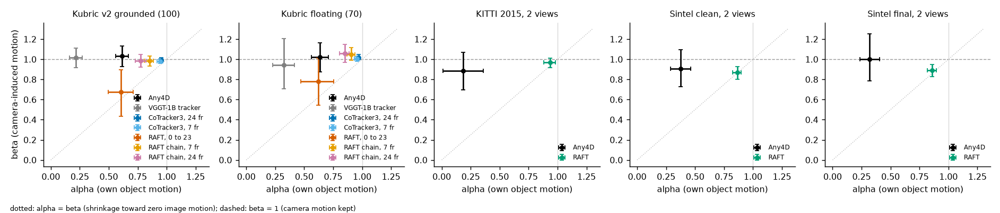
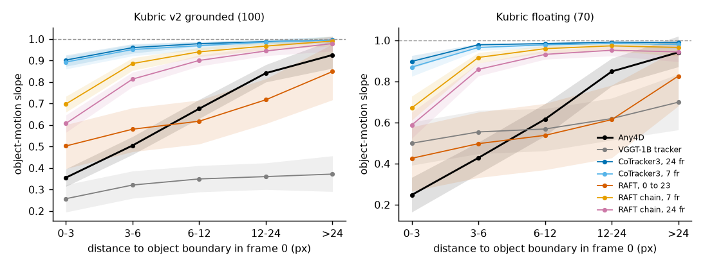

**w2_decomp_summary.md**

# w2_decomp: pull toward camera motion vs shrinkage vs smoothing (review item 1, W2)

Per scene, on moving query points with |x_true - x_static| > 2 px: x_pred - x1 = alpha (x_true - x_static) + beta (x_static - x1) + e (least squares over both coordinates). Pure camera-motion pull: beta near 1, alpha < 1. Shrinkage toward zero image motion: alpha near beta, both < 1. beta_static is the same fit on static points (only beta). alpha and beta are only separable when the object's motion is not parallel to the camera-induced motion and both are visible: alpha, beta and their tests use only scenes where the condition number of [A B] is at most 10 and the median |A| and |B| are at least 2 px (column n: identifiable of all scenes). Epipolar-aligned scenes, most KITTI cars and Sintel shots with a near-static camera fail this guard. slope and beta_static use all scenes. Mean over scenes [bootstrap 95% CI]; sign tests are two-sided.

| model | data | n | slope | alpha | beta | beta_static | alpha - beta [sign p] | beta vs 1 [sign p] | median abs cos(A,B) | median alpha, beta over all scenes (no guard) |
|---|---|---|---|---|---|---|---|---|---|---|
| Any4D | v2 | 84 of 100 | 0.61 [0.56, 0.65] | 0.61 [0.56, 0.67] | 1.03 [0.93, 1.13] | 0.99 [0.99, 1.00] | -0.42 [-0.53, -0.30] [7.9e-11] | 46+/38- [0.445] | 0.64 | 0.67, 1.01 |
| Any4D | v3float | 35 of 69 | 0.56 [0.47, 0.64] | 0.64 [0.56, 0.71] | 1.02 [0.88, 1.16] | 0.99 [0.98, 1.00] | -0.38 [-0.56, -0.22] [5.1e-04] | 17+/18- [1.000] | 0.83 | 0.74, 0.87 |
| VGGT-1B tracker | v2 | 84 of 100 | 0.34 [0.29, 0.41] | 0.22 [0.16, 0.27] | 1.02 [0.92, 1.11] | 1.02 [1.00, 1.04] | -0.80 [-0.90, -0.69] [2.1e-19] | 44+/40- [0.744] | 0.64 | 0.16, 1.05 |
| VGGT-1B tracker | v3float | 35 of 69 | 0.57 [0.47, 0.68] | 0.32 [0.23, 0.42] | 0.95 [0.71, 1.21] | 1.06 [1.02, 1.09] | -0.62 [-0.91, -0.35] [0.006] | 13+/22- [0.175] | 0.83 | 0.39, 0.72 |
| CoTracker3, 24 fr | v2 | 84 of 100 | 0.96 [0.93, 0.97] | 0.95 [0.94, 0.97] | 0.99 [0.97, 1.01] | 0.97 [0.94, 0.99] | -0.04 [-0.07, -0.01] [0.001] | 41+/43- [0.913] | 0.64 | 0.96, 1.00 |
| CoTracker3, 24 fr | v3float | 35 of 69 | 0.97 [0.96, 0.98] | 0.97 [0.96, 0.98] | 1.02 [0.99, 1.05] | 0.97 [0.93, 0.99] | -0.05 [-0.08, -0.02] [5.1e-04] | 15+/20- [0.500] | 0.83 | 0.97, 1.01 |
| CoTracker3, 7 fr | v2 | 84 of 100 | 0.95 [0.92, 0.97] | 0.94 [0.92, 0.97] | 0.98 [0.96, 1.00] | 0.96 [0.93, 0.98] | -0.04 [-0.07, -0.00] [0.038] | 39+/45- [0.586] | 0.64 | 0.97, 1.00 |
| CoTracker3, 7 fr | v3float | 35 of 69 | 0.96 [0.94, 0.97] | 0.96 [0.94, 0.98] | 1.00 [0.98, 1.03] | 0.95 [0.90, 0.98] | -0.05 [-0.07, -0.02] [0.017] | 14+/21- [0.311] | 0.83 | 0.97, 1.00 |
| RAFT, 0 to 23 | v2 | 84 of 100 | 0.59 [0.48, 0.69] | 0.61 [0.49, 0.71] | 0.68 [0.43, 0.90] | 0.60 [0.55, 0.66] | -0.07 [-0.32, 0.18] [0.586] | 27+/57- [0.001] | 0.64 | 0.75, 0.89 |
| RAFT, 0 to 23 | v3float | 35 of 69 | 0.50 [0.33, 0.65] | 0.62 [0.47, 0.75] | 0.78 [0.54, 1.01] | 0.66 [0.58, 0.75] | -0.16 [-0.45, 0.10] [0.736] | 10+/25- [0.017] | 0.83 | 0.62, 0.96 |
| RAFT chain, 7 fr | v2 | 84 of 100 | 0.88 [0.84, 0.90] | 0.85 [0.81, 0.89] | 0.98 [0.93, 1.03] | 0.97 [0.95, 0.99] | -0.13 [-0.20, -0.07] [4.7e-07] | 40+/44- [0.744] | 0.64 | 0.90, 1.00 |
| RAFT chain, 7 fr | v3float | 35 of 69 | 0.89 [0.85, 0.91] | 0.91 [0.87, 0.94] | 1.05 [0.99, 1.11] | 0.96 [0.92, 0.99] | -0.14 [-0.21, -0.08] [0.017] | 14+/21- [0.311] | 0.83 | 0.93, 0.98 |
| RAFT chain, 24 fr | v2 | 84 of 100 | 0.82 [0.79, 0.85] | 0.78 [0.73, 0.82] | 0.99 [0.92, 1.05] | 0.95 [0.92, 0.97] | -0.21 [-0.29, -0.14] [3.5e-08] | 41+/43- [0.913] | 0.64 | 0.82, 1.01 |
| RAFT chain, 24 fr | v3float | 35 of 69 | 0.85 [0.82, 0.88] | 0.85 [0.81, 0.89] | 1.06 [0.97, 1.15] | 0.94 [0.90, 0.98] | -0.21 [-0.30, -0.12] [0.017] | 14+/21- [0.311] | 0.83 | 0.90, 0.95 |
| Any4D | kitti15_rgb | 42 of 200 | 0.58 [0.51, 0.64] | 0.18 [0.01, 0.36] | 0.88 [0.69, 1.07] | 0.84 [0.80, 0.87] | -0.70 [-0.85, -0.54] [4.4e-07] | 20+/22- [0.878] | 0.99 | 0.40, 0.77 |
| Any4D | sintel_clean | 123 of 256 | 0.31 [0.23, 0.39] | 0.38 [0.29, 0.46] | 0.91 [0.73, 1.10] | 0.45 [0.37, 0.53] | -0.53 [-0.75, -0.33] [1.2e-05] | 48+/75- [0.019] | 0.51 | 0.29, 0.73 |
| Any4D | sintel_final | 123 of 256 | 0.33 [0.24, 0.41] | 0.32 [0.24, 0.41] | 1.00 [0.79, 1.25] | 0.48 [0.39, 0.58] | -0.68 [-0.94, -0.45] [2.9e-10] | 44+/79- [0.002] | 0.51 | 0.25, 0.66 |
| RAFT | kitti15_rgb | 41 of 200 | 0.95 [0.94, 0.96] | 0.94 [0.88, 0.98] | 0.97 [0.92, 1.01] | 0.91 [0.88, 0.92] | -0.03 [-0.06, -0.00] [0.028] | 13+/28- [0.028] | 0.99 | 0.97, 0.95 |
| RAFT | sintel_clean | 122 of 256 | 0.91 [0.89, 0.93] | 0.86 [0.82, 0.90] | 0.87 [0.80, 0.93] | 0.92 [0.80, 0.99] | -0.01 [-0.05, 0.05] [0.001] | 36+/86- [6.9e-06] | 0.51 | 0.96, 0.96 |
| RAFT | sintel_final | 122 of 256 | 0.90 [0.88, 0.92] | 0.86 [0.82, 0.90] | 0.89 [0.83, 0.95] | 0.98 [0.95, 1.01] | -0.03 [-0.08, 0.01] [0.085] | 39+/83- [8.4e-05] | 0.51 | 0.95, 0.95 |

## Slope vs distance to the object boundary (Kubric)

Spatial smoothing toward the neighbouring background predicts a lower slope near the boundary and a slope near 1 in the interior. A pull that is the same at all distances is not explained by smoothing.

| model | data | slope, d 0-3 px | slope, d 3-6 px | slope, d 6-12 px | slope, d 12-24 px | slope, d >24 px | edge (d <= 4) | interior (d >= 14) | interior - edge [sign p] |
|---|---|---|---|---|---|---|---|---|---|
| Any4D | v2 | 0.36 [0.31, 0.40] | 0.50 [0.46, 0.55] | 0.68 [0.63, 0.72] | 0.84 [0.80, 0.88] | 0.93 [0.86, 1.00] | 0.40 [0.36, 0.44] | 0.86 [0.82, 0.91] | 0.45 [0.41, 0.49] [1.3e-23] |
| Any4D | v3float | 0.25 [0.16, 0.33] | 0.43 [0.35, 0.50] | 0.62 [0.54, 0.69] | 0.85 [0.78, 0.91] | 0.94 [0.87, 1.02] | 0.30 [0.22, 0.38] | 0.87 [0.80, 0.94] | 0.49 [0.42, 0.56] [4.6e-14] |
| VGGT-1B tracker | v2 | 0.26 [0.20, 0.32] | 0.32 [0.26, 0.39] | 0.35 [0.29, 0.41] | 0.36 [0.30, 0.42] | 0.37 [0.29, 0.46] | 0.28 [0.22, 0.34] | 0.36 [0.30, 0.42] | 0.14 [0.10, 0.19] [2.4e-07] |
| VGGT-1B tracker | v3float | 0.50 [0.39, 0.60] | 0.55 [0.45, 0.66] | 0.57 [0.46, 0.67] | 0.62 [0.51, 0.72] | 0.70 [0.56, 0.84] | 0.52 [0.41, 0.62] | 0.64 [0.52, 0.74] | 0.10 [0.05, 0.16] [0.002] |
| CoTracker3, 24 fr | v2 | 0.90 [0.87, 0.93] | 0.96 [0.93, 0.98] | 0.98 [0.97, 0.99] | 0.99 [0.98, 1.00] | 1.00 [0.98, 1.01] | 0.92 [0.90, 0.94] | 0.99 [0.98, 1.00] | 0.06 [0.04, 0.07] [1.1e-10] |
| CoTracker3, 24 fr | v3float | 0.90 [0.86, 0.93] | 0.98 [0.97, 0.98] | 0.98 [0.98, 0.99] | 0.99 [0.99, 1.00] | 0.99 [0.98, 1.00] | 0.93 [0.91, 0.95] | 0.99 [0.98, 1.00] | 0.07 [0.04, 0.09] [1.2e-07] |
| CoTracker3, 7 fr | v2 | 0.89 [0.86, 0.92] | 0.95 [0.92, 0.97] | 0.97 [0.95, 0.99] | 0.99 [0.97, 1.00] | 0.99 [0.98, 1.01] | 0.91 [0.88, 0.94] | 0.99 [0.98, 1.00] | 0.06 [0.05, 0.08] [5.9e-10] |
| CoTracker3, 7 fr | v3float | 0.87 [0.82, 0.91] | 0.97 [0.95, 0.98] | 0.98 [0.96, 0.99] | 0.99 [0.97, 1.00] | 0.98 [0.96, 1.00] | 0.90 [0.87, 0.93] | 0.98 [0.97, 1.00] | 0.08 [0.06, 0.12] [1.2e-07] |
| RAFT, 0 to 23 | v2 | 0.50 [0.40, 0.60] | 0.58 [0.48, 0.68] | 0.62 [0.51, 0.72] | 0.72 [0.61, 0.81] | 0.85 [0.72, 0.98] | 0.53 [0.42, 0.63] | 0.78 [0.68, 0.87] | 0.17 [0.12, 0.24] [2.9e-05] |
| RAFT, 0 to 23 | v3float | 0.43 [0.27, 0.58] | 0.50 [0.33, 0.65] | 0.54 [0.37, 0.69] | 0.61 [0.43, 0.78] | 0.83 [0.68, 0.96] | 0.45 [0.30, 0.61] | 0.62 [0.44, 0.79] | 0.08 [0.02, 0.14] [0.161] |
| RAFT chain, 7 fr | v2 | 0.70 [0.66, 0.73] | 0.89 [0.85, 0.91] | 0.94 [0.92, 0.96] | 0.97 [0.95, 0.98] | 0.99 [0.97, 1.01] | 0.76 [0.73, 0.79] | 0.97 [0.95, 0.99] | 0.19 [0.17, 0.22] [4.0e-20] |
| RAFT chain, 7 fr | v3float | 0.67 [0.61, 0.73] | 0.92 [0.89, 0.94] | 0.96 [0.94, 0.97] | 0.97 [0.95, 0.99] | 0.97 [0.92, 0.99] | 0.76 [0.71, 0.80] | 0.97 [0.95, 0.99] | 0.19 [0.14, 0.24] [2.3e-09] |
| RAFT chain, 24 fr | v2 | 0.61 [0.57, 0.65] | 0.81 [0.78, 0.85] | 0.90 [0.87, 0.93] | 0.94 [0.92, 0.97] | 0.98 [0.94, 1.01] | 0.67 [0.63, 0.71] | 0.95 [0.93, 0.98] | 0.27 [0.24, 0.31] [1.0e-21] |
| RAFT chain, 24 fr | v3float | 0.59 [0.52, 0.65] | 0.86 [0.83, 0.89] | 0.93 [0.91, 0.95] | 0.95 [0.92, 0.97] | 0.94 [0.90, 0.98] | 0.68 [0.63, 0.73] | 0.95 [0.92, 0.97] | 0.25 [0.19, 0.32] [2.4e-10] |

## Rule-based reading (thresholds: slope CI vs 0.9; beta CI vs 0.95 and 1; sign tests at 0.05)

- Any4D, v2: pull (slope CI below 0.9); camera motion kept (beta near 1), own motion under-recovered (alpha < 1): camera-motion pull; slope lower at object boundaries (spatial smoothing contributes)
- Any4D, v3float: pull (slope CI below 0.9); camera motion kept (beta near 1), own motion under-recovered (alpha < 1): camera-motion pull; slope lower at object boundaries (spatial smoothing contributes)
- VGGT-1B tracker, v2: pull (slope CI below 0.9); camera motion kept (beta near 1), own motion under-recovered (alpha < 1): camera-motion pull; slope lower at object boundaries (spatial smoothing contributes)
- VGGT-1B tracker, v3float: pull (slope CI below 0.9); camera motion kept (beta near 1), own motion under-recovered (alpha < 1): camera-motion pull; slope lower at object boundaries (spatial smoothing contributes)
- CoTracker3, 24 fr, v2: no pull (slope CI above 0.9); camera motion kept (beta near 1); slope lower at object boundaries (spatial smoothing contributes)
- CoTracker3, 24 fr, v3float: no pull (slope CI above 0.9); camera motion kept (beta near 1); slope lower at object boundaries (spatial smoothing contributes)
- CoTracker3, 7 fr, v2: no pull (slope CI above 0.9); camera motion kept (beta near 1); slope lower at object boundaries (spatial smoothing contributes)
- CoTracker3, 7 fr, v3float: no pull (slope CI above 0.9); camera motion kept (beta near 1); slope lower at object boundaries (spatial smoothing contributes)
- RAFT, 0 to 23, v2: pull (slope CI below 0.9); shrinkage toward zero image motion (beta below 1 and alpha not different from beta); slope lower at object boundaries (spatial smoothing contributes)
- RAFT, 0 to 23, v3float: pull (slope CI below 0.9); camera motion kept (beta near 1), own motion under-recovered (alpha < 1): camera-motion pull
- RAFT chain, 7 fr, v2: weak or unclear pull (slope CI includes 0.9); camera motion kept (beta near 1), own motion under-recovered (alpha < 1): camera-motion pull; slope lower at object boundaries (spatial smoothing contributes)
- RAFT chain, 7 fr, v3float: weak or unclear pull (slope CI includes 0.9); camera motion kept (beta near 1), own motion under-recovered (alpha < 1): camera-motion pull; slope lower at object boundaries (spatial smoothing contributes)
- RAFT chain, 24 fr, v2: pull (slope CI below 0.9); camera motion kept (beta near 1), own motion under-recovered (alpha < 1): camera-motion pull; slope lower at object boundaries (spatial smoothing contributes)
- RAFT chain, 24 fr, v3float: pull (slope CI below 0.9); camera motion kept (beta near 1), own motion under-recovered (alpha < 1): camera-motion pull; slope lower at object boundaries (spatial smoothing contributes)
- Any4D, kitti15_rgb: pull (slope CI below 0.9); camera motion kept (beta near 1), own motion under-recovered (alpha < 1): camera-motion pull
- Any4D, sintel_clean: pull (slope CI below 0.9); camera motion kept (beta near 1), own motion under-recovered (alpha < 1): camera-motion pull
- Any4D, sintel_final: pull (slope CI below 0.9); camera motion kept (beta near 1), own motion under-recovered (alpha < 1): camera-motion pull
- raft, kitti15_rgb: no pull (slope CI above 0.9); camera motion kept (beta near 1), own motion under-recovered (alpha < 1): camera-motion pull
- raft, sintel_clean: weak or unclear pull (slope CI includes 0.9); mixed (beta below 1 and alpha different from beta)
- raft, sintel_final: weak or unclear pull (slope CI includes 0.9); shrinkage toward zero image motion (beta below 1 and alpha not different from beta)

## w2_dose

Round 2 item 1 (W2): dose-response of the slope (speed, area, texture, occlusion, camera rotation, motions, confidence)

Status: **done**, attempt 1, started 2026-10-16 15:55:12, finished 2026-10-16 15:55:49. [Raw results](../results/queue/w2_dose/), [log](../results/queue/w2_dose/task.log).

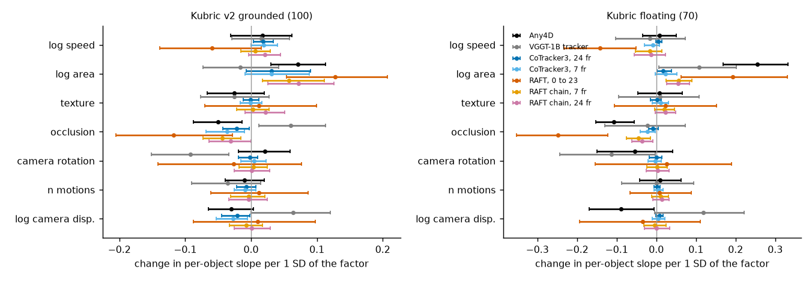
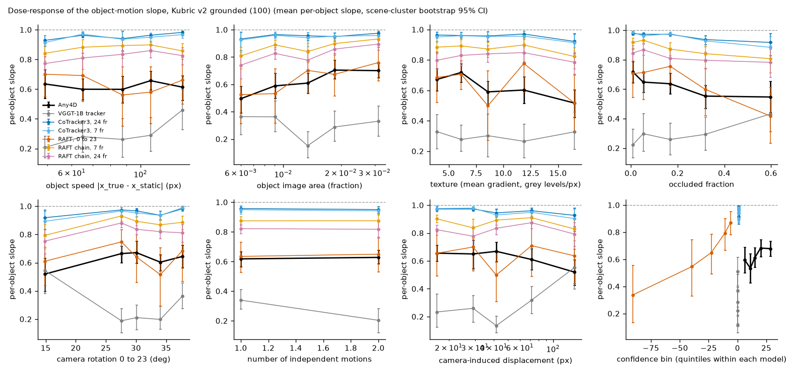
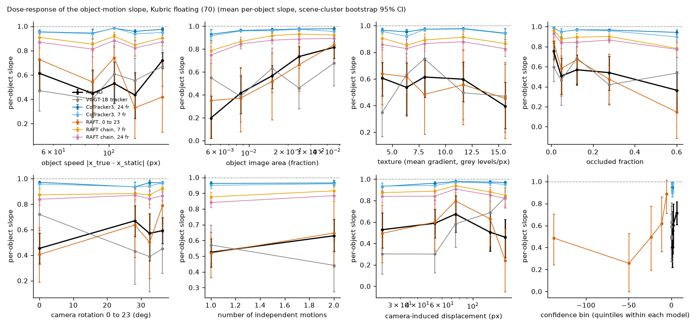

**w2_dose_summary.md**

# w2_dose: dose-response of the object-motion slope (review item 1, W2)

Per-object slope (objects with more than 20 moving query points), winsorised to [-0.5, 1.5]. Bins are quintiles of the Any4D objects (number of motions: its values). Regression: OLS of per-object slope on all factors, standardised (coefficient = change in slope per 1 SD), scene-cluster bootstrap 95% CI. Confidence is model-specific and is added in a separate fit.

What each pattern implies:
- Regression shrinkage (the prediction moves toward the training-set mean under uncertainty) predicts a LOWER slope at low texture, small area, high occlusion and low confidence, so positive coefficients for texture, area and confidence and a negative one for occlusion.
- A structural pull toward the static (camera-only) hypothesis that does not depend on how well the object is seen predicts flat curves for texture, area, occlusion and confidence, with dependence on the geometry instead (camera rotation, camera-induced displacement, number of motions).
- Speed: a lower slope at high speed is expected under both readings (large motions are rarer and harder), so it does not separate them; a lower slope at LOW speed points to a fixed offset or a detection threshold.

| model | data | objects | log speed | log area | texture | occlusion | cam rotation | n motions | log cam disp | confidence (added to the same fit) |
|---|---|---|---|---|---|---|---|---|---|---|
| Any4D | v2 | 138 | +0.018 [-0.031, +0.062] | +0.071 [+0.030, +0.113] | -0.025 [-0.067, +0.020] | -0.050 [-0.088, -0.014] | +0.021 [-0.019, +0.059] | -0.010 [-0.040, +0.020] | -0.030 [-0.065, +0.004] | -0.018 [-0.056, +0.024] |
| VGGT-1B tracker | v2 | 138 | +0.016 [-0.029, +0.058] | -0.016 [-0.073, +0.042] | -0.025 [-0.077, +0.027] | +0.060 [+0.011, +0.113] | -0.092 [-0.151, -0.033] | -0.036 [-0.090, +0.015] | +0.064 [+0.000, +0.121] | -0.090 [-0.127, -0.048] |
| CoTracker3, 24 fr | v2 | 138 | +0.019 [+0.004, +0.034] | +0.031 [-0.008, +0.091] | -0.000 [-0.012, +0.012] | -0.022 [-0.043, -0.003] | -0.002 [-0.019, +0.010] | -0.007 [-0.022, +0.007] | -0.021 [-0.045, -0.002] | +0.026 [+0.002, +0.044] |
| CoTracker3, 7 fr | v2 | 138 | +0.019 [+0.000, +0.041] | +0.031 [-0.009, +0.089] | -0.001 [-0.016, +0.016] | -0.037 [-0.068, -0.010] | +0.005 [-0.016, +0.023] | -0.009 [-0.025, +0.008] | -0.027 [-0.053, -0.005] | +0.020 [-0.001, +0.037] |
| RAFT, 0 to 23 | v2 | 138 | -0.059 [-0.139, +0.016] | +0.128 [+0.054, +0.207] | +0.012 [-0.070, +0.100] | -0.117 [-0.205, -0.028] | -0.026 [-0.141, +0.076] | +0.012 [-0.061, +0.086] | +0.010 [-0.087, +0.098] | +0.146 [+0.059, +0.239] |
| RAFT chain, 7 fr | v2 | 138 | +0.007 [-0.016, +0.029] | +0.058 [+0.017, +0.111] | +0.003 [-0.022, +0.027] | -0.043 [-0.073, -0.016] | +0.004 [-0.018, +0.025] | -0.003 [-0.031, +0.021] | -0.007 [-0.032, +0.017] | n/a |
| RAFT chain, 24 fr | v2 | 138 | +0.021 [-0.004, +0.045] | +0.072 [+0.025, +0.126] | +0.022 [-0.010, +0.051] | -0.031 [-0.064, +0.000] | +0.001 [-0.025, +0.028] | -0.004 [-0.034, +0.025] | +0.001 [-0.026, +0.029] | n/a |
| Any4D | v3float | 84 | +0.009 [-0.035, +0.051] | +0.255 [+0.169, +0.332] | +0.008 [-0.047, +0.065] | -0.107 [-0.152, -0.056] | -0.054 [-0.150, +0.041] | +0.010 [-0.043, +0.063] | -0.090 [-0.169, -0.006] | +0.020 [-0.022, +0.068] |
| VGGT-1B tracker | v3float | 84 | -0.017 [-0.103, +0.073] | +0.108 [+0.006, +0.202] | +0.010 [-0.095, +0.108] | -0.023 [-0.129, +0.073] | -0.113 [-0.243, -0.003] | +0.000 [-0.087, +0.094] | +0.119 [-0.004, +0.222] | +0.028 [-0.082, +0.121] |
| CoTracker3, 24 fr | v3float | 84 | +0.005 [-0.001, +0.014] | +0.017 [+0.001, +0.038] | +0.001 [-0.015, +0.013] | -0.008 [-0.019, +0.005] | -0.000 [-0.018, +0.014] | +0.002 [-0.006, +0.010] | +0.008 [-0.001, +0.018] | +0.009 [+0.000, +0.020] |
| CoTracker3, 7 fr | v3float | 84 | -0.009 [-0.030, +0.008] | +0.023 [-0.002, +0.052] | +0.011 [-0.010, +0.030] | -0.022 [-0.040, -0.003] | -0.003 [-0.021, +0.013] | +0.006 [-0.005, +0.017] | +0.005 [-0.010, +0.021] | +0.042 [+0.010, +0.069] |
| RAFT, 0 to 23 | v3float | 84 | -0.143 [-0.232, -0.051] | +0.193 [+0.062, +0.331] | +0.023 [-0.105, +0.152] | -0.247 [-0.352, -0.122] | +0.026 [-0.153, +0.190] | +0.008 [-0.067, +0.089] | -0.034 [-0.193, +0.111] | +0.056 [-0.047, +0.173] |
| RAFT chain, 7 fr | v3float | 84 | -0.016 [-0.053, +0.014] | +0.056 [+0.024, +0.091] | +0.021 [-0.004, +0.045] | -0.045 [-0.075, -0.015] | +0.003 [-0.024, +0.027] | +0.010 [-0.012, +0.031] | -0.004 [-0.032, +0.025] | n/a |
| RAFT chain, 24 fr | v3float | 84 | -0.013 [-0.055, +0.023] | +0.055 [+0.026, +0.084] | +0.023 [-0.002, +0.048] | -0.035 [-0.061, -0.009] | +0.004 [-0.026, +0.032] | +0.014 [-0.009, +0.033] | +0.001 [-0.030, +0.034] | n/a |

## w2_summary

Round 2 item 1 (W2): summary table, figure and verdict (pull: 4D-model property or generic shrinkage?)

Status: **done**, attempt 1, started 2026-10-16 15:55:58, finished 2026-10-16 15:56:05. [Raw results](../results/queue/w2_summary/), [log](../results/queue/w2_summary/task.log).

**w2_summary_summary.md**

# w2_summary: is the camera-motion pull regression shrinkage or a 4D-model property? (review item 1, W2)

## All models, same scenes and query sets

Mean over scenes [bootstrap 95% CI]. Kubric slope is slope2d_q and sep_ratio is sep_ratio_q (e5_xm_eval.py definitions, frame 0 to 23); real data use e5_realdata_eval.py. alpha and beta: x_pred - x1 = alpha (x_true - x_static) + beta (x_static - x1) on moving points, only on scenes where they are identifiable (condition number of [A B] at most 10, median |A| and |B| at least 2 px). Last column: paired per-scene difference to Any4D with a two-sided sign test.

| model | data | n scenes | slope | alpha (n identifiable) | beta | beta_static | sep_ratio | slope vs Any4D [sign p] |
|---|---|---|---|---|---|---|---|---|
| Any4D | v2 | 98 | 0.61 [0.56, 0.65] | 0.61 [0.56, 0.67] (84) | 1.03 [0.93, 1.13] | 0.99 [0.99, 1.00] | 0.83 [0.70, 0.96] | reference |
| Any4D | v3float | 65 | 0.56 [0.47, 0.64] | 0.64 [0.56, 0.71] (35) | 1.02 [0.88, 1.16] | 0.99 [0.98, 1.00] | 0.73 [0.57, 0.89] | reference |
| VGGT-1B tracker | v2 | 98 | 0.34 [0.29, 0.41] | 0.22 [0.16, 0.27] (84) | 1.02 [0.92, 1.11] | 1.02 [1.00, 1.04] | 0.23 [0.16, 0.33] | -0.26 [-0.34, -0.18] [p 3.7e-06] |
| VGGT-1B tracker | v3float | 65 | 0.57 [0.47, 0.68] | 0.32 [0.23, 0.42] (35) | 0.95 [0.71, 1.21] | 1.06 [1.02, 1.09] | 0.27 [0.19, 0.35] | +0.02 [-0.10, +0.14] [p 0.620] |
| CoTracker3, 24 fr | v2 | 98 | 0.96 [0.93, 0.97] | 0.95 [0.94, 0.97] (84) | 0.99 [0.97, 1.01] | 0.97 [0.94, 0.99] | 1.14 [0.88, 1.57] | +0.35 [+0.31, +0.39] [p 9.9e-25] |
| CoTracker3, 24 fr | v3float | 65 | 0.97 [0.96, 0.98] | 0.97 [0.96, 0.98] (35) | 1.02 [0.99, 1.05] | 0.97 [0.93, 0.99] | 0.96 [0.86, 1.07] | +0.41 [+0.33, +0.50] [p 3.9e-14] |
| CoTracker3, 7 fr | v2 | 98 | 0.95 [0.92, 0.97] | 0.94 [0.92, 0.97] (84) | 0.98 [0.96, 1.00] | 0.96 [0.93, 0.98] | 0.95 [0.84, 1.07] | +0.34 [+0.30, +0.38] [p 2.4e-23] |
| CoTracker3, 7 fr | v3float | 65 | 0.96 [0.94, 0.97] | 0.96 [0.94, 0.98] (35) | 1.00 [0.98, 1.03] | 0.95 [0.90, 0.98] | 1.04 [0.87, 1.25] | +0.40 [+0.32, +0.49] [p 4.9e-13] |
| RAFT, 0 to 23 | v2 | 98 | 0.59 [0.48, 0.69] | 0.61 [0.49, 0.71] (84) | 0.68 [0.43, 0.90] | 0.60 [0.55, 0.66] | 0.90 [0.66, 1.25] | -0.02 [-0.12, +0.08] [p 0.006] |
| RAFT, 0 to 23 | v3float | 65 | 0.50 [0.33, 0.65] | 0.62 [0.47, 0.75] (35) | 0.78 [0.54, 1.01] | 0.66 [0.58, 0.75] | 0.80 [0.54, 1.17] | -0.06 [-0.20, +0.08] [p 0.136] |
| RAFT chain, 7 fr | v2 | 98 | 0.88 [0.84, 0.90] | 0.85 [0.81, 0.89] (84) | 0.98 [0.93, 1.03] | 0.97 [0.95, 0.99] | 0.84 [0.63, 1.17] | +0.27 [+0.23, +0.31] [p 8.1e-16] |
| RAFT chain, 7 fr | v3float | 65 | 0.89 [0.85, 0.91] | 0.91 [0.87, 0.94] (35) | 1.05 [0.99, 1.11] | 0.96 [0.92, 0.99] | 0.66 [0.56, 0.77] | +0.33 [+0.26, +0.41] [p 4.3e-11] |
| RAFT chain, 24 fr | v2 | 98 | 0.82 [0.79, 0.85] | 0.78 [0.73, 0.82] (84) | 0.99 [0.92, 1.05] | 0.95 [0.92, 0.97] | 0.77 [0.59, 1.06] | +0.22 [+0.17, +0.26] [p 1.4e-12] |
| RAFT chain, 24 fr | v3float | 65 | 0.85 [0.82, 0.88] | 0.85 [0.81, 0.89] (35) | 1.06 [0.97, 1.15] | 0.94 [0.90, 0.98] | 0.65 [0.55, 0.75] | +0.29 [+0.22, +0.37] [p 4.3e-11] |
| Any4D | kitti15_rgb | 195 | 0.58 [0.51, 0.64] | 0.18 [0.01, 0.36] (42) | 0.88 [0.69, 1.07] | 0.84 [0.80, 0.87] | 1.55 [0.89, 2.38] | reference |
| Any4D | sintel_clean | 217 | 0.31 [0.23, 0.39] | 0.38 [0.29, 0.46] (123) | 0.91 [0.73, 1.10] | 0.45 [0.37, 0.53] | 0.84 [0.69, 1.02] | reference |
| Any4D | sintel_final | 217 | 0.33 [0.24, 0.41] | 0.32 [0.24, 0.41] (123) | 1.00 [0.79, 1.25] | 0.48 [0.39, 0.58] | 0.69 [0.59, 0.81] | reference |
| RAFT | kitti15_rgb | 195 | 0.95 [0.94, 0.96] | 0.94 [0.88, 0.98] (41) | 0.97 [0.92, 1.01] | 0.91 [0.88, 0.92] | 0.76 [0.57, 0.95] | +0.38 [+0.31, +0.44] [p 9.0e-18] |
| RAFT | sintel_clean | 217 | 0.91 [0.89, 0.93] | 0.86 [0.82, 0.90] (122) | 0.87 [0.80, 0.93] | 0.92 [0.80, 0.99] | 0.89 [0.81, 0.98] | +0.60 [+0.52, +0.68] [p 2.3e-31] |
| RAFT | sintel_final | 217 | 0.90 [0.88, 0.92] | 0.86 [0.82, 0.90] (122) | 0.89 [0.83, 0.95] | 0.98 [0.95, 1.01] | 0.93 [0.80, 1.08] | +0.57 [+0.49, +0.66] [p 2.3e-27] |

## Rule-based reading per model

Thresholds: pull if the slope CI is below 0.9, no pull if it is above 0.9; shrinkage toward zero image motion if the beta CI is below 0.95 and alpha is not different from beta (sign test p >= 0.05); camera-motion pull if beta is near 1 and alpha below 1; smoothing if the interior slope is higher than the edge slope (sign test p < 0.05).

- Any4D, v2: pull (slope CI below 0.9); camera motion kept (beta near 1), own motion under-recovered (alpha < 1): camera-motion pull; slope lower at object boundaries (spatial smoothing contributes)
- Any4D, v3float: pull (slope CI below 0.9); camera motion kept (beta near 1), own motion under-recovered (alpha < 1): camera-motion pull; slope lower at object boundaries (spatial smoothing contributes)
- VGGT-1B tracker, v2: pull (slope CI below 0.9); camera motion kept (beta near 1), own motion under-recovered (alpha < 1): camera-motion pull; slope lower at object boundaries (spatial smoothing contributes)
- VGGT-1B tracker, v3float: pull (slope CI below 0.9); camera motion kept (beta near 1), own motion under-recovered (alpha < 1): camera-motion pull; slope lower at object boundaries (spatial smoothing contributes)
- CoTracker3, 24 fr, v2: no pull (slope CI above 0.9); camera motion kept (beta near 1); slope lower at object boundaries (spatial smoothing contributes)
- CoTracker3, 24 fr, v3float: no pull (slope CI above 0.9); camera motion kept (beta near 1); slope lower at object boundaries (spatial smoothing contributes)
- CoTracker3, 7 fr, v2: no pull (slope CI above 0.9); camera motion kept (beta near 1); slope lower at object boundaries (spatial smoothing contributes)
- CoTracker3, 7 fr, v3float: no pull (slope CI above 0.9); camera motion kept (beta near 1); slope lower at object boundaries (spatial smoothing contributes)
- RAFT, 0 to 23, v2: pull (slope CI below 0.9); shrinkage toward zero image motion (beta below 1 and alpha not different from beta); slope lower at object boundaries (spatial smoothing contributes)
- RAFT, 0 to 23, v3float: pull (slope CI below 0.9); camera motion kept (beta near 1), own motion under-recovered (alpha < 1): camera-motion pull
- RAFT chain, 7 fr, v2: weak or unclear pull (slope CI includes 0.9); camera motion kept (beta near 1), own motion under-recovered (alpha < 1): camera-motion pull; slope lower at object boundaries (spatial smoothing contributes)
- RAFT chain, 7 fr, v3float: weak or unclear pull (slope CI includes 0.9); camera motion kept (beta near 1), own motion under-recovered (alpha < 1): camera-motion pull; slope lower at object boundaries (spatial smoothing contributes)
- RAFT chain, 24 fr, v2: pull (slope CI below 0.9); camera motion kept (beta near 1), own motion under-recovered (alpha < 1): camera-motion pull; slope lower at object boundaries (spatial smoothing contributes)
- RAFT chain, 24 fr, v3float: pull (slope CI below 0.9); camera motion kept (beta near 1), own motion under-recovered (alpha < 1): camera-motion pull; slope lower at object boundaries (spatial smoothing contributes)
- Any4D, kitti15_rgb: pull (slope CI below 0.9); camera motion kept (beta near 1), own motion under-recovered (alpha < 1): camera-motion pull
- Any4D, sintel_clean: pull (slope CI below 0.9); camera motion kept (beta near 1), own motion under-recovered (alpha < 1): camera-motion pull
- Any4D, sintel_final: pull (slope CI below 0.9); camera motion kept (beta near 1), own motion under-recovered (alpha < 1): camera-motion pull
- RAFT, kitti15_rgb: no pull (slope CI above 0.9); camera motion kept (beta near 1), own motion under-recovered (alpha < 1): camera-motion pull
- RAFT, sintel_clean: weak or unclear pull (slope CI includes 0.9); mixed (beta below 1 and alpha different from beta)
- RAFT, sintel_final: weak or unclear pull (slope CI includes 0.9); shrinkage toward zero image motion (beta below 1 and alpha not different from beta)

## Dose-response (Any4D)

- Any4D, v2: factors whose standardised coefficient CI excludes 0: area +0.07, occlusion -0.05
  confidence (added): -0.02 [-0.06, +0.02]
- Any4D, v3float: factors whose standardised coefficient CI excludes 0: area +0.26, occlusion -0.11, cam_disp_px -0.09
  confidence (added): +0.02 [-0.02, +0.07]

See w2_dose summary for all models and the figures fig_w2_dose_v2.png, fig_w2_dose_v3float.png, fig_w2_dose_regression.png.

## Verdict (generated from the numbers above; to be checked and edited by hand)

Kubric v2 grounded (100): Any4D slope 0.61 [0.56, 0.65], VGGT tracker 0.34 [0.29, 0.41], CoTracker3 0.96 [0.93, 0.97], RAFT 0.59 [0.48, 0.69]; 0.88 [0.84, 0.90]; 0.82 [0.79, 0.85]. The best non-reconstruction baseline recovers clearly more object motion than Any4D (CIs do not overlap). Kubric floating (70): Any4D slope 0.56 [0.47, 0.64], VGGT tracker 0.57 [0.47, 0.68], CoTracker3 0.97 [0.96, 0.98], RAFT 0.50 [0.33, 0.65]; 0.89 [0.85, 0.91]; 0.85 [0.82, 0.88]. The best non-reconstruction baseline recovers clearly more object motion than Any4D (CIs do not overlap). KITTI 2015, 2 views: Any4D slope 0.58 [0.51, 0.64], RAFT 0.95 [0.94, 0.96]. Sintel clean, 2 views: Any4D slope 0.31 [0.23, 0.39], RAFT 0.91 [0.89, 0.93]. Sintel final, 2 views: Any4D slope 0.33 [0.24, 0.41], RAFT 0.90 [0.88, 0.92].
If the dedicated trackers (CoTracker3, RAFT) recover close to all object motion on the same scenes while Any4D and the VGGT tracker head do not, the pull is a property of the reconstruction models and not a generic property of dense correspondence under uncertainty. If the baselines show the same deficit, with alpha close to beta, it is generic shrinkage. The decomposition rows above say which of the two readings each model follows.

## ft_render_v2

Item 10: render 200 v2-grounded training scenes (seeds 2001-2200, approved settings)

Status: **done**, attempt 1, started 2026-10-16 15:56:13, finished 2026-10-16 19:20:03. [Raw results](../results/queue/ft_render_v2/), [log](../results/queue/ft_render_v2/task.log).

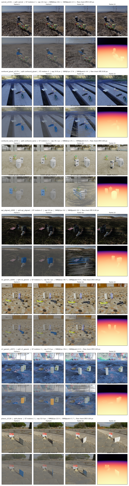

**ft_render_v2_summary.md**

# ft_render_v2

Training scenes for item 10 (fine-tuning), rendered with the approved generator settings into `/media/workbench/zone_x/e5_multibody/data/ft_train_v2`.

- Rendered: 197 of 200 planned scenes; render failures: 3 (confound_glued_s2178, confound_glued_s2184, confound_glued_s2196).
- Seeds 2001 to 2200 (all at or above 2001, disjoint from every evaluation set, whose seeds are at most 720).
- GT flow self-check (geometric GT vs Kubric optical flow, frame 0 to 1): median EPE 0.000 px, max 0.000 px.

| split | scenes | median sep (px) | median SNR at 1 px |
|---|---|---|---|
| camrot | 25 | 17.7 | 12.5 |
| confound_glued | 22 | 29.2 | 20.6 |
| confound_same | 25 | 32.4 | 22.9 |
| epi_aligned | 40 | 0.0 | 0.0 |
| n2_generic | 30 | 30.5 | 21.6 |
| n3_generic | 30 | 29.5 | 20.9 |
| planar | 25 | 33.6 | 23.8 |

## ft_render_float

Item 10: render 200 floating training scenes (seeds 2201-2400, approved v3float settings)

Status: **done**, attempt 1, started 2026-10-16 19:20:12, finished 2026-10-16 22:48:04. [Raw results](../results/queue/ft_render_float/), [log](../results/queue/ft_render_float/task.log).

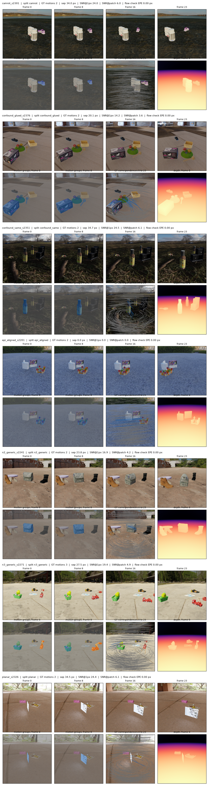

**ft_render_float_summary.md**

# ft_render_float

Training scenes for item 10 (fine-tuning), rendered with the approved generator settings into `/media/workbench/zone_x/e5_multibody/data/ft_train_float`.

- Rendered: 194 of 200 planned scenes; render failures: 6 (confound_glued_s2397, confound_glued_s2398, confound_glued_s2400, n3_generic_s2272, n3_generic_s2285, n3_generic_s2296).
- Seeds 2201 to 2400 (all at or above 2001, disjoint from every evaluation set, whose seeds are at most 720).
- GT flow self-check (geometric GT vs Kubric optical flow, frame 0 to 1): median EPE 0.000 px, max 0.000 px.

| split | scenes | median sep (px) | median SNR at 1 px |
|---|---|---|---|
| camrot | 25 | 20.2 | 14.3 |
| confound_glued | 22 | 23.3 | 16.5 |
| confound_same | 25 | 32.9 | 23.2 |
| epi_aligned | 40 | 0.0 | 0.0 |
| n2_generic | 30 | 30.9 | 21.9 |
| n3_generic | 27 | 25.1 | 17.7 |
| planar | 25 | 34.5 | 24.4 |

## ft_eval_base

Item 10: evaluate base Any4D with the fine-tune evaluation (Kubric v2/v3float/v3far, internals, KITTI, Sintel)

Status: **done**, attempt 1, started 2026-10-17 11:30:48, finished 2026-10-17 11:41:57. [Raw results](../results/queue/ft_eval_base/), [log](../results/queue/ft_eval_base/task.log).

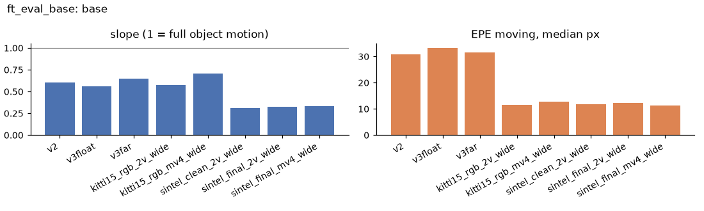

**ft_eval_base_summary.md**

# ft_eval_base

Evaluation of **base** with the round-1 metric code (output metrics: e5_causal / e5_step3 definitions).

| dataset | n | slope (mean) | EPE static (median of scenes) | EPE moving | sep ratio (median) | mask IoU | mask IoU, epi_aligned |
|---|---|---|---|---|---|---|---|
| v2 | 100 | 0.607 | 3.82 | 30.7 | 0.735 | 0.644 | 0.532 |
| v3float | 69 | 0.559 | 4.02 | 33.2 | 0.657 | 0.496 | 0.278 |
| v3far | 19 | 0.648 | 4.38 | 31.6 | 0.566 | 0.663 | nan |
| kitti15_rgb_2v_wide | 200 | 0.575 | 3.67 | 11.6 | 0.740 | - | - |
| kitti15_rgb_mv4_wide | 200 | 0.707 | 4.26 | 12.7 | 1.086 | - | - |
| sintel_clean_2v_wide | 256 | 0.314 | 3.98 | 11.9 | 0.539 | - | - |
| sintel_final_2v_wide | 256 | 0.327 | 4.30 | 12.2 | 0.510 | - | - |
| sintel_final_mv4_wide | 256 | 0.334 | 4.13 | 11.3 | 0.458 | - | - |

Internal motion decodability (view-0 linear probe, 5-fold by scene, floating set):

| layer | motion AUC, all splits | motion AUC, epi_aligned |
|---|---|---|
| 0 | 0.569 | 0.515 |
| 17 | 0.843 | 0.905 |
| 24 | 0.973 | 0.999 |

## ft_pilot

Item 10: pilot fine-tune (heads_sf, 1000 steps) to choose the number of steps

Status: **done**, attempt 3, started 2026-10-17 01:01:23, finished 2026-10-17 02:31:45. [Raw results](../results/queue/ft_pilot/), [log](../results/queue/ft_pilot/task.log).

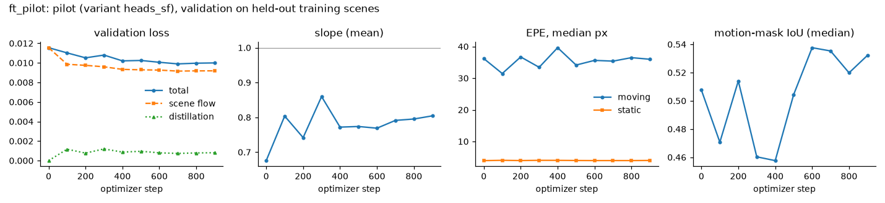

**ft_pilot_summary.md**

# ft_pilot

Pilot run to choose the number of fine-tuning steps (variant heads_sf = five-head LoRA + scene-flow head, the largest variant).

- Validation every 100 steps on 38 held-out training scenes (10%, never used for gradients).
- Validation loss 0.0116 at step 0, minimum 0.0099 at step 700; 90% of the reduction reached at step 600.
- Speed: 5.36 s per optimizer step (2 samples of 7 views).
- Chosen max_steps for every variant: **1200** (rule: 2 x step-at-90%, rounded up to 100, within [400, 2500] and 3 h). Each run still early-stops on its own validation loss.

| step | loss | slope | EPE moving | EPE static | mask IoU |
|---|---|---|---|---|---|
| 0 | 0.0116 | 0.676 | 36.2 | 3.94 | 0.508 |
| 100 | 0.0110 | 0.804 | 31.5 | 4.04 | 0.471 |
| 200 | 0.0105 | 0.742 | 36.7 | 3.96 | 0.514 |
| 300 | 0.0108 | 0.860 | 33.4 | 4.04 | 0.460 |
| 400 | 0.0102 | 0.772 | 39.6 | 4.03 | 0.458 |
| 500 | 0.0102 | 0.774 | 34.2 | 3.98 | 0.504 |
| 600 | 0.0101 | 0.769 | 35.6 | 3.96 | 0.538 |
| 700 | 0.0099 | 0.791 | 35.4 | 3.96 | 0.535 |
| 800 | 0.0100 | 0.795 | 36.5 | 3.96 | 0.520 |
| 900 | 0.0100 | 0.804 | 36.0 | 3.99 | 0.532 |

## ft_train_heads

Item 10: fine-tune (a) LoRA r8 on the five supply heads' slices

Status: **done**, attempt 1, started 2026-10-17 11:42:06, finished 2026-10-17 12:09:15. [Raw results](../results/queue/ft_train_heads/), [log](../results/queue/ft_train_heads/task.log).

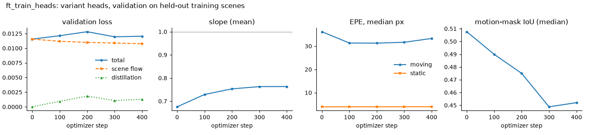

**ft_train_heads_summary.md**

# ft_train_heads

Fine-tuning variant **heads** of Any4D from any4d_4v_combined.pth.

- Trainable parameters: 71,680; heads: [[2, 1], [22, 9], [17, 10], [14, 6], [8, 11]]; LoRA rank 8, alpha 16.
- Learning rates: LoRA 0.0002, scene-flow head 2e-05, gain 0.005; AdamW, warmup 100, cosine to 10%; bf16, activation checkpointing.
- Loss: Any4D scene-flow loss (scale-invariant, log-norm, x10.0 on moving pixels) + 1.0 x distillation to the frozen model (pointmaps, depth, pose, metric scale).
- Stopped: early stop at step 400 (best 0). Best validation step: 0. Merge check (adapter vs merged weights): {'d_sf': 0.0, 'd_pts': 0.0}.

| validation (held-out training scenes, frames 0 to 23) | step 0 (base) | best step |
|---|---|---|
| loss | 0.0116 | 0.0116 |
| slope (mean) | 0.6757 | 0.6757 |
| EPE moving (median px) | 36.1928 | 36.1928 |
| EPE static (median px) | 3.9417 | 3.9417 |
| motion-mask IoU (median) | 0.5076 | 0.5076 |

These are training-distribution numbers; the held-out evaluation is in the matching ft_eval task.

## ft_eval_heads

Item 10: evaluate fine-tune (a) LoRA r8 on the five supply heads' slices

Status: **done**, attempt 1, started 2026-10-17 12:09:24, finished 2026-10-17 12:24:03. [Raw results](../results/queue/ft_eval_heads/), [log](../results/queue/ft_eval_heads/task.log).

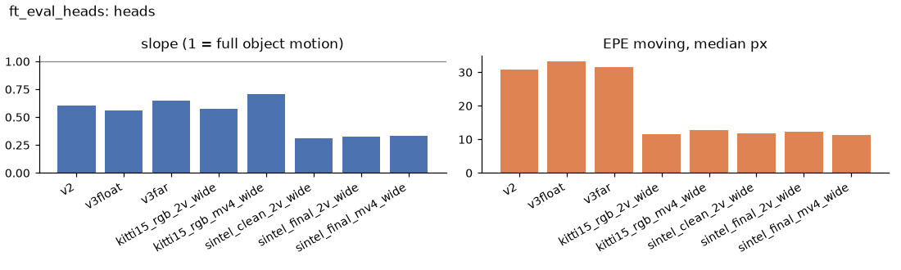

**ft_eval_heads_summary.md**

# ft_eval_heads

Evaluation of **heads** with the round-1 metric code (output metrics: e5_causal / e5_step3 definitions).

| dataset | n | slope (mean) | EPE static (median of scenes) | EPE moving | sep ratio (median) | mask IoU | mask IoU, epi_aligned |
|---|---|---|---|---|---|---|---|
| v2 | 100 | 0.607 | 3.82 | 30.7 | 0.735 | 0.644 | 0.532 |
| v3float | 69 | 0.559 | 4.02 | 33.2 | 0.657 | 0.496 | 0.278 |
| v3far | 19 | 0.648 | 4.38 | 31.6 | 0.566 | 0.663 | nan |
| kitti15_rgb_2v_wide | 200 | 0.575 | 3.67 | 11.6 | 0.740 | - | - |
| kitti15_rgb_mv4_wide | 200 | 0.707 | 4.26 | 12.7 | 1.086 | - | - |
| sintel_clean_2v_wide | 256 | 0.314 | 3.98 | 11.9 | 0.539 | - | - |
| sintel_final_2v_wide | 256 | 0.327 | 4.30 | 12.2 | 0.510 | - | - |
| sintel_final_mv4_wide | 256 | 0.334 | 4.13 | 11.3 | 0.458 | - | - |

Internal motion decodability (view-0 linear probe, 5-fold by scene, floating set):

| layer | motion AUC, all splits | motion AUC, epi_aligned |
|---|---|---|
| 0 | 0.569 | 0.515 |
| 17 | 0.843 | 0.905 |
| 24 | 0.973 | 0.999 |

## ft_train_ctrl

Item 10: fine-tune (d) control: LoRA r8 on 5 matched random heads

Status: **done**, attempt 1, started 2026-10-17 12:24:13, finished 2026-10-17 12:51:22. [Raw results](../results/queue/ft_train_ctrl/), [log](../results/queue/ft_train_ctrl/task.log).

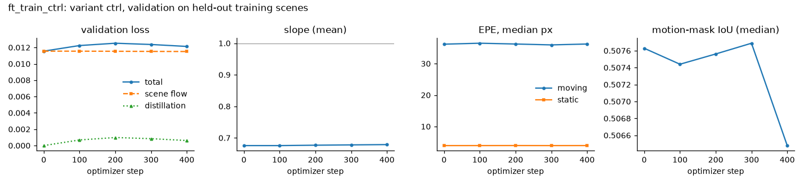

**ft_train_ctrl_summary.md**

# ft_train_ctrl

Fine-tuning variant **ctrl** of Any4D from any4d_4v_combined.pth.

- Trainable parameters: 71,680; heads: [[2, 9], [22, 11], [17, 2], [14, 2], [8, 8]]; LoRA rank 8, alpha 16.
- Learning rates: LoRA 0.0002, scene-flow head 2e-05, gain 0.005; AdamW, warmup 100, cosine to 10%; bf16, activation checkpointing.
- Loss: Any4D scene-flow loss (scale-invariant, log-norm, x10.0 on moving pixels) + 1.0 x distillation to the frozen model (pointmaps, depth, pose, metric scale).
- Stopped: early stop at step 400 (best 0). Best validation step: 0. Merge check (adapter vs merged weights): {'d_sf': 0.0, 'd_pts': 0.0}.

| validation (held-out training scenes, frames 0 to 23) | step 0 (base) | best step |
|---|---|---|
| loss | 0.0116 | 0.0116 |
| slope (mean) | 0.6757 | 0.6757 |
| EPE moving (median px) | 36.1928 | 36.1928 |
| EPE static (median px) | 3.9417 | 3.9417 |
| motion-mask IoU (median) | 0.5076 | 0.5076 |

These are training-distribution numbers; the held-out evaluation is in the matching ft_eval task.

## ft_eval_ctrl

Item 10: evaluate fine-tune (d) control: LoRA r8 on 5 matched random heads

Status: **done**, attempt 1, started 2026-10-17 12:51:31, finished 2026-10-17 13:06:10. [Raw results](../results/queue/ft_eval_ctrl/), [log](../results/queue/ft_eval_ctrl/task.log).

**ft_eval_ctrl_summary.md**

# ft_eval_ctrl

Evaluation of **ctrl** with the round-1 metric code (output metrics: e5_causal / e5_step3 definitions).

| dataset | n | slope (mean) | EPE static (median of scenes) | EPE moving | sep ratio (median) | mask IoU | mask IoU, epi_aligned |
|---|---|---|---|---|---|---|---|
| v2 | 100 | 0.607 | 3.82 | 30.7 | 0.735 | 0.644 | 0.532 |
| v3float | 69 | 0.559 | 4.02 | 33.2 | 0.657 | 0.496 | 0.278 |
| v3far | 19 | 0.648 | 4.38 | 31.6 | 0.566 | 0.663 | nan |
| kitti15_rgb_2v_wide | 200 | 0.575 | 3.67 | 11.6 | 0.740 | - | - |
| kitti15_rgb_mv4_wide | 200 | 0.707 | 4.26 | 12.7 | 1.086 | - | - |
| sintel_clean_2v_wide | 256 | 0.314 | 3.98 | 11.9 | 0.539 | - | - |
| sintel_final_2v_wide | 256 | 0.327 | 4.30 | 12.2 | 0.510 | - | - |
| sintel_final_mv4_wide | 256 | 0.334 | 4.13 | 11.3 | 0.458 | - | - |

Internal motion decodability (view-0 linear probe, 5-fold by scene, floating set):

| layer | motion AUC, all splits | motion AUC, epi_aligned |
|---|---|---|
| 0 | 0.569 | 0.515 |
| 17 | 0.843 | 0.905 |
| 24 | 0.973 | 0.999 |

## ft_train_sf

Item 10: fine-tune (b) scene-flow DPT head + adaptor

Status: **done**, attempt 1, started 2026-10-17 13:06:18, finished 2026-10-17 13:46:58. [Raw results](../results/queue/ft_train_sf/), [log](../results/queue/ft_train_sf/task.log).

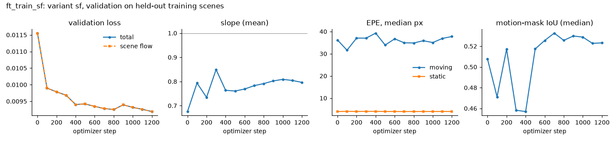

**ft_train_sf_summary.md**

# ft_train_sf

Fine-tuning variant **sf** of Any4D from any4d_4v_combined.pth.

- Trainable parameters: 19,021,379; heads: none (scene-flow head only); LoRA rank 8, alpha 16.
- Learning rates: LoRA 0.0002, scene-flow head 2e-05, gain 0.005; AdamW, warmup 100, cosine to 10%; bf16, activation checkpointing.
- Loss: Any4D scene-flow loss (scale-invariant, log-norm, x10.0 on moving pixels) (no distillation needed: transformer and geometry heads are frozen).
- Stopped: max_steps 1200. Best validation step: 1200. Merge check (adapter vs merged weights): {'d_sf': 0.0, 'd_pts': 0.0}.

| validation (held-out training scenes, frames 0 to 23) | step 0 (base) | best step |
|---|---|---|
| loss | 0.0116 | 0.0092 |
| slope (mean) | 0.6757 | 0.7964 |
| EPE moving (median px) | 36.1928 | 37.7783 |
| EPE static (median px) | 3.9417 | 3.9732 |
| motion-mask IoU (median) | 0.5076 | 0.5232 |

These are training-distribution numbers; the held-out evaluation is in the matching ft_eval task.

## ft_eval_sf

Item 10: evaluate fine-tune (b) scene-flow DPT head + adaptor

Status: **done**, attempt 1, started 2026-10-17 13:47:07, finished 2026-10-17 14:01:16. [Raw results](../results/queue/ft_eval_sf/), [log](../results/queue/ft_eval_sf/task.log).

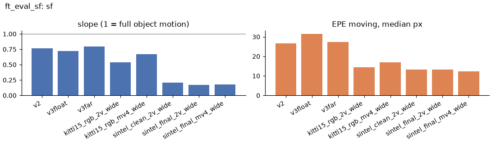

**ft_eval_sf_summary.md**

# ft_eval_sf

Evaluation of **sf** with the round-1 metric code (output metrics: e5_causal / e5_step3 definitions).

| dataset | n | slope (mean) | EPE static (median of scenes) | EPE moving | sep ratio (median) | mask IoU | mask IoU, epi_aligned |
|---|---|---|---|---|---|---|---|
| v2 | 100 | 0.767 | 3.82 | 26.7 | 0.737 | 0.561 | 0.464 |
| v3float | 69 | 0.724 | 4.08 | 31.5 | 0.814 | 0.537 | 0.323 |
| v3far | 19 | 0.797 | 4.49 | 27.4 | 0.513 | 0.589 | nan |
| kitti15_rgb_2v_wide | 200 | 0.542 | 3.54 | 14.5 | 0.670 | - | - |
| kitti15_rgb_mv4_wide | 200 | 0.672 | 4.03 | 17.0 | 0.610 | - | - |
| sintel_clean_2v_wide | 256 | 0.211 | 3.76 | 13.4 | 0.430 | - | - |
| sintel_final_2v_wide | 256 | 0.171 | 4.20 | 13.3 | 0.539 | - | - |
| sintel_final_mv4_wide | 256 | 0.180 | 4.08 | 12.3 | 0.456 | - | - |

Internal motion decodability (view-0 linear probe, 5-fold by scene, floating set):

| layer | motion AUC, all splits | motion AUC, epi_aligned |
|---|---|---|
| 0 | 0.569 | 0.515 |
| 17 | 0.843 | 0.905 |
| 24 | 0.973 | 0.999 |

## ft_train_heads_sf

Item 10: fine-tune (c) five-head LoRA + scene-flow head

Status: **done**, attempt 1, started 2026-10-17 14:01:26, finished 2026-10-17 15:24:46. [Raw results](../results/queue/ft_train_heads_sf/), [log](../results/queue/ft_train_heads_sf/task.log).

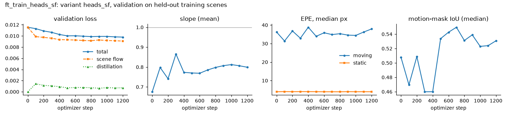

**ft_train_heads_sf_summary.md**

# ft_train_heads_sf

Fine-tuning variant **heads_sf** of Any4D from any4d_4v_combined.pth.

- Trainable parameters: 19,093,059; heads: [[2, 1], [22, 9], [17, 10], [14, 6], [8, 11]]; LoRA rank 8, alpha 16.
- Learning rates: LoRA 0.0002, scene-flow head 2e-05, gain 0.005; AdamW, warmup 100, cosine to 10%; bf16, activation checkpointing.
- Loss: Any4D scene-flow loss (scale-invariant, log-norm, x10.0 on moving pixels) + 1.0 x distillation to the frozen model (pointmaps, depth, pose, metric scale).
- Stopped: max_steps 1200. Best validation step: 1200. Merge check (adapter vs merged weights): {'d_sf': 0.0011048614978790283, 'd_pts': 0.008114814758300781}.

| validation (held-out training scenes, frames 0 to 23) | step 0 (base) | best step |
|---|---|---|
| loss | 0.0116 | 0.0098 |
| slope (mean) | 0.6757 | 0.7991 |
| EPE moving (median px) | 36.1928 | 37.8953 |
| EPE static (median px) | 3.9417 | 3.9488 |
| motion-mask IoU (median) | 0.5076 | 0.5308 |

These are training-distribution numbers; the held-out evaluation is in the matching ft_eval task.

## ft_eval_heads_sf

Item 10: evaluate fine-tune (c) five-head LoRA + scene-flow head

Status: **done**, attempt 1, started 2026-10-17 15:24:57, finished 2026-10-17 15:39:05. [Raw results](../results/queue/ft_eval_heads_sf/), [log](../results/queue/ft_eval_heads_sf/task.log).

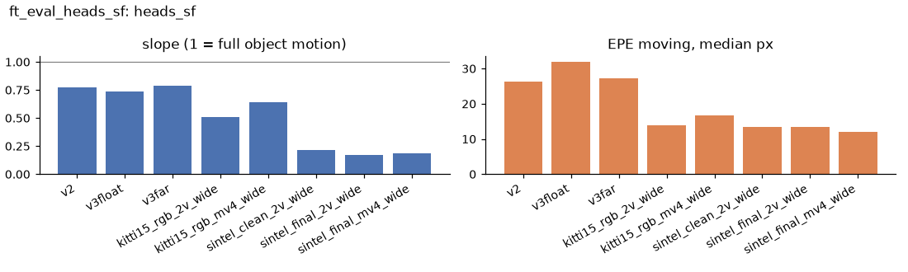

**ft_eval_heads_sf_summary.md**

# ft_eval_heads_sf

Evaluation of **heads_sf** with the round-1 metric code (output metrics: e5_causal / e5_step3 definitions).

| dataset | n | slope (mean) | EPE static (median of scenes) | EPE moving | sep ratio (median) | mask IoU | mask IoU, epi_aligned |
|---|---|---|---|---|---|---|---|
| v2 | 100 | 0.776 | 3.82 | 26.4 | 0.759 | 0.560 | 0.439 |
| v3float | 69 | 0.735 | 4.06 | 31.9 | 0.806 | 0.534 | 0.364 |
| v3far | 19 | 0.790 | 4.51 | 27.2 | 0.360 | 0.595 | nan |
| kitti15_rgb_2v_wide | 200 | 0.512 | 3.53 | 13.9 | 0.638 | - | - |
| kitti15_rgb_mv4_wide | 200 | 0.642 | 3.98 | 16.6 | 0.738 | - | - |
| sintel_clean_2v_wide | 256 | 0.217 | 3.76 | 13.4 | 0.435 | - | - |
| sintel_final_2v_wide | 256 | 0.173 | 4.21 | 13.4 | 0.528 | - | - |
| sintel_final_mv4_wide | 256 | 0.186 | 4.07 | 12.1 | 0.468 | - | - |

Internal motion decodability (view-0 linear probe, 5-fold by scene, floating set):

| layer | motion AUC, all splits | motion AUC, epi_aligned |
|---|---|---|
| 0 | 0.569 | 0.515 |
| 17 | 0.846 | 0.907 |
| 24 | 0.973 | 0.999 |

## ft_train_gain

Item 10: fine-tune (e) 5 learned per-head gains

Status: **done**, attempt 1, started 2026-10-17 15:39:16, finished 2026-10-17 16:06:25. [Raw results](../results/queue/ft_train_gain/), [log](../results/queue/ft_train_gain/task.log).

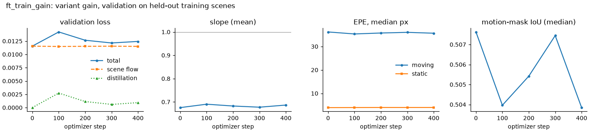

**ft_train_gain_summary.md**

# ft_train_gain

Fine-tuning variant **gain** of Any4D from any4d_4v_combined.pth.

- Trainable parameters: 5; heads: [[2, 1], [22, 9], [17, 10], [14, 6], [8, 11]]; LoRA rank 8, alpha 16.
- Learning rates: LoRA 0.0002, scene-flow head 2e-05, gain 0.005; AdamW, warmup 100, cosine to 10%; bf16, activation checkpointing.
- Loss: Any4D scene-flow loss (scale-invariant, log-norm, x10.0 on moving pixels) + 1.0 x distillation to the frozen model (pointmaps, depth, pose, metric scale).
- Stopped: early stop at step 400 (best 0). Best validation step: 0. Merge check (adapter vs merged weights): {'d_sf': 0.0, 'd_pts': 0.0}.

| validation (held-out training scenes, frames 0 to 23) | step 0 (base) | best step |
|---|---|---|
| loss | 0.0116 | 0.0116 |
| slope (mean) | 0.6757 | 0.6757 |
| EPE moving (median px) | 36.1928 | 36.1928 |
| EPE static (median px) | 3.9417 | 3.9417 |
| motion-mask IoU (median) | 0.5076 | 0.5076 |

These are training-distribution numbers; the held-out evaluation is in the matching ft_eval task.

## ft_eval_gain

Item 10: evaluate fine-tune (e) 5 learned per-head gains

Status: **done**, attempt 1, started 2026-10-17 16:06:35, finished 2026-10-17 16:21:13. [Raw results](../results/queue/ft_eval_gain/), [log](../results/queue/ft_eval_gain/task.log).

**ft_eval_gain_summary.md**

# ft_eval_gain

Evaluation of **gain** with the round-1 metric code (output metrics: e5_causal / e5_step3 definitions).

| dataset | n | slope (mean) | EPE static (median of scenes) | EPE moving | sep ratio (median) | mask IoU | mask IoU, epi_aligned |
|---|---|---|---|---|---|---|---|
| v2 | 100 | 0.607 | 3.82 | 30.7 | 0.735 | 0.644 | 0.532 |
| v3float | 69 | 0.559 | 4.02 | 33.2 | 0.657 | 0.496 | 0.278 |
| v3far | 19 | 0.648 | 4.38 | 31.6 | 0.566 | 0.663 | nan |
| kitti15_rgb_2v_wide | 200 | 0.575 | 3.67 | 11.6 | 0.740 | - | - |
| kitti15_rgb_mv4_wide | 200 | 0.707 | 4.26 | 12.7 | 1.086 | - | - |
| sintel_clean_2v_wide | 256 | 0.314 | 3.98 | 11.9 | 0.539 | - | - |
| sintel_final_2v_wide | 256 | 0.327 | 4.30 | 12.2 | 0.510 | - | - |
| sintel_final_mv4_wide | 256 | 0.334 | 4.13 | 11.3 | 0.458 | - | - |

Internal motion decodability (view-0 linear probe, 5-fold by scene, floating set):

| layer | motion AUC, all splits | motion AUC, epi_aligned |
|---|---|---|
| 0 | 0.569 | 0.515 |
| 17 | 0.843 | 0.905 |
| 24 | 0.973 | 0.999 |

## ft_summary

Item 10: comparison table and figure (base vs variants; a vs d head specificity; transfer; decodability gap)

Status: **done**, attempt 1, started 2026-10-17 16:21:23, finished 2026-10-17 16:21:33. [Raw results](../results/queue/ft_summary/), [log](../results/queue/ft_summary/task.log).

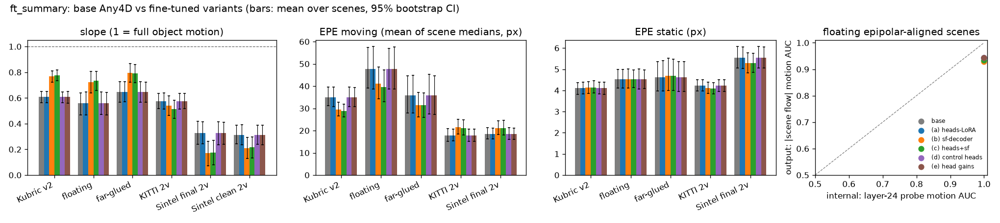

**ft_summary_summary.md**

# ft_summary: item 10, head-targeted and decoder-side fine-tuning of Any4D

Each cell: mean over scenes (EPE: mean of per-scene medians, px), then in brackets the paired change vs base with a bootstrap 95% CI over scenes and the two-sided paired sign-test p. Lower is better for EPE and geometry errors.

| dataset | metric | base | (a) heads-LoRA | (b) sf-decoder | (c) heads+sf | (d) control heads | (e) head gains |
|---|---|---|---|---|---|---|---|
| v2 | slope | 0.607 | 0.607 (+0.000 [+0.000, +0.000], p=nan) | 0.767 (+0.160 [+0.134, +0.187], p=9.9e-17) | 0.776 (+0.169 [+0.143, +0.197], p=8.1e-16) | 0.607 (+0.000 [+0.000, +0.000], p=nan) | 0.607 (+0.000 [+0.000, +0.000], p=nan) |
| v2 | epe_static | 4.100 | 4.100 (+0.000 [+0.000, +0.000], p=nan) | 4.136 (+0.035 [+0.019, +0.052], p=0.0035) | 4.136 (+0.036 [+0.020, +0.053], p=7.9e-05) | 4.100 (+0.000 [+0.000, +0.000], p=nan) | 4.100 (+0.000 [+0.000, +0.000], p=nan) |
| v2 | epe_moving | 35.0 | 35.0 (+0.000 [+0.000, +0.000], p=nan) | 29.5 (-5.412 [-8.399, -2.632], p=0.011) | 28.9 (-6.075 [-9.302, -3.100], p=0.011) | 35.0 (+0.000 [+0.000, +0.000], p=nan) | 35.0 (+0.000 [+0.000, +0.000], p=nan) |
| v2 | sep_ratio | 0.825 | 0.825 (+0.000 [+0.000, +0.000], p=nan) | 0.828 (+0.003 [-0.092, +0.103], p=0.4) | 0.826 (+0.002 [-0.078, +0.088], p=0.67) | 0.825 (+0.000 [+0.000, +0.000], p=nan) | 0.825 (+0.000 [+0.000, +0.000], p=nan) |
| v2 | mask_iou | 0.591 | 0.591 (+0.000 [+0.000, +0.000], p=nan) | 0.544 (-0.047 [-0.066, -0.027], p=3.1e-07) | 0.544 (-0.047 [-0.065, -0.027], p=9.4e-08) | 0.591 (+0.000 [+0.000, +0.000], p=nan) | 0.591 (+0.000 [+0.000, +0.000], p=nan) |
| v2_epi | mask_iou | 0.486 | 0.486 (+0.000 [+0.000, +0.000], p=nan) | 0.424 (-0.062 [-0.135, +0.010], p=0.18) | 0.419 (-0.066 [-0.141, +0.012], p=0.18) | 0.486 (+0.000 [+0.000, +0.000], p=nan) | 0.486 (+0.000 [+0.000, +0.000], p=nan) |
| v3float | slope | 0.559 | 0.559 (+0.000 [+0.000, +0.000], p=nan) | 0.724 (+0.165 [+0.127, +0.207], p=3.2e-10) | 0.735 (+0.177 [+0.135, +0.219], p=5e-12) | 0.559 (+0.000 [+0.000, +0.000], p=nan) | 0.559 (+0.000 [+0.000, +0.000], p=nan) |
| v3float | epe_static | 4.517 | 4.517 (+0.000 [+0.000, +0.000], p=nan) | 4.527 (+0.009 [-0.028, +0.042], p=0.053) | 4.534 (+0.017 [-0.023, +0.049], p=0.0016) | 4.517 (+0.000 [+0.000, +0.000], p=nan) | 4.517 (+0.000 [+0.000, +0.000], p=nan) |
| v3float | epe_moving | 47.7 | 47.7 (+0.000 [+0.000, +0.000], p=nan) | 41.1 (-6.633 [-12.691, -1.033], p=0.46) | 39.5 (-8.169 [-14.659, -2.264], p=0.14) | 47.7 (+0.000 [+0.000, +0.000], p=nan) | 47.7 (+0.000 [+0.000, +0.000], p=nan) |
| v3float | sep_ratio | 0.727 | 0.727 (+0.000 [+0.000, +0.000], p=nan) | 0.858 (+0.132 [-0.022, +0.291], p=0.26) | 0.835 (+0.109 [-0.049, +0.248], p=0.14) | 0.727 (+0.000 [+0.000, +0.000], p=nan) | 0.727 (+0.000 [+0.000, +0.000], p=nan) |
| v3float | mask_iou | 0.453 | 0.453 (+0.000 [+0.000, +0.000], p=nan) | 0.463 (+0.011 [-0.013, +0.036], p=0.53) | 0.471 (+0.018 [-0.009, +0.048], p=1) | 0.453 (+0.000 [+0.000, +0.000], p=nan) | 0.453 (+0.000 [+0.000, +0.000], p=nan) |
| v3float_epi | mask_iou | 0.312 | 0.312 (+0.000 [+0.000, +0.000], p=nan) | 0.346 (+0.034 [-0.006, +0.080], p=0.56) | 0.358 (+0.046 [-0.000, +0.103], p=0.33) | 0.312 (+0.000 [+0.000, +0.000], p=nan) | 0.312 (+0.000 [+0.000, +0.000], p=nan) |
| v3float_epi | mask_auc | 0.943 | 0.943 (+0.000 [+0.000, +0.000], p=nan) | 0.929 (-0.014 [-0.065, +0.018], p=0.036) | 0.934 (-0.010 [-0.060, +0.023], p=0.036) | 0.943 (+0.000 [+0.000, +0.000], p=nan) | 0.943 (+0.000 [+0.000, +0.000], p=nan) |
| v3far | slope | 0.648 | 0.648 (+0.000 [+0.000, +0.000], p=nan) | 0.797 (+0.149 [+0.094, +0.209], p=0.00073) | 0.790 (+0.142 [+0.092, +0.199], p=0.00073) | 0.648 (+0.000 [+0.000, +0.000], p=nan) | 0.648 (+0.000 [+0.000, +0.000], p=nan) |
| v3far | epe_moving | 35.8 | 35.8 (+0.000 [+0.000, +0.000], p=nan) | 31.4 (-4.409 [-9.149, -0.272], p=0.65) | 31.5 (-4.314 [-9.277, +0.337], p=0.65) | 35.8 (+0.000 [+0.000, +0.000], p=nan) | 35.8 (+0.000 [+0.000, +0.000], p=nan) |
| v3far | sep_ratio | 0.855 | 0.855 (+0.000 [+0.000, +0.000], p=nan) | 0.686 (-0.169 [-0.416, +0.048], p=0.65) | 0.691 (-0.163 [-0.376, +0.037], p=1) | 0.855 (+0.000 [+0.000, +0.000], p=nan) | 0.855 (+0.000 [+0.000, +0.000], p=nan) |
| v2 | depth_absrel_med | 0.020 | 0.020 (+0.000 [+0.000, +0.000], p=nan) | 0.020 (+0.000 [+0.000, +0.000], p=nan) | 0.020 (-0.000 [-0.000, +0.000], p=0.62) | 0.020 (+0.000 [+0.000, +0.000], p=nan) | 0.020 (+0.000 [+0.000, +0.000], p=nan) |
| v2 | rot_err_deg | 0.604 | 0.604 (+0.000 [+0.000, +0.000], p=nan) | 0.604 (+0.000 [+0.000, +0.000], p=nan) | 0.603 (-0.000 [-0.001, +0.000], p=0.76) | 0.604 (+0.000 [+0.000, +0.000], p=nan) | 0.604 (+0.000 [+0.000, +0.000], p=nan) |
| v2 | trans_relerr_med | 0.045 | 0.045 (+0.000 [+0.000, +0.000], p=nan) | 0.045 (+0.000 [+0.000, +0.000], p=nan) | 0.045 (-0.000 [-0.000, +0.000], p=0.75) | 0.045 (+0.000 [+0.000, +0.000], p=nan) | 0.045 (+0.000 [+0.000, +0.000], p=nan) |
| kitti15_rgb_2v_wide | slope | 0.575 | 0.575 (+0.000 [+0.000, +0.000], p=nan) | 0.542 (-0.034 [-0.079, +0.013], p=1.5e-05) | 0.512 (-0.063 [-0.105, -0.021], p=1.8e-07) | 0.575 (+0.000 [+0.000, +0.000], p=nan) | 0.575 (+0.000 [+0.000, +0.000], p=nan) |
| kitti15_rgb_2v_wide | epe_static | 4.232 | 4.232 (+0.000 [+0.000, +0.000], p=nan) | 4.119 (-0.113 [-0.144, -0.081], p=2.5e-12) | 4.089 (-0.142 [-0.172, -0.112], p=8.3e-19) | 4.232 (+0.000 [+0.000, +0.000], p=nan) | 4.232 (+0.000 [+0.000, +0.000], p=nan) |
| kitti15_rgb_2v_wide | epe_moving | 17.8 | 17.8 (+0.000 [+0.000, +0.000], p=nan) | 21.6 (+3.822 [+2.587, +5.099], p=1.5e-08) | 21.2 (+3.424 [+2.290, +4.621], p=8.1e-08) | 17.8 (+0.000 [+0.000, +0.000], p=nan) | 17.8 (+0.000 [+0.000, +0.000], p=nan) |
| kitti15_rgb_mv4_wide | slope | 0.707 | 0.707 (+0.000 [+0.000, +0.000], p=nan) | 0.672 (-0.035 [-0.095, +0.021], p=0.00094) | 0.642 (-0.064 [-0.118, -0.011], p=5.4e-05) | 0.707 (+0.000 [+0.000, +0.000], p=nan) | 0.707 (+0.000 [+0.000, +0.000], p=nan) |
| sintel_final_2v_wide | slope | 0.327 | 0.327 (+0.000 [+0.000, +0.000], p=nan) | 0.171 (-0.156 [-0.219, -0.091], p=1.4e-09) | 0.173 (-0.153 [-0.220, -0.089], p=7.7e-09) | 0.327 (+0.000 [+0.000, +0.000], p=nan) | 0.327 (+0.000 [+0.000, +0.000], p=nan) |
| sintel_final_2v_wide | epe_moving | 18.5 | 18.5 (+0.000 [+0.000, +0.000], p=nan) | 21.1 (+2.587 [+1.397, +3.926], p=4.2e-05) | 21.1 (+2.580 [+1.407, +3.934], p=7.5e-05) | 18.5 (+0.000 [+0.000, +0.000], p=nan) | 18.5 (+0.000 [+0.000, +0.000], p=nan) |
| sintel_final_2v_wide | sep_ratio | 0.692 | 0.692 (+0.000 [+0.000, +0.000], p=nan) | 0.716 (+0.024 [-0.073, +0.122], p=0.67) | 0.712 (+0.020 [-0.073, +0.112], p=0.8) | 0.692 (+0.000 [+0.000, +0.000], p=nan) | 0.692 (+0.000 [+0.000, +0.000], p=nan) |
| sintel_final_mv4_wide | slope | 0.334 | 0.334 (+0.000 [+0.000, +0.000], p=nan) | 0.180 (-0.154 [-0.219, -0.096], p=3.3e-09) | 0.186 (-0.148 [-0.215, -0.087], p=1.8e-08) | 0.334 (+0.000 [+0.000, +0.000], p=nan) | 0.334 (+0.000 [+0.000, +0.000], p=nan) |
| sintel_clean_2v_wide | slope | 0.314 | 0.314 (+0.000 [+0.000, +0.000], p=nan) | 0.211 (-0.103 [-0.143, -0.060], p=1.4e-09) | 0.217 (-0.096 [-0.139, -0.052], p=1.8e-08) | 0.314 (+0.000 [+0.000, +0.000], p=nan) | 0.314 (+0.000 [+0.000, +0.000], p=nan) |
| probe_epi | motion_auc_v0_objects_L24 | 0.999 | 0.999 (+0.000 [+0.000, +0.000], p=nan) | 0.999 (+0.000 [+0.000, +0.000], p=nan) | 0.999 (-0.000 [-0.000, +0.000], p=1) | 0.999 (+0.000 [+0.000, +0.000], p=nan) | 0.999 (+0.000 [+0.000, +0.000], p=nan) |
| probe | motion_auc_v0_objects_L24 | 0.973 | 0.973 (+0.000 [+0.000, +0.000], p=nan) | 0.973 (+0.000 [+0.000, +0.000], p=nan) | 0.973 (+0.000 [-0.001, +0.001], p=1) | 0.973 (+0.000 [+0.000, +0.000], p=nan) | 0.973 (+0.000 [+0.000, +0.000], p=nan) |

## Are the gains specific to the five heads? (paired vs the matched control heads, variant d)

| dataset | metric | (a) heads-LoRA vs (d) | (c) heads+sf vs (d) |
|---|---|---|---|
| v2 | slope | 0.607 (+0.000 [+0.000, +0.000], p=nan) | 0.776 (+0.169 [+0.142, +0.197], p=8.1e-16) |
| v2 | epe_static | 4.100 (+0.000 [+0.000, +0.000], p=nan) | 4.136 (+0.036 [+0.019, +0.054], p=7.9e-05) |
| v2 | epe_moving | 35.0 (+0.000 [+0.000, +0.000], p=nan) | 28.9 (-6.075 [-9.379, -3.165], p=0.011) |
| v2 | sep_ratio | 0.825 (+0.000 [+0.000, +0.000], p=nan) | 0.826 (+0.002 [-0.075, +0.082], p=0.67) |
| v2 | mask_iou | 0.591 (+0.000 [+0.000, +0.000], p=nan) | 0.544 (-0.047 [-0.065, -0.027], p=9.4e-08) |
| v2_epi | mask_iou | 0.486 (+0.000 [+0.000, +0.000], p=nan) | 0.419 (-0.066 [-0.138, +0.011], p=0.18) |
| v3float | slope | 0.559 (+0.000 [+0.000, +0.000], p=nan) | 0.735 (+0.177 [+0.137, +0.219], p=5e-12) |
| v3float | epe_static | 4.517 (+0.000 [+0.000, +0.000], p=nan) | 4.534 (+0.017 [-0.023, +0.048], p=0.0016) |
| v3float | epe_moving | 47.7 (+0.000 [+0.000, +0.000], p=nan) | 39.5 (-8.169 [-14.563, -2.120], p=0.14) |
| v3float | sep_ratio | 0.727 (+0.000 [+0.000, +0.000], p=nan) | 0.835 (+0.109 [-0.042, +0.258], p=0.14) |
| v3float | mask_iou | 0.453 (+0.000 [+0.000, +0.000], p=nan) | 0.471 (+0.018 [-0.008, +0.047], p=1) |
| v3float_epi | mask_iou | 0.312 (+0.000 [+0.000, +0.000], p=nan) | 0.358 (+0.046 [-0.002, +0.100], p=0.33) |
| v3float_epi | mask_auc | 0.943 (+0.000 [+0.000, +0.000], p=nan) | 0.934 (-0.010 [-0.062, +0.022], p=0.036) |
| v3far | slope | 0.648 (+0.000 [+0.000, +0.000], p=nan) | 0.790 (+0.142 [+0.093, +0.197], p=0.00073) |
| v3far | epe_moving | 35.8 (+0.000 [+0.000, +0.000], p=nan) | 31.5 (-4.314 [-9.476, +0.103], p=0.65) |
| v3far | sep_ratio | 0.855 (+0.000 [+0.000, +0.000], p=nan) | 0.691 (-0.163 [-0.370, +0.055], p=1) |
| kitti15_rgb_2v_wide | slope | 0.575 (+0.000 [+0.000, +0.000], p=nan) | 0.512 (-0.063 [-0.105, -0.021], p=1.8e-07) |
| kitti15_rgb_2v_wide | epe_static | 4.232 (+0.000 [+0.000, +0.000], p=nan) | 4.089 (-0.142 [-0.172, -0.114], p=8.3e-19) |
| kitti15_rgb_2v_wide | epe_moving | 17.8 (+0.000 [+0.000, +0.000], p=nan) | 21.2 (+3.424 [+2.238, +4.699], p=8.1e-08) |
| kitti15_rgb_mv4_wide | slope | 0.707 (+0.000 [+0.000, +0.000], p=nan) | 0.642 (-0.064 [-0.116, -0.010], p=5.4e-05) |
| sintel_final_2v_wide | slope | 0.327 (+0.000 [+0.000, +0.000], p=nan) | 0.173 (-0.153 [-0.219, -0.087], p=7.7e-09) |
| sintel_final_2v_wide | epe_moving | 18.5 (+0.000 [+0.000, +0.000], p=nan) | 21.1 (+2.580 [+1.387, +4.006], p=7.5e-05) |
| sintel_final_2v_wide | sep_ratio | 0.692 (+0.000 [+0.000, +0.000], p=nan) | 0.712 (+0.020 [-0.069, +0.106], p=0.8) |
| sintel_final_mv4_wide | slope | 0.334 (+0.000 [+0.000, +0.000], p=nan) | 0.186 (-0.148 [-0.212, -0.086], p=1.8e-08) |
| sintel_clean_2v_wide | slope | 0.314 (+0.000 [+0.000, +0.000], p=nan) | 0.217 (-0.096 [-0.139, -0.053], p=1.8e-08) |

## Questions

- Largest Kubric v2 slope: (c) heads+sf (0.776 vs base 0.607); moving EPE 28.9 vs 35.0 px; static EPE 4.14 vs 4.10 px.
- (a) heads-LoRA: KITTI 2-view slope change +0.000 (p=nan), Sintel final 2-view +0.000 (p=nan); floating epi mask IoU 0.312 (base 0.312), layer-24 probe AUC on the same scenes 0.999.
- (b) sf-decoder: KITTI 2-view slope change -0.034 (p=1.5e-05), Sintel final 2-view -0.156 (p=1.4e-09); floating epi mask IoU 0.346 (base 0.312), layer-24 probe AUC on the same scenes 0.999.
- (c) heads+sf: KITTI 2-view slope change -0.063 (p=1.8e-07), Sintel final 2-view -0.153 (p=7.7e-09); floating epi mask IoU 0.358 (base 0.312), layer-24 probe AUC on the same scenes 0.999.
- (d) control heads: KITTI 2-view slope change +0.000 (p=nan), Sintel final 2-view +0.000 (p=nan); floating epi mask IoU 0.312 (base 0.312), layer-24 probe AUC on the same scenes 0.999.
- (e) head gains: KITTI 2-view slope change +0.000 (p=nan), Sintel final 2-view +0.000 (p=nan); floating epi mask IoU 0.312 (base 0.312), layer-24 probe AUC on the same scenes 0.999.

Automatic text above only reports numbers; interpretation is left to the write-up. Full statistics: ft_comparison_long.csv.

## v4_pilot

Review item W3 pilot: 2 scenes each of epi_accel, epi_const (paired), epi_sizerand, epi_sizematch, with GT checks

Status: **done**, attempt 1, started 2026-10-16 22:48:29, finished 2026-10-16 22:53:06. [Raw results](../results/queue/v4_pilot/), [log](../results/queue/v4_pilot/task.log).

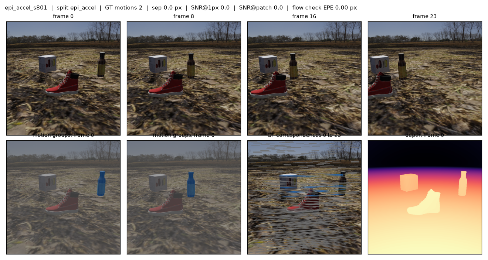

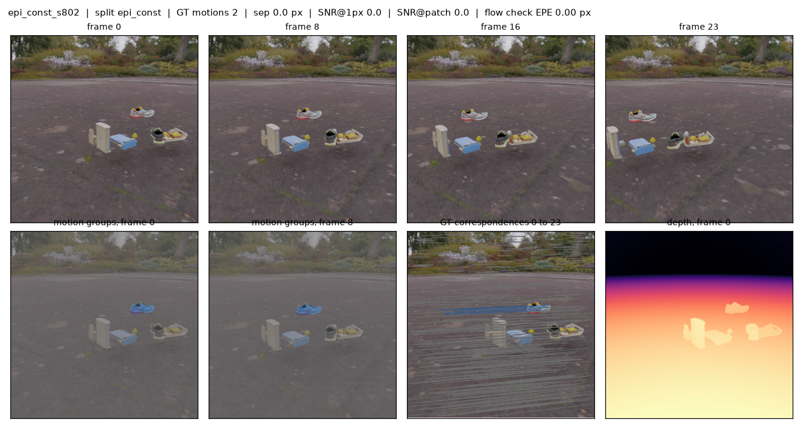

       

**v4_pilot_summary.md**

# v4_pilot: pilot of the new epipolar scene types (review item W3)

Two scenes per new split, rendered with the v3float settings (floating, shadowless, sizes 1.4 to 2.2 m for static objects).
Contact sheets and GIFs are in sheets/. The scaled task v4_scale_epi waits for the gate approvals/v4_visual.

What to check visually:
- epi_accel vs epi_const with the same seed: frames 0 and 23 look the same; in the GIF the accelerated object starts or stops while the constant one glides.
- epi_sizerand: the moving object can be much smaller or larger than the static objects.
- epi_sizematch: the moving object is large (2.2 to 4.4 m), so read as a static object at the closer ambiguous depth it would be of typical size.
- Nothing touches the floor, no shadows, every object stays in view.

Scenes checked: 8; scenes with errors: 0.

All numbers come from Kubric ground truth (depth, segmentation, camera and object matrices).

| split | n | sep GT 0 to 23 (px), median [min, max] | 3-view residual, moving, frame 12 (px), median [min, max] | 3-view residual, background, frame 12 (px) | max centre gap from static reading (px) | static objects per scene, mean |
|---|---|---|---|---|---|---|
| epi_accel | 2 | 0.00 [0.00, 0.00] | 43.1 [38.7, 47.6] | 0.00 | 43.7 | 2.50 |
| epi_const | 2 | 0.00 [0.00, 0.00] | 0.0 [0.0, 0.0] | 0.00 | 0.0 | 2.50 |
| epi_sizerand | 2 | 0.00 [0.00, 0.00] | 0.0 [0.0, 0.0] | 0.00 | 0.0 | 2.00 |
| epi_sizematch | 2 | 0.00 [0.00, 0.00] | 0.0 [0.0, 0.0] | 0.00 | 0.0 | 2.00 |

## Pairing check (epi_accel vs epi_const, same seed)

- Pairs: 2. Largest pixel difference (0 to 255) in frame 0: 0; in frame 23: 0. Mean absolute difference in frame 12: 1.24 (only the moving object differs there).
- A difference of 0 in frames 0 and 23 means the two-view input (frames 0 and 23) is identical within a pair.

## Size cue

| split | n | true moving size (m), median [min, max] | size if read as static (m), median [min, max] | max abs error of static scale vs 1/(1+k) |
|---|---|---|---|---|
| epi_accel | 2 | 1.74 [1.51, 1.98] | 1.03 [0.92, 1.15] | 5.8e-15 |
| epi_const | 2 | 1.74 [1.51, 1.98] | 1.03 [0.92, 1.15] | 5.8e-15 |
| epi_sizerand | 2 | 3.33 [3.29, 3.36] | 2.01 [1.98, 2.04] | 2.9e-15 |
| epi_sizematch | 2 | 3.42 [3.19, 3.64] | 1.94 [1.89, 1.99] | 2.8e-15 |

Static objects in every split are 1.4 to 2.2 m (the v3float range).

How to read the figure: (a) for epi_accel the static fit from frames 0 and 23 misses the object in a third view by tens of pixels, while for epi_const and for the background it fits to about 0 px. (b) Two-view separation is about 0 in every split, so frames 0 and 23 alone are ambiguous. (c) The accelerated object's image track leaves the track of its static reading (the constant-velocity object stays on it). (d) Size randomisation decouples apparent size from the static interpretation.

## v4_scale_epi

Review item W3: render 30 scenes per new epipolar split (120 scenes) + GT checks

Status: **done**, attempt 1, started 2026-10-16 22:53:45, finished 2026-10-17 01:01:15. [Raw results](../results/queue/v4_scale_epi/), [log](../results/queue/v4_scale_epi/task.log).

**v4_scale_epi_summary.md**

# v4_scale_epi: GT checks of the v4 epipolar set (120 scenes)

Scenes checked: 120; scenes with errors: 0.

All numbers come from Kubric ground truth (depth, segmentation, camera and object matrices).

| split | n | sep GT 0 to 23 (px), median [min, max] | 3-view residual, moving, frame 12 (px), median [min, max] | 3-view residual, background, frame 12 (px) | max centre gap from static reading (px) | static objects per scene, mean |
|---|---|---|---|---|---|---|
| epi_accel | 30 | 0.00 [0.00, 0.00] | 41.9 [31.4, 61.3] | 0.00 | 41.2 | 2.57 |
| epi_const | 30 | 0.00 [0.00, 0.00] | 0.0 [0.0, 0.0] | 0.00 | 0.0 | 2.57 |
| epi_sizerand | 30 | 0.00 [0.00, 0.00] | 0.0 [0.0, 0.0] | 0.00 | 0.0 | 2.23 |
| epi_sizematch | 30 | 0.00 [0.00, 0.00] | 0.0 [0.0, 0.0] | 0.00 | 0.0 | 1.77 |

## Pairing check (epi_accel vs epi_const, same seed)

- Pairs: 30. Largest pixel difference (0 to 255) in frame 0: 0; in frame 23: 0. Mean absolute difference in frame 12: 1.34 (only the moving object differs there).
- A difference of 0 in frames 0 and 23 means the two-view input (frames 0 and 23) is identical within a pair.

## Size cue

| split | n | true moving size (m), median [min, max] | size if read as static (m), median [min, max] | max abs error of static scale vs 1/(1+k) |
|---|---|---|---|---|
| epi_accel | 30 | 1.73 [1.41, 2.19] | 1.02 [0.74, 1.34] | 1.0e-14 |
| epi_const | 30 | 1.73 [1.41, 2.19] | 1.02 [0.74, 1.34] | 1.0e-14 |
| epi_sizerand | 30 | 2.36 [0.81, 3.36] | 1.38 [0.47, 2.04] | 6.3e-15 |
| epi_sizematch | 30 | 3.20 [2.28, 4.27] | 1.78 [1.41, 2.15] | 6.9e-15 |

Static objects in every split are 1.4 to 2.2 m (the v3float range).

How to read the figure: (a) for epi_accel the static fit from frames 0 and 23 misses the object in a third view by tens of pixels, while for epi_const and for the background it fits to about 0 px. (b) Two-view separation is about 0 in every split, so frames 0 and 23 alone are ambiguous. (c) The accelerated object's image track leaves the track of its static reading (the constant-velocity object stays on it). (d) Size randomisation decouples apparent size from the static interpretation.

## v4_viewsweep_epi

Review item W3: 2/3/4/7-view sweep on v4 epipolar set + v3float: outputs, probes (pooled and transfer), attention, stats

Status: **done**, attempt 1, started 2026-10-17 16:21:43, finished 2026-10-17 16:37:22. [Raw results](../results/queue/v4_viewsweep_epi/), [log](../results/queue/v4_viewsweep_epi/task.log).

**v4_viewsweep_epi_summary.md**

# v4_viewsweep_epi: view-count test with accelerated epipolar motion, and the monocular size cue (review item W3)

Data: v4epi (epi_accel and epi_const paired by seed, epi_sizerand, epi_sizematch; floating, shadowless, v3float settings) pooled with the 70 v3float scenes (reference: its 30 epi_aligned scenes). Any4D, frames 2 views = 0,23; 3 = 0,12,23; 4 = 0,8,16,23; 7 = 0,4,8,12,16,20,23.

Metric definitions are those of round 1. Probe = ridge moving-vs-static probe on the view-0 token (object patches), 5-fold CV by scene.
Pooled probe: trained on all scenes, paired accel and const scenes share a fold. Transfer probe: trained only on v3float scenes (round-1 folds), so it has never seen an accelerated or size-randomised mover.
CIs are bootstrap 95% over scenes (10000 resamples). Paired tests are two-sided sign tests; unpaired tests are Mann-Whitney.

Pre-specified primary read-outs: probe AUC averaged over layers 8, 12 and 16 (layer 24 is near ceiling in round 1), output mask IoU and slope at the frame-23 target.

## 1. Accelerated motion: does a third view help?

Seed pairs: 30. With 2 views the accel and const inputs are the same images, so any difference there is a bug: largest |accel - const| at 2 views, pooled mid-depth AUC = 0.0.

| views | AUC accel | AUC const | delta accel vs 2 views | delta const vs 2 views | difference in differences | sign test (+/-), p, Holm p |
|---|---|---|---|---|---|---|
| 2 | 0.974 [0.944, 0.995] | 0.974 [0.944, 0.995] | | | | |
| 3 | 0.973 [0.951, 0.992] | 0.974 [0.950, 0.992] | -0.000 [-0.008, 0.010] | -0.000 [-0.009, 0.010] | -0.000 [-0.004, 0.004] | 6/5, 1.000, 1.000 |
| 4 | 0.976 [0.958, 0.992] | 0.974 [0.952, 0.992] | 0.002 [-0.009, 0.019] | 0.000 [-0.010, 0.014] | 0.002 [-0.003, 0.009] | 7/6, 1.000, 1.000 |
| 7 | 0.978 [0.961, 0.992] | 0.975 [0.955, 0.991] | 0.004 [-0.010, 0.024] | 0.001 [-0.011, 0.017] | 0.003 [-0.004, 0.010] | 7/5, 0.774, 1.000 |

Same tests for the output (frame-23 target) and for the probe at layer 24:

| read-out | views | accel | const | difference in differences | sign test (+/-), p |
|---|---|---|---|---|---|
| mask_iou | 3 | 0.333 [0.246, 0.425] | 0.333 [0.247, 0.424] | 0.000 [-0.008, 0.009] | 16/12, 0.572 |
| mask_iou | 4 | 0.333 [0.249, 0.421] | 0.330 [0.245, 0.420] | 0.003 [-0.011, 0.021] | 11/17, 0.345 |
| mask_iou | 7 | 0.325 [0.237, 0.417] | 0.325 [0.236, 0.418] | 0.000 [-0.011, 0.013] | 10/17, 0.248 |
| slope | 3 | 0.397 [0.269, 0.520] | 0.389 [0.269, 0.508] | 0.008 [-0.019, 0.039] | 15/15, 1.000 |
| slope | 4 | 0.379 [0.253, 0.502] | 0.393 [0.266, 0.516] | -0.014 [-0.038, 0.010] | 14/16, 0.856 |
| slope | 7 | 0.365 [0.232, 0.494] | 0.379 [0.251, 0.502] | -0.014 [-0.032, 0.006] | 11/19, 0.200 |
| L24 | 3 | 0.997 [0.993, 1.000] | 0.999 [0.998, 1.000] | -0.003 [-0.006, -0.000] | 0/4, 0.125 |
| L24 | 4 | 0.999 [0.998, 1.000] | 1.000 [1.000, 1.000] | -0.001 [-0.002, 0.000] | 0/3, 0.250 |
| L24 | 7 | 0.999 [0.997, 1.000] | 1.000 [1.000, 1.000] | -0.001 [-0.003, 0.000] | 0/2, 0.500 |
| mid (transfer probe) | 3 | 0.776 [0.692, 0.851] | 0.776 [0.690, 0.851] | 0.000 [-0.018, 0.021] | 10/11, 1.000 |
| mid (transfer probe) | 4 | 0.764 [0.674, 0.844] | 0.773 [0.690, 0.847] | -0.009 [-0.028, 0.008] | 10/12, 0.832 |
| mid (transfer probe) | 7 | 0.762 [0.673, 0.842] | 0.774 [0.689, 0.848] | -0.011 [-0.033, 0.010] | 10/12, 0.832 |

Slope for the frame-12 target (only where frame 12 is an input view):

- 3 views: accel 0.416 [0.208, 0.615], const 0.471 [0.338, 0.596], accel minus const -0.054 [-0.196, 0.072], sign 15/15 p = 1.000.
- 7 views: accel 0.360 [0.163, 0.547], const 0.464 [0.326, 0.594], accel minus const -0.105 [-0.229, 0.006], sign 13/17 p = 0.585.

Verdict (pre-specified rule: DiD > 0 with CI above 0 and Holm p < 0.05): 0 of 3 view counts meet it. No view count meets it: adding views that make the motion geometrically resolvable does not raise decodability beyond the constant-velocity control.

## 2. Size cue: is apparent size what reveals epipolar-aligned motion?

| views | v3float epi_aligned | sizerand | sizematch | sizerand minus ref, MWU p, Holm p | sizematch minus ref, MWU p |
|---|---|---|---|---|---|
| 2 | 0.778 [0.696, 0.855] | 0.685 [0.587, 0.780] | 0.639 [0.538, 0.737] | -0.093 [-0.218, 0.038], 0.221, 0.883 | -0.139 [-0.266, -0.012], 0.057 |
| 3 | 0.747 [0.656, 0.833] | 0.672 [0.571, 0.770] | 0.613 [0.501, 0.723] | -0.076 [-0.207, 0.062], 0.376, 1.000 | -0.135 [-0.276, 0.005], 0.126 |
| 4 | 0.729 [0.626, 0.825] | 0.657 [0.547, 0.761] | 0.584 [0.468, 0.701] | -0.072 [-0.216, 0.080], 0.402, 1.000 | -0.146 [-0.298, 0.007], 0.113 |
| 7 | 0.721 [0.613, 0.820] | 0.654 [0.545, 0.759] | 0.578 [0.464, 0.693] | -0.067 [-0.212, 0.086], 0.451, 1.000 | -0.143 [-0.297, 0.011], 0.122 |

Matched reference: epi_const is generated with the same v4 constraints as the size splits (no image overlap between the mover and static objects), while v3float epi_aligned is the round-1 reference requested in the plan. Transfer probe, mid-depth AUC:

| views | epi_const | sizerand minus const, MWU p | sizematch minus const, MWU p |
|---|---|---|---|
| 2 | 0.798 [0.715, 0.870] | -0.113 [-0.237, 0.018], 0.099 | -0.159 [-0.285, -0.034], 0.034 |
| 3 | 0.776 [0.690, 0.851] | -0.104 [-0.232, 0.030], 0.148 | -0.163 [-0.300, -0.026], 0.041 |
| 4 | 0.773 [0.690, 0.847] | -0.116 [-0.250, 0.023], 0.138 | -0.189 [-0.331, -0.048], 0.036 |
| 7 | 0.774 [0.689, 0.848] | -0.120 [-0.252, 0.017], 0.123 | -0.196 [-0.335, -0.055], 0.023 |

Primary table uses the transfer probe, mid-depth AUC. Secondary read-outs:

| read-out | views | ref | sizerand | sizematch | sizerand minus ref, MWU p | Spearman(AUC, size if read as static) in sizerand |
|---|---|---|---|---|---|---|
| mid (pooled) | 2 | 0.932 [0.896, 0.964] | 0.979 [0.958, 0.994] | 0.982 [0.959, 0.997] | 0.046 [0.010, 0.086], 0.006 | 0.04 (p 0.853, n 25) |
| mid (pooled) | 3 | 0.897 [0.838, 0.947] | 0.974 [0.954, 0.991] | 0.980 [0.957, 0.995] | 0.077 [0.024, 0.139], 0.006 | 0.07 (p 0.759, n 25) |
| mid (pooled) | 4 | 0.887 [0.821, 0.943] | 0.973 [0.952, 0.990] | 0.980 [0.955, 0.996] | 0.086 [0.027, 0.154], 0.002 | -0.01 (p 0.947, n 25) |
| mid (pooled) | 7 | 0.877 [0.799, 0.941] | 0.975 [0.954, 0.991] | 0.979 [0.953, 0.996] | 0.098 [0.032, 0.178], 0.002 | 0.08 (p 0.705, n 25) |
| L24 (transfer) | 2 | 0.995 [0.985, 1.000] | 0.984 [0.963, 0.996] | 0.977 [0.947, 0.996] | -0.011 [-0.034, 0.006], 0.035 | -0.17 (p 0.408, n 25) |
| L24 (transfer) | 3 | 0.998 [0.995, 1.000] | 0.987 [0.963, 1.000] | 0.967 [0.912, 0.997] | -0.011 [-0.036, 0.003], 0.415 | -0.34 (p 0.093, n 25) |
| L24 (transfer) | 4 | 0.999 [0.998, 1.000] | 0.983 [0.953, 1.000] | 0.969 [0.919, 0.997] | -0.016 [-0.047, 0.001], 0.462 | -0.29 (p 0.157, n 25) |
| L24 (transfer) | 7 | 0.999 [0.997, 1.000] | 0.990 [0.970, 1.000] | 0.959 [0.897, 0.996] | -0.009 [-0.029, 0.002], 0.755 | -0.36 (p 0.068, n 25) |
| mask_iou (pooled) | 2 | 0.293 [0.209, 0.379] | 0.340 [0.261, 0.419] | 0.505 [0.425, 0.582] | 0.047 [-0.072, 0.163], 0.382 | 0.63 (p 4.0e-04, n 30) |
| mask_iou (pooled) | 3 | 0.318 [0.234, 0.405] | 0.324 [0.242, 0.407] | 0.525 [0.452, 0.595] | 0.006 [-0.115, 0.125], 0.917 | 0.55 (p 0.002, n 30) |
| mask_iou (pooled) | 4 | 0.316 [0.230, 0.405] | 0.327 [0.240, 0.415] | 0.536 [0.466, 0.601] | 0.011 [-0.114, 0.136], 0.941 | 0.49 (p 0.008, n 30) |
| mask_iou (pooled) | 7 | 0.312 [0.224, 0.402] | 0.328 [0.240, 0.414] | 0.539 [0.468, 0.606] | 0.016 [-0.112, 0.141], 0.859 | 0.50 (p 0.006, n 30) |
| slope (pooled) | 2 | 0.440 [0.294, 0.581] | 0.479 [0.343, 0.611] | 0.688 [0.610, 0.757] | 0.038 [-0.156, 0.233], 0.587 | 0.62 (p 6.0e-04, n 30) |
| slope (pooled) | 3 | 0.445 [0.299, 0.585] | 0.488 [0.336, 0.636] | 0.714 [0.631, 0.790] | 0.043 [-0.165, 0.249], 0.655 | 0.66 (p 2.0e-04, n 30) |
| slope (pooled) | 4 | 0.440 [0.292, 0.578] | 0.474 [0.320, 0.624] | 0.693 [0.608, 0.772] | 0.034 [-0.174, 0.242], 0.749 | 0.69 (p 0.0e+00, n 30) |
| slope (pooled) | 7 | 0.412 [0.267, 0.549] | 0.479 [0.328, 0.625] | 0.702 [0.620, 0.780] | 0.067 [-0.137, 0.271], 0.512 | 0.67 (p 0.0e+00, n 30) |

Verdict (pre-specified rule: sizerand minus ref < 0 with CI below 0 and Holm p < 0.05): 0 of 4 view counts meet it. Breaking the size cue does not lower decodability, so apparent size is not what the model relies on (other monocular cues remain possible).

## Caveats

- Probe AUC is linear decodability, not use (see review item W4).
- The reference (v3float epi_aligned) and the size splits are different scenes, so the size comparison is unpaired.
- v4 scenes keep static objects from overlapping the mover in the image (to avoid occlusion-order cues and hidden movers); v3float epi_aligned does not, which is why epi_const is also reported as a matched reference.
- epi_sizematch makes the static reading a typical size, but that static copy also floats higher (it is scaled about the camera), so it is not a perfect look-alike of a static object.
- Files: v4_stats.json (all numbers), outm_<n>v.json, vs_pool_<n>v_results.json, vs_xfer_<n>v_results.json, step3_v4epi_<n>v.json.

## r2_probe_extract

Round 2 W4: control-model internals (random-init Any4D, DINOv2 + random transformer, raw encoder tokens) on v2 out100 and v3float

Status: **done**, attempt 1, started 2026-10-17 16:37:33, finished 2026-10-17 16:43:12. [Raw results](../results/queue/r2_probe_extract/), [log](../results/queue/r2_probe_extract/task.log).

**r2_probe_extract_summary.md**

# r2_probe_extract: control-model internals for the probe controls (review W4)

Variants: randtf = public DINOv2 ViT-L/14 encoder + Any4D projection, fusion norm, transformer and heads at their own seeded random init; randall = everything random (encoder re-initialised with the dinov2 constructor, pretrained=False); enc_any4d / enc_dino = raw encoder patch tokens of the trained Any4D encoder / the public DINOv2 encoder (1024-d, before fusion norm, projection and view PE); trained = round-1 Any4D internals (symlinks). Layers 0,4,...,24 for the transformer variants (0 = transformer input).

| dataset | source | scenes | stored layers | non-finite values | encoder max abs param diff to public DINOv2 |
|---|---|---|---|---|---|
| v2 | trained | 100 | 0,1,2,3,4,5,6,7,8,9,10,11,12,13,14,15,16,17,18,19,20,21,22,23,24 | 0 (first 20 scenes) |  |
| v2 | randtf | 100 | 0,4,8,12,16,20,24 | 0 (first 20 scenes) | 0 |
| v2 | randall | 100 | 0,4,8,12,16,20,24 | 0 (first 20 scenes) | 72.27 |
| v2 | enc_any4d | 100 | 0 | 0 (first 20 scenes) | 0.0617 |
| v2 | enc_dino | 100 | 0 | 0 (first 20 scenes) | 0 |
| v3float | trained | 69 | 0,2,4,6,8,10,12,14,16,18,20,22,24,17,19,21 | 0 (first 20 scenes) |  |
| v3float | randtf | 69 | 0,4,8,12,16,20,24 | 0 (first 20 scenes) | 0 |
| v3float | randall | 69 | 0,4,8,12,16,20,24 | 0 (first 20 scenes) | 72.27 |
| v3float | enc_any4d | 69 | 0 | 0 (first 20 scenes) | 0.0617 |
| v3float | enc_dino | 69 | 0 | 0 (first 20 scenes) | 0 |

The trained Any4D encoder differs from the public DINOv2 weights (it was fine-tuned), so enc_any4d and enc_dino are two different baselines.

## r2_heads_null

Round 2 W5: five supply heads vs 40 matched random head sets (mean ablation), resample ablation, amplification x1.5 (v2 out100)

Status: **RUNNING**, attempt 1, started 2026-10-17 16:43:22. [Raw results](../results/queue/r2_heads_null/), [log](../results/queue/r2_heads_null/task.log).

Partial results so far; the run is still going.

