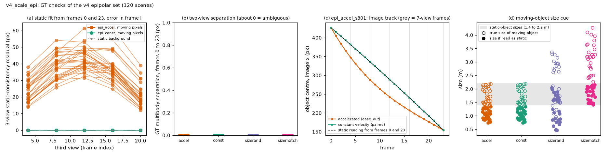

# v4_scale_epi: GT checks of the v4 epipolar set (120 scenes)

Scenes checked: 120; scenes with errors: 0.

All numbers come from Kubric ground truth (depth, segmentation, camera and object matrices).

| split | n | sep GT 0 to 23 (px), median [min, max] | 3-view residual, moving, frame 12 (px), median [min, max] | 3-view residual, background, frame 12 (px) | max centre gap from static reading (px) | static objects per scene, mean |
|---|---|---|---|---|---|---|
| epi_accel | 30 | 0.00 [0.00, 0.00] | 41.9 [31.4, 61.3] | 0.00 | 41.2 | 2.57 |
| epi_const | 30 | 0.00 [0.00, 0.00] | 0.0 [0.0, 0.0] | 0.00 | 0.0 | 2.57 |
| epi_sizerand | 30 | 0.00 [0.00, 0.00] | 0.0 [0.0, 0.0] | 0.00 | 0.0 | 2.23 |
| epi_sizematch | 30 | 0.00 [0.00, 0.00] | 0.0 [0.0, 0.0] | 0.00 | 0.0 | 1.77 |

## Pairing check (epi_accel vs epi_const, same seed)

- Pairs: 30. Largest pixel difference (0 to 255) in frame 0: 0; in frame 23: 0. Mean absolute difference in frame 12: 1.34 (only the moving object differs there).
- A difference of 0 in frames 0 and 23 means the two-view input (frames 0 and 23) is identical within a pair.

## Size cue

| split | n | true moving size (m), median [min, max] | size if read as static (m), median [min, max] | max abs error of static scale vs 1/(1+k) |
|---|---|---|---|---|
| epi_accel | 30 | 1.73 [1.41, 2.19] | 1.02 [0.74, 1.34] | 1.0e-14 |
| epi_const | 30 | 1.73 [1.41, 2.19] | 1.02 [0.74, 1.34] | 1.0e-14 |
| epi_sizerand | 30 | 2.36 [0.81, 3.36] | 1.38 [0.47, 2.04] | 6.3e-15 |
| epi_sizematch | 30 | 3.20 [2.28, 4.27] | 1.78 [1.41, 2.15] | 6.9e-15 |

Static objects in every split are 1.4 to 2.2 m (the v3float range).

How to read the figure: (a) for epi_accel the static fit from frames 0 and 23 misses the object in a third view by tens of pixels, while for epi_const and for the background it fits to about 0 px. (b) Two-view separation is about 0 in every split, so frames 0 and 23 alone are ambiguous. (c) The accelerated object's image track leaves the track of its static reading (the constant-velocity object stays on it). (d) Size randomisation decouples apparent size from the static interpretation.
