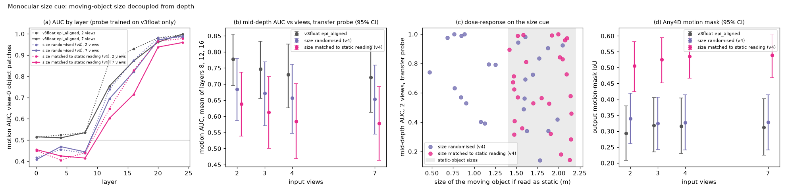

# v4_viewsweep_epi: view-count test with accelerated epipolar motion, and the monocular size cue (review item W3)

Data: v4epi (epi_accel and epi_const paired by seed, epi_sizerand, epi_sizematch; floating, shadowless, v3float settings) pooled with the 70 v3float scenes (reference: its 30 epi_aligned scenes). Any4D, frames 2 views = 0,23; 3 = 0,12,23; 4 = 0,8,16,23; 7 = 0,4,8,12,16,20,23.

Metric definitions are those of round 1. Probe = ridge moving-vs-static probe on the view-0 token (object patches), 5-fold CV by scene.
Pooled probe: trained on all scenes, paired accel and const scenes share a fold. Transfer probe: trained only on v3float scenes (round-1 folds), so it has never seen an accelerated or size-randomised mover.
CIs are bootstrap 95% over scenes (10000 resamples). Paired tests are two-sided sign tests; unpaired tests are Mann-Whitney.

Pre-specified primary read-outs: probe AUC averaged over layers 8, 12 and 16 (layer 24 is near ceiling in round 1), output mask IoU and slope at the frame-23 target.

## 1. Accelerated motion: does a third view help?

Seed pairs: 30. With 2 views the accel and const inputs are the same images, so any difference there is a bug: largest |accel - const| at 2 views, pooled mid-depth AUC = 0.0.

| views | AUC accel | AUC const | delta accel vs 2 views | delta const vs 2 views | difference in differences | sign test (+/-), p, Holm p |
|---|---|---|---|---|---|---|
| 2 | 0.974 [0.944, 0.995] | 0.974 [0.944, 0.995] | | | | |
| 3 | 0.973 [0.951, 0.992] | 0.974 [0.950, 0.992] | -0.000 [-0.008, 0.010] | -0.000 [-0.009, 0.010] | -0.000 [-0.004, 0.004] | 6/5, 1.000, 1.000 |
| 4 | 0.976 [0.958, 0.992] | 0.974 [0.952, 0.992] | 0.002 [-0.009, 0.019] | 0.000 [-0.010, 0.014] | 0.002 [-0.003, 0.009] | 7/6, 1.000, 1.000 |
| 7 | 0.978 [0.961, 0.992] | 0.975 [0.955, 0.991] | 0.004 [-0.010, 0.024] | 0.001 [-0.011, 0.017] | 0.003 [-0.004, 0.010] | 7/5, 0.774, 1.000 |

Same tests for the output (frame-23 target) and for the probe at layer 24:

| read-out | views | accel | const | difference in differences | sign test (+/-), p |
|---|---|---|---|---|---|
| mask_iou | 3 | 0.333 [0.246, 0.425] | 0.333 [0.247, 0.424] | 0.000 [-0.008, 0.009] | 16/12, 0.572 |
| mask_iou | 4 | 0.333 [0.249, 0.421] | 0.330 [0.245, 0.420] | 0.003 [-0.011, 0.021] | 11/17, 0.345 |
| mask_iou | 7 | 0.325 [0.237, 0.417] | 0.325 [0.236, 0.418] | 0.000 [-0.011, 0.013] | 10/17, 0.248 |
| slope | 3 | 0.397 [0.269, 0.520] | 0.389 [0.269, 0.508] | 0.008 [-0.019, 0.039] | 15/15, 1.000 |
| slope | 4 | 0.379 [0.253, 0.502] | 0.393 [0.266, 0.516] | -0.014 [-0.038, 0.010] | 14/16, 0.856 |
| slope | 7 | 0.365 [0.232, 0.494] | 0.379 [0.251, 0.502] | -0.014 [-0.032, 0.006] | 11/19, 0.200 |
| L24 | 3 | 0.997 [0.993, 1.000] | 0.999 [0.998, 1.000] | -0.003 [-0.006, -0.000] | 0/4, 0.125 |
| L24 | 4 | 0.999 [0.998, 1.000] | 1.000 [1.000, 1.000] | -0.001 [-0.002, 0.000] | 0/3, 0.250 |
| L24 | 7 | 0.999 [0.997, 1.000] | 1.000 [1.000, 1.000] | -0.001 [-0.003, 0.000] | 0/2, 0.500 |
| mid (transfer probe) | 3 | 0.776 [0.692, 0.851] | 0.776 [0.690, 0.851] | 0.000 [-0.018, 0.021] | 10/11, 1.000 |
| mid (transfer probe) | 4 | 0.764 [0.674, 0.844] | 0.773 [0.690, 0.847] | -0.009 [-0.028, 0.008] | 10/12, 0.832 |
| mid (transfer probe) | 7 | 0.762 [0.673, 0.842] | 0.774 [0.689, 0.848] | -0.011 [-0.033, 0.010] | 10/12, 0.832 |

Slope for the frame-12 target (only where frame 12 is an input view):

- 3 views: accel 0.416 [0.208, 0.615], const 0.471 [0.338, 0.596], accel minus const -0.054 [-0.196, 0.072], sign 15/15 p = 1.000.
- 7 views: accel 0.360 [0.163, 0.547], const 0.464 [0.326, 0.594], accel minus const -0.105 [-0.229, 0.006], sign 13/17 p = 0.585.

Verdict (pre-specified rule: DiD > 0 with CI above 0 and Holm p < 0.05): 0 of 3 view counts meet it. No view count meets it: adding views that make the motion geometrically resolvable does not raise decodability beyond the constant-velocity control.

## 2. Size cue: is apparent size what reveals epipolar-aligned motion?

| views | v3float epi_aligned | sizerand | sizematch | sizerand minus ref, MWU p, Holm p | sizematch minus ref, MWU p |
|---|---|---|---|---|---|
| 2 | 0.778 [0.696, 0.855] | 0.685 [0.587, 0.780] | 0.639 [0.538, 0.737] | -0.093 [-0.218, 0.038], 0.221, 0.883 | -0.139 [-0.266, -0.012], 0.057 |
| 3 | 0.747 [0.656, 0.833] | 0.672 [0.571, 0.770] | 0.613 [0.501, 0.723] | -0.076 [-0.207, 0.062], 0.376, 1.000 | -0.135 [-0.276, 0.005], 0.126 |
| 4 | 0.729 [0.626, 0.825] | 0.657 [0.547, 0.761] | 0.584 [0.468, 0.701] | -0.072 [-0.216, 0.080], 0.402, 1.000 | -0.146 [-0.298, 0.007], 0.113 |
| 7 | 0.721 [0.613, 0.820] | 0.654 [0.545, 0.759] | 0.578 [0.464, 0.693] | -0.067 [-0.212, 0.086], 0.451, 1.000 | -0.143 [-0.297, 0.011], 0.122 |

Matched reference: epi_const is generated with the same v4 constraints as the size splits (no image overlap between the mover and static objects), while v3float epi_aligned is the round-1 reference requested in the plan. Transfer probe, mid-depth AUC:

| views | epi_const | sizerand minus const, MWU p | sizematch minus const, MWU p |
|---|---|---|---|
| 2 | 0.798 [0.715, 0.870] | -0.113 [-0.237, 0.018], 0.099 | -0.159 [-0.285, -0.034], 0.034 |
| 3 | 0.776 [0.690, 0.851] | -0.104 [-0.232, 0.030], 0.148 | -0.163 [-0.300, -0.026], 0.041 |
| 4 | 0.773 [0.690, 0.847] | -0.116 [-0.250, 0.023], 0.138 | -0.189 [-0.331, -0.048], 0.036 |
| 7 | 0.774 [0.689, 0.848] | -0.120 [-0.252, 0.017], 0.123 | -0.196 [-0.335, -0.055], 0.023 |

Primary table uses the transfer probe, mid-depth AUC. Secondary read-outs:

| read-out | views | ref | sizerand | sizematch | sizerand minus ref, MWU p | Spearman(AUC, size if read as static) in sizerand |
|---|---|---|---|---|---|---|
| mid (pooled) | 2 | 0.932 [0.896, 0.964] | 0.979 [0.958, 0.994] | 0.982 [0.959, 0.997] | 0.046 [0.010, 0.086], 0.006 | 0.04 (p 0.853, n 25) |
| mid (pooled) | 3 | 0.897 [0.838, 0.947] | 0.974 [0.954, 0.991] | 0.980 [0.957, 0.995] | 0.077 [0.024, 0.139], 0.006 | 0.07 (p 0.759, n 25) |
| mid (pooled) | 4 | 0.887 [0.821, 0.943] | 0.973 [0.952, 0.990] | 0.980 [0.955, 0.996] | 0.086 [0.027, 0.154], 0.002 | -0.01 (p 0.947, n 25) |
| mid (pooled) | 7 | 0.877 [0.799, 0.941] | 0.975 [0.954, 0.991] | 0.979 [0.953, 0.996] | 0.098 [0.032, 0.178], 0.002 | 0.08 (p 0.705, n 25) |
| L24 (transfer) | 2 | 0.995 [0.985, 1.000] | 0.984 [0.963, 0.996] | 0.977 [0.947, 0.996] | -0.011 [-0.034, 0.006], 0.035 | -0.17 (p 0.408, n 25) |
| L24 (transfer) | 3 | 0.998 [0.995, 1.000] | 0.987 [0.963, 1.000] | 0.967 [0.912, 0.997] | -0.011 [-0.036, 0.003], 0.415 | -0.34 (p 0.093, n 25) |
| L24 (transfer) | 4 | 0.999 [0.998, 1.000] | 0.983 [0.953, 1.000] | 0.969 [0.919, 0.997] | -0.016 [-0.047, 0.001], 0.462 | -0.29 (p 0.157, n 25) |
| L24 (transfer) | 7 | 0.999 [0.997, 1.000] | 0.990 [0.970, 1.000] | 0.959 [0.897, 0.996] | -0.009 [-0.029, 0.002], 0.755 | -0.36 (p 0.068, n 25) |
| mask_iou (pooled) | 2 | 0.293 [0.209, 0.379] | 0.340 [0.261, 0.419] | 0.505 [0.425, 0.582] | 0.047 [-0.072, 0.163], 0.382 | 0.63 (p 4.0e-04, n 30) |
| mask_iou (pooled) | 3 | 0.318 [0.234, 0.405] | 0.324 [0.242, 0.407] | 0.525 [0.452, 0.595] | 0.006 [-0.115, 0.125], 0.917 | 0.55 (p 0.002, n 30) |
| mask_iou (pooled) | 4 | 0.316 [0.230, 0.405] | 0.327 [0.240, 0.415] | 0.536 [0.466, 0.601] | 0.011 [-0.114, 0.136], 0.941 | 0.49 (p 0.008, n 30) |
| mask_iou (pooled) | 7 | 0.312 [0.224, 0.402] | 0.328 [0.240, 0.414] | 0.539 [0.468, 0.606] | 0.016 [-0.112, 0.141], 0.859 | 0.50 (p 0.006, n 30) |
| slope (pooled) | 2 | 0.440 [0.294, 0.581] | 0.479 [0.343, 0.611] | 0.688 [0.610, 0.757] | 0.038 [-0.156, 0.233], 0.587 | 0.62 (p 6.0e-04, n 30) |
| slope (pooled) | 3 | 0.445 [0.299, 0.585] | 0.488 [0.336, 0.636] | 0.714 [0.631, 0.790] | 0.043 [-0.165, 0.249], 0.655 | 0.66 (p 2.0e-04, n 30) |
| slope (pooled) | 4 | 0.440 [0.292, 0.578] | 0.474 [0.320, 0.624] | 0.693 [0.608, 0.772] | 0.034 [-0.174, 0.242], 0.749 | 0.69 (p 0.0e+00, n 30) |
| slope (pooled) | 7 | 0.412 [0.267, 0.549] | 0.479 [0.328, 0.625] | 0.702 [0.620, 0.780] | 0.067 [-0.137, 0.271], 0.512 | 0.67 (p 0.0e+00, n 30) |

Verdict (pre-specified rule: sizerand minus ref < 0 with CI below 0 and Holm p < 0.05): 0 of 4 view counts meet it. Breaking the size cue does not lower decodability, so apparent size is not what the model relies on (other monocular cues remain possible).

## Caveats

- Probe AUC is linear decodability, not use (see review item W4).
- The reference (v3float epi_aligned) and the size splits are different scenes, so the size comparison is unpaired.
- v4 scenes keep static objects from overlapping the mover in the image (to avoid occlusion-order cues and hidden movers); v3float epi_aligned does not, which is why epi_const is also reported as a matched reference.
- epi_sizematch makes the static reading a typical size, but that static copy also floats higher (it is scaled about the camera), so it is not a perfect look-alike of a static object.
- Files: v4_stats.json (all numbers), outm_<n>v.json, vs_pool_<n>v_results.json, vs_xfer_<n>v_results.json, step3_v4epi_<n>v.json.
