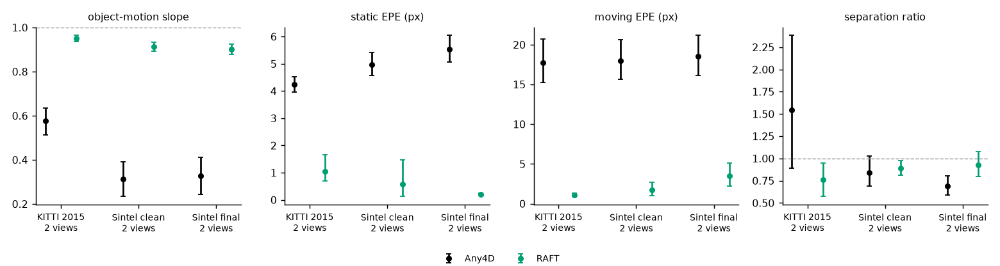

# w2_real_baselines: RAFT vs Any4D on KITTI 2015 and Sintel (2 views)

RAFT: torchvision raft_large, C_T_V2 weights (FlyingChairs + FlyingThings; no KITTI or Sintel training), native resolution. Any4D: round-1 2-view wide-input predictions (cached). Metrics: e5_realdata_eval.evaluate on the same evaluation points (the alpha/beta decomposition is in w2_decomp). Bootstrap 95% CIs over scenes; paired sign test vs Any4D.

| model | data | n | slope | epe_static | epe_moving | sep_ratio | paired slope diff vs Any4D [sign test p] |
|---|---|---|---|---|---|---|---|
| Any4D | kitti15_rgb | 200 | 0.58 [0.51, 0.64] | 4.23 [3.96, 4.52] | 17.77 [15.22, 20.69] | 1.55 [0.89, 2.38] | reference |
| Any4D | sintel_clean | 256 | 0.31 [0.23, 0.39] | 4.98 [4.58, 5.42] | 18.01 [15.64, 20.59] | 0.84 [0.69, 1.02] | reference |
| Any4D | sintel_final | 256 | 0.33 [0.24, 0.41] | 5.54 [5.07, 6.05] | 18.54 [16.14, 21.17] | 0.69 [0.59, 0.81] | reference |
| raft | kitti15_rgb | 200 | 0.95 [0.94, 0.96] | 1.04 [0.69, 1.66] | 1.08 [0.91, 1.30] | 0.76 [0.57, 0.95] | 0.38 [0.31, 0.44] [p 9.0e-18, 156+/39-] |
| raft | sintel_clean | 256 | 0.91 [0.89, 0.93] | 0.58 [0.13, 1.48] | 1.73 [0.97, 2.66] | 0.89 [0.81, 0.98] | 0.60 [0.52, 0.68] [p 2.3e-31, 190+/27-] |
| raft | sintel_final | 256 | 0.90 [0.88, 0.92] | 0.21 [0.17, 0.25] | 3.53 [2.22, 5.07] | 0.93 [0.80, 1.08] | 0.57 [0.49, 0.66] [p 2.3e-27, 185+/32-] |

