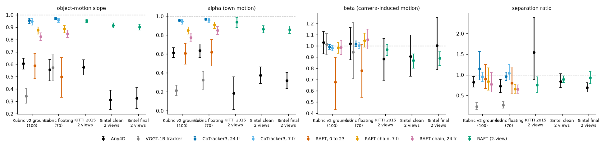

# w2_summary: is the camera-motion pull regression shrinkage or a 4D-model property? (review item 1, W2)

## All models, same scenes and query sets

Mean over scenes [bootstrap 95% CI]. Kubric slope is slope2d_q and sep_ratio is sep_ratio_q (e5_xm_eval.py definitions, frame 0 to 23); real data use e5_realdata_eval.py. alpha and beta: x_pred - x1 = alpha (x_true - x_static) + beta (x_static - x1) on moving points, only on scenes where they are identifiable (condition number of [A B] at most 10, median |A| and |B| at least 2 px). Last column: paired per-scene difference to Any4D with a two-sided sign test.

| model | data | n scenes | slope | alpha (n identifiable) | beta | beta_static | sep_ratio | slope vs Any4D [sign p] |
|---|---|---|---|---|---|---|---|---|
| Any4D | v2 | 98 | 0.61 [0.56, 0.65] | 0.61 [0.56, 0.67] (84) | 1.03 [0.93, 1.13] | 0.99 [0.99, 1.00] | 0.83 [0.70, 0.96] | reference |
| Any4D | v3float | 65 | 0.56 [0.47, 0.64] | 0.64 [0.56, 0.71] (35) | 1.02 [0.88, 1.16] | 0.99 [0.98, 1.00] | 0.73 [0.57, 0.89] | reference |
| VGGT-1B tracker | v2 | 98 | 0.34 [0.29, 0.41] | 0.22 [0.16, 0.27] (84) | 1.02 [0.92, 1.11] | 1.02 [1.00, 1.04] | 0.23 [0.16, 0.33] | -0.26 [-0.34, -0.18] [p 3.7e-06] |
| VGGT-1B tracker | v3float | 65 | 0.57 [0.47, 0.68] | 0.32 [0.23, 0.42] (35) | 0.95 [0.71, 1.21] | 1.06 [1.02, 1.09] | 0.27 [0.19, 0.35] | +0.02 [-0.10, +0.14] [p 0.620] |
| CoTracker3, 24 fr | v2 | 98 | 0.96 [0.93, 0.97] | 0.95 [0.94, 0.97] (84) | 0.99 [0.97, 1.01] | 0.97 [0.94, 0.99] | 1.14 [0.88, 1.57] | +0.35 [+0.31, +0.39] [p 9.9e-25] |
| CoTracker3, 24 fr | v3float | 65 | 0.97 [0.96, 0.98] | 0.97 [0.96, 0.98] (35) | 1.02 [0.99, 1.05] | 0.97 [0.93, 0.99] | 0.96 [0.86, 1.07] | +0.41 [+0.33, +0.50] [p 3.9e-14] |
| CoTracker3, 7 fr | v2 | 98 | 0.95 [0.92, 0.97] | 0.94 [0.92, 0.97] (84) | 0.98 [0.96, 1.00] | 0.96 [0.93, 0.98] | 0.95 [0.84, 1.07] | +0.34 [+0.30, +0.38] [p 2.4e-23] |
| CoTracker3, 7 fr | v3float | 65 | 0.96 [0.94, 0.97] | 0.96 [0.94, 0.98] (35) | 1.00 [0.98, 1.03] | 0.95 [0.90, 0.98] | 1.04 [0.87, 1.25] | +0.40 [+0.32, +0.49] [p 4.9e-13] |
| RAFT, 0 to 23 | v2 | 98 | 0.59 [0.48, 0.69] | 0.61 [0.49, 0.71] (84) | 0.68 [0.43, 0.90] | 0.60 [0.55, 0.66] | 0.90 [0.66, 1.25] | -0.02 [-0.12, +0.08] [p 0.006] |
| RAFT, 0 to 23 | v3float | 65 | 0.50 [0.33, 0.65] | 0.62 [0.47, 0.75] (35) | 0.78 [0.54, 1.01] | 0.66 [0.58, 0.75] | 0.80 [0.54, 1.17] | -0.06 [-0.20, +0.08] [p 0.136] |
| RAFT chain, 7 fr | v2 | 98 | 0.88 [0.84, 0.90] | 0.85 [0.81, 0.89] (84) | 0.98 [0.93, 1.03] | 0.97 [0.95, 0.99] | 0.84 [0.63, 1.17] | +0.27 [+0.23, +0.31] [p 8.1e-16] |
| RAFT chain, 7 fr | v3float | 65 | 0.89 [0.85, 0.91] | 0.91 [0.87, 0.94] (35) | 1.05 [0.99, 1.11] | 0.96 [0.92, 0.99] | 0.66 [0.56, 0.77] | +0.33 [+0.26, +0.41] [p 4.3e-11] |
| RAFT chain, 24 fr | v2 | 98 | 0.82 [0.79, 0.85] | 0.78 [0.73, 0.82] (84) | 0.99 [0.92, 1.05] | 0.95 [0.92, 0.97] | 0.77 [0.59, 1.06] | +0.22 [+0.17, +0.26] [p 1.4e-12] |
| RAFT chain, 24 fr | v3float | 65 | 0.85 [0.82, 0.88] | 0.85 [0.81, 0.89] (35) | 1.06 [0.97, 1.15] | 0.94 [0.90, 0.98] | 0.65 [0.55, 0.75] | +0.29 [+0.22, +0.37] [p 4.3e-11] |
| Any4D | kitti15_rgb | 195 | 0.58 [0.51, 0.64] | 0.18 [0.01, 0.36] (42) | 0.88 [0.69, 1.07] | 0.84 [0.80, 0.87] | 1.55 [0.89, 2.38] | reference |
| Any4D | sintel_clean | 217 | 0.31 [0.23, 0.39] | 0.38 [0.29, 0.46] (123) | 0.91 [0.73, 1.10] | 0.45 [0.37, 0.53] | 0.84 [0.69, 1.02] | reference |
| Any4D | sintel_final | 217 | 0.33 [0.24, 0.41] | 0.32 [0.24, 0.41] (123) | 1.00 [0.79, 1.25] | 0.48 [0.39, 0.58] | 0.69 [0.59, 0.81] | reference |
| RAFT | kitti15_rgb | 195 | 0.95 [0.94, 0.96] | 0.94 [0.88, 0.98] (41) | 0.97 [0.92, 1.01] | 0.91 [0.88, 0.92] | 0.76 [0.57, 0.95] | +0.38 [+0.31, +0.44] [p 9.0e-18] |
| RAFT | sintel_clean | 217 | 0.91 [0.89, 0.93] | 0.86 [0.82, 0.90] (122) | 0.87 [0.80, 0.93] | 0.92 [0.80, 0.99] | 0.89 [0.81, 0.98] | +0.60 [+0.52, +0.68] [p 2.3e-31] |
| RAFT | sintel_final | 217 | 0.90 [0.88, 0.92] | 0.86 [0.82, 0.90] (122) | 0.89 [0.83, 0.95] | 0.98 [0.95, 1.01] | 0.93 [0.80, 1.08] | +0.57 [+0.49, +0.66] [p 2.3e-27] |

## Rule-based reading per model

Thresholds: pull if the slope CI is below 0.9, no pull if it is above 0.9; shrinkage toward zero image motion if the beta CI is below 0.95 and alpha is not different from beta (sign test p >= 0.05); camera-motion pull if beta is near 1 and alpha below 1; smoothing if the interior slope is higher than the edge slope (sign test p < 0.05).

- Any4D, v2: pull (slope CI below 0.9); camera motion kept (beta near 1), own motion under-recovered (alpha < 1): camera-motion pull; slope lower at object boundaries (spatial smoothing contributes)
- Any4D, v3float: pull (slope CI below 0.9); camera motion kept (beta near 1), own motion under-recovered (alpha < 1): camera-motion pull; slope lower at object boundaries (spatial smoothing contributes)
- VGGT-1B tracker, v2: pull (slope CI below 0.9); camera motion kept (beta near 1), own motion under-recovered (alpha < 1): camera-motion pull; slope lower at object boundaries (spatial smoothing contributes)
- VGGT-1B tracker, v3float: pull (slope CI below 0.9); camera motion kept (beta near 1), own motion under-recovered (alpha < 1): camera-motion pull; slope lower at object boundaries (spatial smoothing contributes)
- CoTracker3, 24 fr, v2: no pull (slope CI above 0.9); camera motion kept (beta near 1); slope lower at object boundaries (spatial smoothing contributes)
- CoTracker3, 24 fr, v3float: no pull (slope CI above 0.9); camera motion kept (beta near 1); slope lower at object boundaries (spatial smoothing contributes)
- CoTracker3, 7 fr, v2: no pull (slope CI above 0.9); camera motion kept (beta near 1); slope lower at object boundaries (spatial smoothing contributes)
- CoTracker3, 7 fr, v3float: no pull (slope CI above 0.9); camera motion kept (beta near 1); slope lower at object boundaries (spatial smoothing contributes)
- RAFT, 0 to 23, v2: pull (slope CI below 0.9); shrinkage toward zero image motion (beta below 1 and alpha not different from beta); slope lower at object boundaries (spatial smoothing contributes)
- RAFT, 0 to 23, v3float: pull (slope CI below 0.9); camera motion kept (beta near 1), own motion under-recovered (alpha < 1): camera-motion pull
- RAFT chain, 7 fr, v2: weak or unclear pull (slope CI includes 0.9); camera motion kept (beta near 1), own motion under-recovered (alpha < 1): camera-motion pull; slope lower at object boundaries (spatial smoothing contributes)
- RAFT chain, 7 fr, v3float: weak or unclear pull (slope CI includes 0.9); camera motion kept (beta near 1), own motion under-recovered (alpha < 1): camera-motion pull; slope lower at object boundaries (spatial smoothing contributes)
- RAFT chain, 24 fr, v2: pull (slope CI below 0.9); camera motion kept (beta near 1), own motion under-recovered (alpha < 1): camera-motion pull; slope lower at object boundaries (spatial smoothing contributes)
- RAFT chain, 24 fr, v3float: pull (slope CI below 0.9); camera motion kept (beta near 1), own motion under-recovered (alpha < 1): camera-motion pull; slope lower at object boundaries (spatial smoothing contributes)
- Any4D, kitti15_rgb: pull (slope CI below 0.9); camera motion kept (beta near 1), own motion under-recovered (alpha < 1): camera-motion pull
- Any4D, sintel_clean: pull (slope CI below 0.9); camera motion kept (beta near 1), own motion under-recovered (alpha < 1): camera-motion pull
- Any4D, sintel_final: pull (slope CI below 0.9); camera motion kept (beta near 1), own motion under-recovered (alpha < 1): camera-motion pull
- RAFT, kitti15_rgb: no pull (slope CI above 0.9); camera motion kept (beta near 1), own motion under-recovered (alpha < 1): camera-motion pull
- RAFT, sintel_clean: weak or unclear pull (slope CI includes 0.9); mixed (beta below 1 and alpha different from beta)
- RAFT, sintel_final: weak or unclear pull (slope CI includes 0.9); shrinkage toward zero image motion (beta below 1 and alpha not different from beta)

## Dose-response (Any4D)

- Any4D, v2: factors whose standardised coefficient CI excludes 0: area +0.07, occlusion -0.05
  confidence (added): -0.02 [-0.06, +0.02]
- Any4D, v3float: factors whose standardised coefficient CI excludes 0: area +0.26, occlusion -0.11, cam_disp_px -0.09
  confidence (added): +0.02 [-0.02, +0.07]

See w2_dose summary for all models and the figures fig_w2_dose_v2.png, fig_w2_dose_v3float.png, fig_w2_dose_regression.png.

## Verdict (generated from the numbers above; to be checked and edited by hand)

Kubric v2 grounded (100): Any4D slope 0.61 [0.56, 0.65], VGGT tracker 0.34 [0.29, 0.41], CoTracker3 0.96 [0.93, 0.97], RAFT 0.59 [0.48, 0.69]; 0.88 [0.84, 0.90]; 0.82 [0.79, 0.85]. The best non-reconstruction baseline recovers clearly more object motion than Any4D (CIs do not overlap). Kubric floating (70): Any4D slope 0.56 [0.47, 0.64], VGGT tracker 0.57 [0.47, 0.68], CoTracker3 0.97 [0.96, 0.98], RAFT 0.50 [0.33, 0.65]; 0.89 [0.85, 0.91]; 0.85 [0.82, 0.88]. The best non-reconstruction baseline recovers clearly more object motion than Any4D (CIs do not overlap). KITTI 2015, 2 views: Any4D slope 0.58 [0.51, 0.64], RAFT 0.95 [0.94, 0.96]. Sintel clean, 2 views: Any4D slope 0.31 [0.23, 0.39], RAFT 0.91 [0.89, 0.93]. Sintel final, 2 views: Any4D slope 0.33 [0.24, 0.41], RAFT 0.90 [0.88, 0.92].
If the dedicated trackers (CoTracker3, RAFT) recover close to all object motion on the same scenes while Any4D and the VGGT tracker head do not, the pull is a property of the reconstruction models and not a generic property of dense correspondence under uncertainty. If the baselines show the same deficit, with alpha close to beta, it is generic shrinkage. The decomposition rows above say which of the two readings each model follows.
